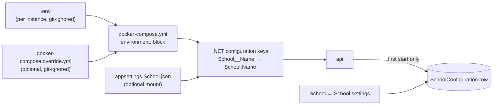

# Configuration reference

Every setting a school instance reads: where it lives, which value wins, and which settings the app takes over after the first start. For the procedures (installing, TLS, sign-in registration, upgrades, backups) see [self-hosting](self-host.md).

## Where configuration lives



- **`.env`** holds the per-instance values. Compose substitutes them into `docker-compose.yml`, which hands them to the containers as environment variables. Copy `.env.example`; keep the result mode 600.
- **The API** reads environment variables as .NET configuration keys: a double underscore is a section separator, so `School__Houses__0` is `School:Houses:0` and `AzureAd__TenantId` is `AzureAd:TenantId`.
- **`docker-compose.override.yml`** adds settings whose *name* varies per school, which `.env` cannot express (compose does not substitute variables into YAML keys). Group → role mappings live here. Compose merges it automatically.
- **`appsettings.School.json`** is an optional JSON file mounted at `/app/appsettings.School.json` (uncomment the line in `docker-compose.yml`). Use it for keys an environment variable cannot name, such as a house code containing a space. `api/src/CarnivalApp.Api/appsettings.School.example.json` shows the shape.
- **`./config`** in the repository is mounted read-only at `/config`: the roster import mapping and the event templates.

### Which value wins

Lowest to highest; a later source overrides an earlier one for the same key:

| Order | Source |
|---|---|
| 1 | `appsettings.json` (in the image) |
| 2 | `appsettings.{ASPNETCORE_ENVIRONMENT}.json` (in the image; `Development` only matters locally) |
| 3 | Environment variables (from compose, so from `.env` and the override file) |
| 4 | Command-line arguments (not used by the compose stack) |
| 5 | **`appsettings.School.json`** |

The mounted file is added last, so **it outranks the environment block**. Put only the keys you mean to set in it, never a full copy of the example file, or its placeholder values replace your `.env` values.

After changing `.env` or the override file, run `docker compose up -d` (it recreates the containers whose settings changed). After changing the mounted file, run `docker compose restart api`.

### Seeded once, or read every time

On its first start against an empty database the API writes one `SchoolConfiguration` row from the `School:*` settings. From then on the app owns those values and the configuration for them is ignored; the start-up log says which source it used (`School settings: source = database` or `source = configuration`).

| Setting | Read | Changed by |
|---|---|---|
| School name, brand colour, houses, house colours | **First start only** (seeds the row) | School → School settings |
| School timezone | Every time it is needed (audit stamps, the roster import's competition year) | `.env`, then recreate |
| Identity provider (`AzureAd`, `Adfs`, `Identity:Provider`) | At start-up | `.env` / override file, then recreate |
| Group → role mappings, groups claim type, bootstrap administrator | Every request | Override file / `.env`, then recreate |
| In-app role assignments | Database only, never configuration | School → Roles |
| Connection strings, `APPLY_MIGRATIONS` | At start-up | `.env`, then recreate |
| Import mapping file | Every roster import | Edit the file in `./config` |
| Event template files | Every list, apply and reconcile | Edit the files in `./config/event-templates` (no restart) |
| Event catalogue | Database; created from templates | School → Event catalogue, School → Event templates |
| Carnival settings (scoring, lanes, divisions) | Database, per carnival | Manage carnival |

## `.env` variables

"Default" is the value used when the variable is empty or absent. "Required" means the stack does not work correctly without it.

### Instance

| Variable | What it does | Default | Required | Notes |
|---|---|---|---|---|
| `COMPOSE_PROJECT_NAME` | Names the compose project: containers, networks and volumes are prefixed with it | the directory name | Yes | One project per school; the isolation boundary. The deploy and backup scripts read it. |
| `ASPNETCORE_ENVIRONMENT` | The API's hosting environment | `Production` | Yes | Leave `Production`. `Development` switches to the local development loop (SQLite, header sign-in). |

### Images

| Variable | What it does | Default | Required | Notes |
|---|---|---|---|---|
| `API_IMAGE` | The API image | `ghcr.io/<owner>/carnival-app-api:main` | No | Leave empty on a first stand-up. The deploy script writes digest pins at the end of `.env` and saves the previous pins for rollback. |
| `WEB_IMAGE` | The proxy image (Caddy plus the built PWA) | `ghcr.io/<owner>/carnival-app-web:main` | No | As above. Demo mode is a different image, chosen by `VITE_DEMO_MODE`. |
| `BACKUP_IMAGE` | The backup image | `ghcr.io/<owner>/carnival-app-backup:main` | No | As above. |
| `GHCR_USER` | User name for pulling private images | empty | Only for private packages | Used once with `docker login`; Docker's credential store keeps it. |
| `GHCR_READ_TOKEN` | Read-only registry token | empty | Only for private packages | **Secret.** Scope it to package read only. It expires: diarise it. |

### Database

| Variable | What it does | Default | Required | Notes |
|---|---|---|---|---|
| `POSTGRES_DB` | Database name | none | Yes | Example: `carnival`. |
| `POSTGRES_USER` | The owner role: owns the schema, runs migrations | none | Yes | Never used by requests. |
| `POSTGRES_PASSWORD` | Owner role password | none | Yes | **Secret.** Long and random. |
| `APP_DB_USER` | The application role every request runs as | `carnival_app` | Yes | Data access only; no updates or deletes on the audit table. Created by `deploy/db/init-roles.sql`, which the deploy script runs. |
| `APP_DB_PASSWORD` | Application role password | none | Yes | **Secret.** Different from the owner password. |
| `APPLY_MIGRATIONS` | Applies pending database migrations at start-up, as the owner role | `false` | — | `true` for the first start or an upgrade that carries a migration, then back to `false`. See [upgrades](self-host.md#6-upgrades). |

### School

| Variable | What it does | Default | Required | Notes |
|---|---|---|---|---|
| `SCHOOL_NAME` | The school's display name | `(unconfigured)` | Yes, first start | **First start only**; then edited in School settings. An empty or blank value seeds the default. |
| `SCHOOL_TIMEZONE` | IANA time zone, e.g. `Australia/Melbourne` | none | Yes | Read every time; not editable in the app. Decides when the year turns for roster imports and is stamped on every audit event. An empty or blank value means `Australia/Melbourne`; an unknown zone is stamped as written but the import year falls back to UTC. |
| `SCHOOL_BRAND_COLOUR` | Header colour, `#rrggbb` or `#rgb` | empty (neutral palette) | No | **First start only.** On that start a value that cannot be parsed, or that reaches 4.5:1 against neither black nor white, stops the API with a message. |
| `SCHOOL_HOUSE_1` … `SCHOOL_HOUSE_4` | House codes | `BANKSIA`, `WATTLE`, `MOUNTAIN ASH`, `GREVILLEA` | Yes, first start | **First start only.** Codes must match the roster export's `HOUSE` values. An empty value takes the default, not "no house". For a different number of houses, see [below](#a-different-number-of-houses). |
| `SCHOOL_HOUSE_1_COLOUR` | Colour for the house whose code is `BANKSIA` | empty (text-only) | No | **First start only.** Compose maps it to `School__HouseColours__BANKSIA`; the key must equal the house code, so rename it with the house. Easier: set colours in the app. |
| `IMPORT_MAPPING_PATH` | Path of the roster import mapping inside the container | `/config/import-mapping.example.json` | Yes | Read on every import. |

#### A different number of houses

Compose has four house slots. **Before the first start**, add houses with extra lines in `docker-compose.override.yml` (`School__Houses__4: KURRAJONG`), or remove one by deleting its `School__Houses__N` line from `docker-compose.yml`: an empty `.env` value falls back to the default name, and an array in `appsettings.School.json` cannot remove an index the environment sets. **After the first start**, add and remove houses in School → School settings (a house in use cannot be removed); configuration is no longer read.

### Identity

| Variable | What it does | Default | Required | Notes |
|---|---|---|---|---|
| `ENTRA_TENANT_ID` | Entra tenant (directory) ID | empty | Yes, for Entra | Empty tenant or client ID: no identity provider, every API call answers `401`. |
| `ENTRA_CLIENT_ID` | App registration (client) ID | empty | Yes, for Entra | |
| `ENTRA_CLIENT_SECRET` | The client secret's *Value* | empty | Yes, for Entra | **Secret.** Diarise its expiry. |
| `ENTRA_INSTANCE` | Entra authority host | `https://login.microsoftonline.com/` | No | Leave empty for the public cloud; set only for a sovereign cloud. |
| `BOOTSTRAP_ADMIN_UPN` | User principal names (or subject IDs) always granted System administrator, comma-separated | empty | Until another administrator exists | Read on every request, never stored: editing it and recreating the container is the lock-out recovery path. See [Identity settings](#identity-settings). |

### TLS

| Variable | What it does | Default | Required | Notes |
|---|---|---|---|---|
| `SITE_ADDRESS` | The DNS name Caddy serves | `localhost` | Yes | Caddy matches requests on this name. |
| `TLS_MODE` | The certificate source: the Caddyfile's `tls` argument (`tls {$TLS_MODE:internal}`) | `internal` | No | `internal` is Caddy's own CA; an email address turns on automatic ACME (public hosts); `"/etc/caddy/certs/cert.pem /etc/caddy/certs/key.pem"` uses mounted certificate files. The mount is commented out in the proxy service of `docker-compose.yml`. See [TLS](self-host.md#tls). |

### Backups

| Variable | What it does | Default | Required | Notes |
|---|---|---|---|---|
| `BACKUP_INTERVAL_SECONDS` | Time between dumps | `86400` | No | |
| `BACKUP_RETENTION_DAYS` | Dumps older than this are pruned | `14` | No | The newest three are always kept, and nothing is pruned after a failed cycle. |
| `BACKUP_AGE_RECIPIENT` | `age` public key (`age1…`) every dump is encrypted to | empty | Yes | The backup container refuses to start without a valid one. The private key stays off the server. See [backups](self-host.md#8-backups). |
| `BACKUP_ENCRYPTION` | `on`, or `off` for plaintext dumps | `on` | — | `off` is for a synthetic test instance only, **never with real student data**. |
| `BACKUP_PUSH_TARGET` | rsync-over-ssh destination for `scripts/deploy/push-backups.sh` | empty | Recommended | Empty: the script does nothing and backups stay on one disk. |

The API's own retention sweep (idempotency keys after 30 days, unpromoted staged rosters after 7) is fixed in code and has no setting; see [self-hosting § what the stack does for you](self-host.md#7-what-the-stack-does-for-you).

### Demo and development

| Variable | What it does | Default | Required | Notes |
|---|---|---|---|---|
| `DEV_AUTH` | Header sign-in (`X-Dev-Subject`, `X-Dev-Roles`): anyone can claim any role | `false` | — | **Must be `false` on any real instance.** The API registers header sign-in only when `ASPNETCORE_ENVIRONMENT=Development` and no identity provider is configured; a `Production` instance answers `401` instead. |
| `VITE_DEMO_MODE` | Makes the deploy script pin the demo web image (public-demo banner, Start demo landing page, no sign-in) | `false` | — | Baked in at build time, so it selects an image rather than switching a running one. It only works against an API in demo mode ([demo mode](../architecture/demo-mode.md)). **`false` on any real instance.** |

## Other configuration keys

Keys the compose file sets for you, or that you set through the override file or `appsettings.School.json`:

| Key | Purpose |
|---|---|
| `ConnectionStrings:CarnivalAppDb` | The application role's connection string. Required outside Development: the API refuses to start without it. |
| `ConnectionStrings:CarnivalAppDbMigrations` | The owner role's connection string, used only for start-up migrations. Unset, migrations use `CarnivalAppDb`. |
| `Database:ApplyMigrationsOnStartup` | Set from `APPLY_MIGRATIONS`. |
| `School:Name`, `School:BrandColour` | As the `.env` variables above. An absent, empty or blank name seeds `(unconfigured)`. |
| `School:Timezone` | IANA zone id. Absent, empty or blank, `Australia/Melbourne`; unknown, UTC for the import year (the audit stamp keeps the configured text). Stamped on every audit event and used to decide the roster import's default competition year. |
| `School:Houses` | Array of house codes (first start only). |
| `School:HouseColours:<CODE>` | Colour per house code, matched ignoring case (first start only). An unparseable value, or one repeating another house's colour, leaves that house text-only with a warning; it never stops the API. Any colour is allowed. |
| `School:Identifier` | Internal identifier stored on the school row at first start. Default `SCHOOL`; leave unset. |
| `Imports:MappingPath` | Set from `IMPORT_MAPPING_PATH`. Read on every upload and on the import screen's defaults; missing, naming no file, unreadable, not valid JSON or not a valid mapping, those requests answer `500 IMPORT_MAPPING_UNAVAILABLE` with the reason in `detail`. |
| `EventTemplates:Path` | Directory of event template files; compose sets `/config/event-templates`. |
| `RateLimiting:BulkDataPerMinute` | Per-user limit on roster uploads, import review reads and CSV exports. Default `10`; refusals are `429` with `Retry-After`. |
| `Identity:DevAuth:Enabled` | Set from `DEV_AUTH`; honoured only in `Development`. |
| `Logging:LogLevel:Default` | Standard .NET log level (`Information` by default). |

The `Demo:*` keys configure a public demo host only and stay unset on a school instance; [demo mode](../architecture/demo-mode.md) explains each.

| Key | Default |
|---|---|
| `Demo:Enabled` | `false`. `true` requires PostgreSQL, `Identity:Provider=Demo` and `ConnectionStrings:DemoControl`, or the API refuses to start. |
| `Demo:TemplateDatabase` | `carnival_demo_template` |
| `Demo:VisitorPoolSize` | `3` |
| `Demo:MaxSessions` | `100` |
| `Demo:ProvisionsPerIpPerHour` | `10` |
| `Demo:ProvisionsPerMinute` | `30` |
| `Demo:RequestsPerIpPerMinute` | `1200` |
| `Demo:CleanupIntervalMinutes` | `10` |
| `Demo:SchoolName` | `Example Synthetic College` (the landing page's name before a session exists) |

## Identity settings

The procedures (app registration, group claims, ADFS relying party) are in [self-hosting § sign-in](self-host.md#4-sign-in). The keys:

### Choosing the provider

`Identity:Provider` selects explicitly: `Entra`, `Adfs`, `DevAuth` or `Demo`. Unset, the API infers it: `AzureAd:TenantId` and `AzureAd:ClientId` both set means Entra; otherwise `Adfs:Authority` and `Adfs:ClientId` both set means ADFS; otherwise none. With none on a `Production` instance every API call answers `401`.

### Entra (`AzureAd:*`)

| Key | `.env` variable | Notes |
|---|---|---|
| `AzureAd:Instance` | `ENTRA_INSTANCE` | Defaults to the public cloud. |
| `AzureAd:TenantId` | `ENTRA_TENANT_ID` | |
| `AzureAd:ClientId` | `ENTRA_CLIENT_ID` | |
| `AzureAd:ClientSecret` | `ENTRA_CLIENT_SECRET` | Secret. |
| `AzureAd:CallbackPath`, `AzureAd:SignedOutCallbackPath` | — | Default `/signin-oidc` and `/signout-callback-oidc`; the proxy forwards exactly these paths, so leave them. |

### ADFS or another OIDC provider (`Adfs:*`)

Compose passes no ADFS variables: set these in `docker-compose.override.yml` (`docker-compose.override.example.yml` carries a commented ADFS block to start from) or `appsettings.School.json`, and leave the Entra variables empty.

| Key | Notes |
|---|---|
| `Adfs:Authority` | e.g. `https://adfs.example.school/adfs`. |
| `Adfs:MetadataAddress` | Optional discovery document URL. |
| `Adfs:ClientId` | Relying-party client ID. |
| `Adfs:ClientSecret` | Secret: pass as `Adfs__ClientSecret` in the environment. |
| `Adfs:CallbackPath`, `Adfs:SignedOutCallbackPath` | Default `/signin-oidc`, `/signout-callback-oidc`. |
| `Adfs:ResponseType` | Default `code`. |
| `Adfs:Scopes` | Array; default `openid`, `profile`. |
| `Adfs:NameClaimType` | Optional claim to use as the display name (ADFS often `upn`). |

Claim types are kept exactly as the provider sends them.

### Roles (`Identity:*`)

A person's roles are the union of three sources, worked out on every request:

| Key or source | Meaning |
|---|---|
| `Identity:GroupToRoleMappings:<group>` | Maps a group identifier to one of `SystemAdministrator`, `CarnivalAdministrator`, `Recorder`, `Viewer`. Entra sends group **object IDs**; ADFS sends whatever its claim rule emits, usually group names. Matching is **case-sensitive**: a mis-cased ID grants nothing (the log names the unmatched group). A mapping to an unknown role is ignored with a warning. |
| `Identity:GroupsClaimType` | The claim carrying group memberships. Default `groups` (Entra). Set it to match an ADFS claim rule. |
| `Identity:BootstrapAdministrators` | UPNs (or subject IDs) always granted `SystemAdministrator`, matched ignoring case. Every value, whether an array entry or the plain key, is split on commas, trimmed, and blanks dropped. Compose sets entry `0` from `BOOTSTRAP_ADMIN_UPN`. It appears on the Roles screen as a row that cannot be revoked in the app. |
| In-app assignments | Granted on School → Roles; stored in the database. |

Mappings go in the override file, because the group ID is part of the key:

```yaml
services:
  api:
    environment:
      Identity__GroupToRoleMappings__<group-object-id>: CarnivalAdministrator
      Identity__GroupToRoleMappings__<another-object-id>: Recorder
```

Several groups may map to the same role. Group claims are read at sign-in, so a change to someone's groups takes effect when they sign out and in again. The older role names `EventAdministrator`, `Verifier`, `RecordsManager`, `ResultsOfficial` and `ReadOnlyViewer` still resolve, and log a line asking for the mapping to be updated; use the four names above. Do not put `//` comment keys inside the mappings block of a JSON file: they bind as a group.

The start-up log reports how many bootstrap administrators are configured. A count other than the number you listed means the `.env` line is mis-shaped.

## School settings in the app

The School hub holds what belongs to the school rather than to one carnival. Settings, Roles, Roster import and Event templates are for System administrators only. Event catalogue and School records are also open to Carnival administrators. The server enforces each one.

### School settings

One form: school name, brand colour, and the houses (code, display name, colour). A save replaces the whole record and is audited. Two administrators cannot overwrite each other: a save based on an older copy is refused and the screen asks for a reload.

| Field | Rule |
|---|---|
| Name | Required, at most 200 characters. |
| Brand colour | Optional. `#rrggbb` or `#rgb`, and black or white text must reach 4.5:1 on it. |
| Houses | At least one. |
| House code | Required, at most 32 characters, unique ignoring case. Stored upper-case. |
| House display name | At most 60 characters; defaults to the code. |
| House colour | Optional. `#rrggbb` or `#rgb`, different from every other house's colour. No contrast minimum: every swatch has a border. |
| Removing or renaming a house | Refused while any roster snapshot, entry, relay leg or house-points adjustment uses its code. The screen disables Remove for such houses. Adding houses is always allowed. |

House codes are what roster imports validate against (ignoring case), so set them to match the export before the first import.

### Roles

Grant a role to a person by their sign-in address (UPN or email), with a reason. Revoking also needs a reason. Both are audited and take effect on that person's next request. An assignment is first matched by UPN; after the person's first sign-in it is bound to their stable account ID, so a later UPN rename does not lose it. You cannot revoke your own System administrator role.

### Event templates

Lists the template files the server holds and lets a System administrator preview and apply a **reconcile** of one onto the school's event catalogue (see [below](#reconciling-a-changed-template)). Applying a template to a carnival is done from the carnival itself.

### Event catalogue

Every event definition the school holds, grouped by sport, each with its usage: how many carnivals, divisions and school records reference it. Usage comes with every row of `GET /api/v1/event-definitions`, with a results count the editor uses to lock fields. An edit changes the definition for every carnival that uses it.

| Action | Rule |
|---|---|
| New definition | Code, name, sport and units required; code unique. Always `Individual`: team events come from templates. |
| Edit | Measure type, units and attempt count are refused once results exist (`409 MEASURE_FROZEN` for type and units, `ATTEMPT_COUNT_FROZEN`); the editor disables those fields, Units included, and says why. Record categories are refused once any school record cites the definition (`409 RECORD_CATEGORIES_FROZEN`; compared by meaning, so a re-serialised value, or one that only drops a stored `OPEN` age, is not a change), and a new value may never name `OPEN` (`400 VALIDATION_FAILED`). Attempts are offered on Distance and Count definitions. Format, team size, legs and scoring weight are not editable in the app; they change through a template reconcile. |
| Retire | Deactivates, never deletes: divisions, entries, results and records stand. A retired definition shows as *Retired* and cannot have new divisions generated. |

## Event templates

A template is a JSON file in `config/event-templates/`, named `<key>.json`. The key is the file name: lower-case letters, digits and hyphens, starting with a letter or digit. The repository ships `swimming.json` and `athletics.json`. Templates are read from disk each time they are listed or used, so an edited file takes effect without a restart. `//` comments, `$comment` keys and trailing commas are allowed. An invalid file is still listed, marked unreadable, and the error is logged.

### Format

| Field | Required | Meaning |
|---|---|---|
| `template` | Yes | The template's key (recorded in the audit trail). |
| `name` | No | Display name; defaults to the key. |
| `divisions.ageGroups` | Yes | Age codes contested, e.g. `["12", "13", …]`. Letters and digits only, at most 16 characters, no duplicates, not `OPEN`. **They must equal the codes the roster import derives**, or no student is eligible. |
| `divisions.categories` | Yes | Any of `M`, `F`, `S` (the competition category derived from the import). |
| `divisions.tiers` | No | `Competitive` and/or `Social`. Default `["Competitive"]`. |
| `definitions` | Yes | The events (below). At least one; codes unique ignoring case. |
| `schedule.streams` | No | The default program (below). Without it, events start unscheduled. |

Each **definition**:

| Field | Required | Meaning |
|---|---|---|
| `code` | Yes | Catalogue identity, e.g. `SW-50-FREE`. |
| `name`, `sport`, `units` | Yes | Display name, sport, units (`s`, `m`). |
| `measureType` | Yes | `Time` (lower wins), `Distance`, `Height`, `Count` (higher wins). |
| `active` | No | Default `true`. An inactive definition is catalogued but never scheduled. |
| `schoolRecords` | No | Default `false`. `true` makes the event a school-record event (see below). |
| `tiers` | No | Overrides the template's tiers for this event. |
| `openDivision` | No | Also creates one all-ages (`OPEN`) division. |
| `format` | No | `Individual` (default) or `Team`. |
| `teamSize`, `legs` | Team only | Team size and exactly that many leg labels. |
| `scoringWeight` | No | House-points multiplier for every placing in this event; default `1` (see below). |
| `attempts` | No | Field events: 1–6 attempts per athlete. Not for `Time`, `Height` or team events. |
| `ladder` | Height only | `{ "start": 1.20, "step": 0.05 }` in metres, whole centimetres. |
| `attemptsPerHeight` | Height only | `2` or `3`; default `3`. |
| `tags` | No | Free labels, e.g. `discipline:Freestyle`. |

Two definition keys feed scoring and the record book:

- **`scoringWeight`** multiplies the points a placing earns in this event, in every carnival that runs it. The shipped templates give relays `2`, so a relay win scores double. Zero or a negative value is read as `1`. It lives on the catalogue definition, not on the carnival, and reconcile freezes it once a finalised carnival has scored the event. How weighted points reach the standings: [scoring § event weight](../architecture/scoring.md#event-weight).
- **`schoolRecords: true`** gives the definition record categories: one per age group × category the template declares (`divisions.ageGroups` × `divisions.categories`). `false` leaves it out of the record book entirely (the shipped novelty race does this). Only Competitive, single-age, `M` or `F` divisions can set a record: Social, `OPEN` (all-ages) and `S` divisions never do, whatever the template declares. Reconcile freezes the categories once the record book cites the event. See [records § record categories](../architecture/records.md#record-categories).

The **schedule** is advisory: it drives the printed program and "next event" navigation, and nothing is gated on it. Streams run concurrently (`Pool`, or `Track` plus a stream per field station). Each slot has:

| Field | Meaning |
|---|---|
| `label` | Required and unique within its stream: the printed line and the slot's identity on re-apply. |
| `start`, `end` | Optional local 24-hour times (`HH:mm`). An end needs a start and must not precede it. |
| `events` | Definition codes, or `{ "code", "ages", "tiers", "categories" }` objects to place only some divisions. Filters must name values the template declares. No `events` makes the slot a plain program item. |
| `adjustmentCategory` | For a novelty item scored as a house-points adjustment; it must match one of the carnival's adjustment categories. A slot cannot have both this and `events`. |

A minimal template:

```json
{
  "template": "swimming",
  "name": "Swimming carnival",
  "divisions": { "ageGroups": ["12", "13", "14"], "categories": ["M", "F"], "tiers": ["Competitive", "Social"] },
  "schedule": {
    "streams": [
      { "name": "Pool", "slots": [
        { "start": "09:00", "label": "Arrival and warm-up" },
        { "start": "09:45", "label": "FREESTYLE EVENTS", "events": ["SW-50-FREE"] },
        { "start": "13:30", "label": "HOUSE RELAY", "events": ["SW-4X50-FREE-RELAY"] }
      ] }
    ]
  },
  "definitions": [
    { "code": "SW-50-FREE", "name": "Freestyle 50m", "sport": "Swimming", "measureType": "Time", "units": "s", "schoolRecords": true },
    { "code": "SW-4X50-FREE-RELAY", "name": "Freestyle Relay 4x50m", "sport": "Swimming", "measureType": "Time", "units": "s",
      "format": "Team", "teamSize": 4, "legs": ["Freestyle", "Freestyle", "Freestyle", "Freestyle"],
      "scoringWeight": 2, "openDivision": true, "tiers": ["Competitive"] }
  ]
}
```

### Applying a template to a carnival

A Carnival administrator applies a template from **Manage carnival** while the carnival is neither Closed nor Finalised. One apply, in one transaction with its audit record:

1. **Catalogue:** creates each definition whose code the school's catalogue does not have. Existing definitions are never changed, even if the template now says something different.
2. **Events:** for each active definition, creates one event per age × category × tier (plus `OPEN` where `openDivision` is set), skipping any that already exist.
3. **Program:** creates missing streams (matched by name) and slots (matched by label), and places only events that are not yet in a slot. Existing streams and slots are left alone, so a re-apply cannot undo an organiser's edits; a slot renamed or deleted in the app comes back on a re-apply.
4. **Divisions profile:** seeds the carnival's divisions profile from the template if the carnival has no usable one.

Applying again is safe: it only adds what is missing.

### Reconciling a changed template

Because applying never changes an existing definition, a corrected template reaches the catalogue through **School → Event templates → reconcile**:

- **Preview** compares the template with the catalogue, definition by definition: *unchanged*, *update* (with each changed field, old and new value), *missing* (would be created), or *catalogue only* (in the catalogue but not the template; left alone). A row shows whether the definition was edited in the app.
- **Guards** freeze fields that existing data depends on. A guarded change cannot be applied: leave that definition out and apply the rest.

  | Field | Frozen once |
  |---|---|
  | `measureType`, `units`, `attempts` | any result is recorded against the definition |
  | `format`, `teamSize` | any entry exists, individual or team |
  | `legs` | any team entry exists |
  | `scoringWeight` | a Finalised carnival includes the event |
  | record categories (`schoolRecords`) | any school record cites the definition, a voided one included |

  Name, sport, `active`, `tags`, `ladder` and `attemptsPerHeight` are never guarded.
- **Apply** needs a reason and the preview's hash. If the catalogue, the template or a guard changed since the preview (a first result arriving freezes a field), it is refused and you preview again. It updates and creates definitions only: it never deletes, never deactivates a catalogue-only row and never schedules anything. Every changed row is audited with the reason.

Changes to a definition apply to every carnival that uses it, which is why reconcile is a System administrator's act. See [ADR-0050](../adr/0050-reconcile-template.md).

## Import mapping

`config/import-mapping.example.json` (selected by `IMPORT_MAPPING_PATH`) tells the roster import which columns of the student export to read and what each becomes: student ID, names, house (validated against the school's houses), enrolment status, year level, home group, and the competition category. The birth date is used only to derive the competition age group and is never stored; columns not listed are ignored and never stored. `ageGroupRule.cutOff` is the day (`MM-DD`) at which age is measured; the year comes from the import, which names its competition year. The file is read on every import. Full detail: [roster import](../architecture/imports.md).

## Carnival settings

Each carnival has its own settings, edited by a Carnival administrator on **Manage carnival** (scoring rules, adjustment categories, venue lanes) and the carnival's **Divisions profile** screen, and audited. A new carnival starts with the defaults below:

| Setting | Default | Notes |
|---|---|---|
| Place points | 4, 3, 2 | Places beyond the list score the participation floor. |
| Participation floor | 1 | |
| DNF / DNS / DQ points | 1 / 0 / 0 | |
| Social points per entry | 1 | Flat per entry in a Social-tier event; a DNS earns none. |
| Adjustment categories | Novelty 1–3, Best Dressed House, Loudest House | The house-points adjustments the carnival offers. |
| Lane count | none | 1–64. Cannot drop below a lane already assigned. |
| Auto-fill lanes | off | Needs a lane count. The New carnival form pre-fills 8 lanes with auto-fill ticked; "none" and "off" apply only when a create sends no value. |
| Divisions profile | from the template | The ages, categories and tiers the carnival contests. |

The settings read also returns three values that are derived, never stored: `rosterAgeGroups` (the distinct age groups on the current roster), `rosterYear` (the competition year most of the roster carries; null with no promoted roster) and `divisionsDefault` (a profile built from those ages, `M` and `F`, Competitive, offered only while the carnival has no profile). Adding events against `divisionsDefault` first saves it as the carnival's profile, then generates the divisions; if a profile was saved elsewhere meanwhile, nothing is written.

The screens write them through `PUT /api/v1/carnivals/{id}/settings`. Every field is optional; an absent field keeps its stored value:

```json
{
  "scoring": {
    "placePoints": [4, 3, 2],
    "participationFloor": 1,
    "dnfPoints": 1,
    "dnsPoints": 0,
    "dqPoints": 0,
    "socialPerEntryPoints": 1
  },
  "adjustmentCategories": ["Novelty 1", "Novelty 2", "Novelty 3", "Best Dressed House", "Loudest House"],
  "laneCount": 8,
  "autoFillLanes": true,
  "divisions": { "ageGroups": ["12", "13", "14"], "categories": ["M", "F"], "tiers": ["Competitive", "Social"] }
}
```

- All points must be zero or more; a negative value is refused. Saving scoring rules stamps a new rule version (`custom-<UTC timestamp>`), recorded with the audit trail. A stored value that fails these rules (for example, one edited by hand in the database) is ignored and the defaults apply.
- The stored settings (excluding the divisions profile, which has its own table) are limited to 4,000 characters; a very long adjustment category list is refused.
- Scoring settings stay editable after the carnival is Closed and lock when it is Finalised.
- An event's scoring weight belongs to its catalogue definition (`scoringWeight` above), not to the carnival.

How these rules turn results into standings, with a worked example: [scoring and house points](../architecture/scoring.md). Records: [records](../architecture/records.md).

### Divisions

A division is one age × category × tier instance of a catalogue definition. The **divisions profile** names the ages, categories and tiers the carnival contests; its ages are a From–To range of the roster's ages (5–21 before a roster is promoted) plus any non-numeric codes. Saving the profile creates and removes no divisions.

- **Event setup** lists the catalogue as *In this carnival* and *Available to add*. **Add** generates every division the profile contests for that definition, first saving `divisionsDefault` as the profile if none is stored.
- Each event's **division grid** has one tick box per age row × category/tier column: ticking generates that division, unticking removes it. A division with entries or results cannot be removed (`409 EVENT_HAS_ENTRIES`); close it instead. Divisions outside the profile still show, marked *off profile*.
- **Profile review prompt:** when the profile names an age that an active, scheduled event does not contest, Event setup lists each such event with its missing ages. Events with an `OPEN` division are not listed.
- `POST /api/v1/carnivals/{id}/events/generate` takes one definition and at most 200 divisions per call. It is idempotent (existing divisions are skipped and counted), writes all or nothing, and is refused once the carnival is Closed or Finalised.

## In the code

- `.env.example`, `docker-compose.yml`, `docker-compose.override.example.yml`, `deploy/Caddyfile`
- `api/src/CarnivalApp.Api/Program.cs`: configuration sources, start-up gates, migrations
- `api/src/CarnivalApp.Api/appsettings.json`, `appsettings.School.example.json`
- `api/src/CarnivalApp.Api/Identity/IdentitySetup.cs`, `GroupToRoleClaimsTransformation.cs`, `RoleAssignmentEndpoints.cs`
- `api/src/CarnivalApp.Api/School/`: `SchoolSettingsBootstrap.cs` (first-start seed), `SchoolSettingsEndpoints.cs` (validation), `BrandColour.cs`, `HouseColour.cs`
- `api/src/CarnivalApp.Api/Carnivals/EventTemplate.cs` (format and validation), `EventTemplateService.cs` (apply), `TemplateReconciler.cs`
- `api/src/CarnivalApp.Api/Carnivals/EventDefinitionEndpoints.cs` (catalogue, usage), `CarnivalEventEndpoints.cs` (divisions, generate)
- `app/src/screens/EventCatalogueScreen.tsx`, `EventSetupScreen.tsx`, `DivisionsProfileScreen.tsx`; `app/src/features/events/DivisionGrid.tsx`, `profileReview.ts`
- `api/src/CarnivalApp.Api/Scoring/CarnivalSettings.cs`
- `config/event-templates/`, `config/import-mapping.example.json`
