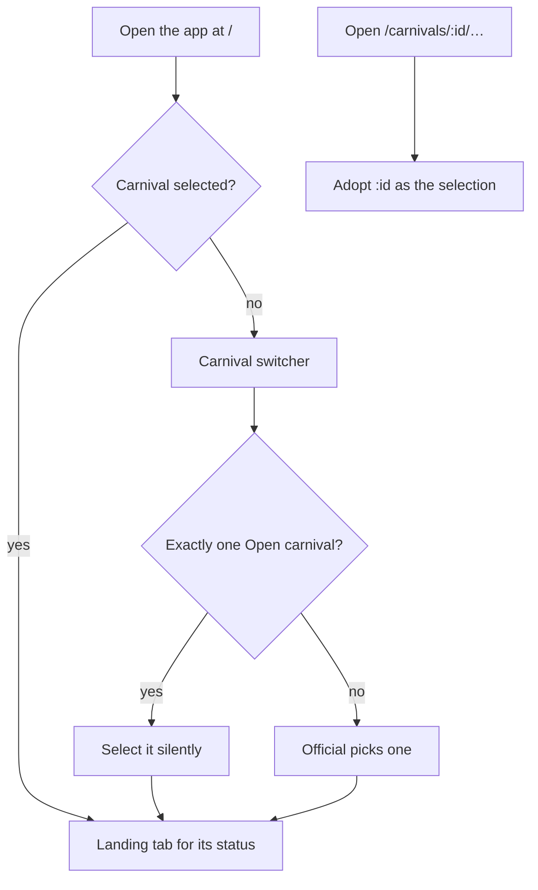

# App navigation and carnival context

How the PWA is organised for the person holding the device: the routes, the primary navigation, the carnival the device is working in, the school's branding, and what the role checks in the app do (and do not) mean.

## Routing

The app uses **hash routing** (`#/carnivals/…`), so the static host needs no rewrite rules. `app/src/router.ts` is a small `hashchange` subscription; `App.tsx` matches the path to one screen, each a lazily loaded chunk that the service worker precaches, so splitting costs nothing offline. On every route change the page scrolls to the top and focus moves to the screen's `<h1>`. The document title is `<screen> — <school name>`, falling back to the product name (`PRODUCT_NAME` in `branding/branding.ts`) until branding arrives or when the school has set no name, and it updates when branding lands.

| Route | Screen |
|---|---|
| `/` | Home: redirects to the selected carnival's landing tab, else the carnival switcher |
| `/carnivals` | Carnival switcher (and New carnival, for administrators) |
| `/carnivals/:id` | **Deck**: the carnival's events, to reach the one being captured |
| `/carnivals/:id/events/:eventId` | The capture deck for one division (`?heat=<raceId>` selects a heat) |
| `/carnivals/:id/dashboard` | **Dashboard** (`/carnivals/:id/standings` redirects here) |
| `/carnivals/:id/program` | Printable program |
| `/carnivals/:id/manage` | **Manage** carnival |
| `/carnivals/:id/schedule` | Program builder |
| `/carnivals/:id/reports` | Reports and exports |
| `/carnivals/:id/setup/events`, `…/setup/events/new`, `…/setup/events/:definitionId` | Event setup, add an event, edit one |
| `/carnivals/:id/setup/divisions` | Divisions profile |
| `/school` | **School** hub |
| `/school/settings`, `/school/roles`, `/school/templates` | School settings, role assignment, event templates |
| `/school/events`, `/school/events/new`, `/school/events/:definitionId` | Event catalogue |
| `/school/records` | School records (`/records-admin` redirects here) |
| `/import` | Roster import |
| `/outbox` | This device's outbox |
| `/login` | Sign in (the identity provider's hand-off, or the development identity picker) |

Any other path renders a "Not found" screen with a link back to the carnivals. A demo build with no visitor session shows only the demo landing page ([demo mode](demo-mode.md)).

## The shell

`shell/AppShell.tsx` frames every screen:

- **Header**: the school's monogram and name, the **carnival chip** (the selected carnival's name, date and status; it opens the switcher), the **outbox indicator**, the signed-in official's name and roles (devices are shared, so the name stays visible), Sign in / Sign out, and the **Outdoor** toggle.
- **Primary navigation**:
  - With a carnival selected: **Deck**, **Dashboard**, **Manage** and **School**.
  - With none: **Carnivals** and **School**.
  - Manage and School appear only for a Carnival or System administrator.
  - Each tab stays lit across its section: Dashboard on the program, Manage on the program builder and setup screens, School on `/import`.
- **Banners**: the stuck-outbox banner and the connectivity strip ([offline outbox](offline-outbox.md)); the "Tap to resume" privacy overlay after idle ([shared devices](authorisation-and-audit.md#shared-devices)); a permanent banner in the public demo.

The Outbox is reached from the header indicator, never from behind a role-gated tab, so queued work is one tap away for every official. Its screen needs a session (it lists the students other officials captured); the indicator and banner show counts only and stay visible when signed out.

## What each top-level screen is for

| Screen | Job |
|---|---|
| **Carnivals** | Pick the carnival this device works in. Open carnivals first, then most recent; 12 rows with a search box. Administrators create carnivals here; a create the server answers without an id stays on the form and says so. Signed out, or when the list read answers `401`, it offers Sign in instead of the list, so a cold signed-out start never shows a raw error. |
| **Deck** | Get to the event being captured: event tiles ("My events" for an official assigned to divisions, then all events) and the event list. Works from the cached event list with no uplink. On a carnival not yet set up, a manager sees one "Set the carnival up" link. |
| **Capture deck** | Enter entries, lanes and results for one division, one heat at a time, with a "Next event" link to the next division on the program ([races, heats and lanes](races-and-lanes.md)). |
| **Dashboard** | How the carnival is going: house standings and progress, read-only. Administrators also see the devices panel. |
| **Manage** | The organiser's changes: setup checklist, links to reports and records, scoring rules, lanes, carnival status, and Finalise at the foot with its own confirmation. |
| **School** | A hub of school-wide sections, each on its own route: settings and houses, roles, roster import and event templates (System administrator); event catalogue and school records (Carnival or System administrator). |
| **Outbox** | This device's queue: what is waiting, what needs a person, what has synced. |

## The selected carnival

The carnival a device is working in is **device-local context** ([ADR-0024](../adr/0024-carnival-context-and-primary-navigation.md)), not a server-side preference: two officials on one shared tablet would fight over a per-account setting, and the venue may have no uplink.

- It is stored in `localStorage` under the key **`sports.carnival`** as `{ id, name, date, status }`. Name, date and status are a display cache, refreshed whenever the carnival is read.
- A `storage` event listener keeps two copies of the app on one device (the installed PWA and a browser tab) on the same selection.
- If storage is unavailable, the selection holds for the current tab only.

### How it is chosen and changed

- **Landing rule**: `/` redirects (replacing the history entry) to the landing tab for the carnival's status:

  | Status | Lands on |
  |---|---|
  | Draft | Manage. Deck for anyone who cannot manage, so nobody lands on a page that refuses them |
  | Open | Deck |
  | Closed, Finalised | Dashboard |

  Role never chooses between Deck and Dashboard: administrators record results on the day too. Home waits for the session to settle before deciding, so it does not decide against an empty role list.
- **Silent auto-selection**: from `/` only, with nothing selected, a school with exactly one Open carnival has it selected without a prompt. The header chip names it. With two carnivals open, nothing is auto-selected. Visiting `/carnivals` directly never auto-selects, so an official who came to switch is not bounced away.
- **Deep links adopt**: opening any `/carnivals/:id/…` address makes that carnival the selection. The selection is a default, never a lock, so printed and shared links keep working.
- **Dropping it**: the selection is cleared only when the server answers `404` for it. A network failure or a `401` is not evidence the carnival is gone, and a dead uplink at the venue must not drop officials out of their own carnival. The carnival is only re-read while signed in.

## Branding

The school's name and brand colour are school settings ([configuration](../admin/configuration.md)).

- **Anonymous read**: `GET /api/v1/branding` returns only `schoolName` and `brandColour`. It is anonymous because the sign-in screen is painted before any session exists. Nothing else may join that response.
- **Cached for offline starts**: the last answer is stored in IndexedDB (the Dexie `appSettings` table). At boot the cached brand is applied first, so a cold start with no uplink still shows the school's chrome without flashing the default accent. The app then fetches a fresh copy; a failed fetch is silent. A save on School settings refreshes it.
- **Applied as tokens**: the brand colour sets the `--brand` token, `--brand-ink` (light or dark text, whichever contrasts more; the server has already refused a colour that cannot reach 4.5:1 against either) and the browser's `theme-color`.
- **Monogram**: the initials of the first two words of the school name, upper-cased. With no school name the header shows the product name and no monogram; with one, the school name is the title and the product's short name sits beneath it.

## Outdoor (high-contrast) mode

The **Outdoor** toggle in the header switches to high-contrast tokens for bright sun on the pool deck. It sets `data-theme="outdoor"` on the root element and is remembered per device in `localStorage` (`sports.theme`). It lives in the app's chrome because borrowed school tablets never get their OS accessibility settings changed. A device that already asks for more contrast (`prefers-contrast: more`) gets the same overrides without the toggle. See the [design system](../development/design-system.md).

## Role gating in the UI

The app reads the session's roles (`hasRole` in `auth/session.ts`) to decide what to **show**: the Manage and School tabs, the School hub's rows, create and edit controls, administrator-only panels. This is a convenience, not access control. **The server decides**: every endpoint names a policy, and a `403` is the rule ([authorisation and audit](authorisation-and-audit.md)).

Role-gated screens are built on `useAccessGate` (`features/ui/SignInOffer.tsx`: the carnival switcher, the School hub, School settings, Roles, roster import, Event templates, the event catalogue, School records, Add an event and Manage) and tell three states apart:

- **loading**: the session has not settled yet.
- **signed out**: offers Sign in, because a role-named refusal would be confusing advice to someone whose session simply lapsed.
- **refused**: names the role the screen needs.

Each section screen refuses on its own, whatever the navigation shows.

## Server reads and local captures

Screens read server state through TanStack Query and fold in this device's undelivered outbox items so a capture shows the moment it is made:

- **Entries** built from a queued create appear at once; see [offline outbox § offline entry creation](offline-outbox.md#offline-entry-creation).
- **Race rosters and lanes** overlay queued placements. An **accepted** item overlays a server read only while it is newer than that read (`acceptedAfter`), so a retained acknowledgement never hides a later change from another device. This rule lives with the race roster: [races, heats and lanes § rendering the race over the outbox](races-and-lanes.md#rendering-the-race-over-the-outbox).

## In the code

- `app/src/router.ts`, `app/src/App.tsx`: routing, Home, redirects, deep-link adoption
- `app/src/shell/AppShell.tsx`: header, primary navigation, banners; `shell/OutdoorToggle.tsx`, `shell/theme.ts`
- `app/src/carnivals/`: `selectedCarnival.ts` (the `sports.carnival` store), `landing.ts` (landing rule, active tab), `useCarnivalContext.ts` (sync and 404 drop), `switcherModel.ts`
- `app/src/screens/CarnivalsScreen.tsx`: switcher and auto-selection
- `app/src/branding/branding.ts`; the `/branding` endpoint in `api/src/CarnivalApp.Api/Program.cs`
- `app/src/features/ui/SignInOffer.tsx`: `useAccessGate`
- `app/src/screens/SchoolScreen.tsx`: the School hub
