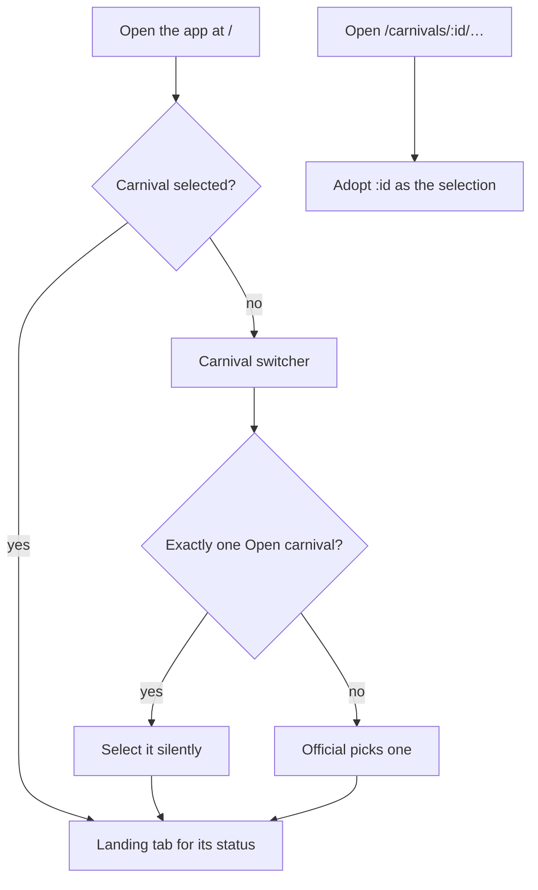

# App navigation and carnival context

How the PWA is organised for the person holding the device: the routes, the primary navigation, the carnival the device is working in, the school's branding, and what the role checks in the app do (and do not) mean.

## Routing

The app uses **hash routing** (`#/carnivals/…`), so the static host needs no rewrite rules. `app/src/router.ts` is a small `hashchange` subscription; `App.tsx` matches the path to one screen, each a lazily loaded chunk that the service worker precaches, so splitting costs nothing offline. On every route change the page scrolls to the top and focus moves to the screen's `<h1>`, or to `<main>` (drawn with no focus ring) while the screen is still loading. The document title is `<screen> — <school name>`, falling back to the product name (`PRODUCT_NAME` in `branding/branding.ts`) until branding arrives or when the school has set no name, and it updates when branding lands.

| Route | Screen |
|---|---|
| `/` | Home: School for a System administrator whose school is not set up; else the selected carnival's landing tab (not a Draft carnival while signed out), else the carnival switcher |
| `/carnivals` | Carnival switcher (and New carnival, for administrators) |
| `/carnivals/:id` | **Deck**: the carnival's events, to reach the one being captured |
| `/carnivals/:id/events/:eventId` | The capture deck for one division (`?heat=<raceId>` selects a heat) |
| `/carnivals/:id/dashboard` | **Dashboard** (`/carnivals/:id/standings` redirects here) |
| `/carnivals/:id/program` | Printable program |
| `/carnivals/:id/manage` | **Manage** carnival |
| `/carnivals/:id/schedule` | Program builder |
| `/carnivals/:id/reports` | Reports and exports |
| `/carnivals/:id/setup/events` | Event setup: "Ages and categories" as one line ("12 to 18+ · Boys, Girls · Competitive", from the carnival's saved profile, else the school's ages) with a Change link, the catalogue split into "In this carnival" and "Available to add" (one-press Add), and the standard events (the template apply). No student list is needed to add events. On a carnival with no division yet, "Add the standard *sport* events" is the screen's primary; once it has events, it sits behind "Add the rest of the standard events". When the student list has students no carnival age covers, a warning names them ("14 students are aged 11, and this carnival has no events for age 11.") with "Add age 11" (or "Add ages 10 to 11"), offered only for ages below the carnival's youngest: it lowers this carnival's youngest age and adds those ages' divisions to every event that has a division for the carnival's youngest age (`POST /carnivals/{id}/divisions/extend-ages`, online only), then says what it added. With no saved ages and no school ages, a notice replaces the standard events: "Set the school's ages in School settings" for a System administrator, a line naming who sets them for anyone else ([ADR-0067](../adr/0067-ages-come-from-the-schools-range.md)) |
| `/carnivals/:id/setup/events/new` | New event: a catalogue definition and its divisions in one form, its grid drawn from the carnival's ages (the school's until the carnival saves its own). Blocked, with the same School settings notice, while there are no ages anywhere |
| `/carnivals/:id/setup/events/:definitionId` | Edit one event and which of its divisions run here |
| `/carnivals/:id/setup/divisions` | Ages and categories, reached from Event setup's Change: From and To over plain ages (3 to 25), where To is the oldest age and takes every student that age or older (saved as `18+`), and the categories and tiers every event uses. Only this carnival changes, never the school's ages. A saved set the range cannot restate (a gap, a plain oldest age saved before open-ended ages, a senior code) is named with what saving replaces it with. With no ages anywhere it shows the School settings notice |
| `/school` | **School** hub |
| `/school/settings`, `/school/roles`, `/school/templates` | School settings (name, brand colour, houses, Ages and Sign-in), role assignment, Update the event catalogue (take a newer template's events into the catalogue). Ages are a Youngest and an Oldest age (1 to 25, youngest no older than oldest, checked on the form and refused by the server with `SCHOOL_AGES_INVALID`), saved with the rest of the form, which then refreshes every carnival read; a new install has none and the form offers 12 and 18. Every carnival starts with these ages, the oldest taking every student that age or older |
| `/school/people` | Local accounts: add, reset, disable, enable, clear a lockout (not in a demo build) |
| `/school/events`, `/school/events/new`, `/school/events/:definitionId` | Event catalogue |
| `/school/records` | School records (`/records-admin` redirects here) |
| `/import` | Roster import. `?carnival=<id>` when launched from a carnival's Students step: the competition year pre-fills from the carnival's date, the back link and the link after a promote lead to that carnival's Manage, and after a promote a warning names students that carnival's ages don't cover, with a link to its Event setup ("Add age 11 in Event setup") ([roster import](imports.md)) |
| `/outbox` | This device's outbox |
| `/login` | Sign in: the one sign-in box (local password, or the hand-off to the identity provider), or the development identity picker on the Vite dev server. `?returnUrl=` names where to go afterwards |
| `/setup/:token` | A setup link: the token is moved into memory and the address replaced with `/setup` before paint (not in a demo build) |
| `/setup` | Set up your account: choose a password, then optionally an authenticator app |
| `/account` | My account, for a local account: change the password, set up an authenticator app (not in a demo build) |

Any other path renders a "Not found" screen with a link back to the carnivals. A demo build with no visitor session shows only the demo landing page ([demo mode](demo-mode.md)).

## The shell

`shell/AppShell.tsx` frames every screen:

- **Header**: the school's monogram and name, the **carnival chip** (the selected carnival's name, date and status; it opens the switcher), the **outbox indicator**, the signed-in official's name and roles in words, such as "System administrator" (devices are shared, so the name stays visible), My account (local accounts only), Sign in / Sign out, and the **Outdoor** toggle.
- **Primary navigation**:
  - With a carnival selected: **Deck**, **Dashboard**, **Manage** and **School**.
  - With none: **Carnivals** and **School**.
  - Manage and School appear only for a Carnival or System administrator.
  - Each tab stays lit across its section: Dashboard on the program, Manage on the program builder and setup screens, School on `/import`.
- **Banners**: the stuck-outbox banner and the connectivity strip ([offline outbox](offline-outbox.md)); the "Tap to resume" privacy overlay after idle ([shared devices](authorisation-and-audit.md#shared-devices)); a permanent banner in the public demo.

The Outbox is reached from the header indicator, never from behind a role-gated tab, so queued work is one tap away for every official. Its screen needs a session (it lists the students other officials captured); the indicator and banner show counts only and stay visible when signed out.

## What each top-level screen is for

| Screen | Job |
|---|---|
| **Carnivals** | Pick the carnival this device works in. Open carnivals first, then most recent; 12 rows with a search box. Administrators create carnivals here, and a new carnival lands on its Manage; a create the server answers without an id stays on the form and says so. With no carnivals the list reads "No carnivals yet."; a System administrator whose school has no name yet also gets a "Set up the school first" link to School. Signed out, or when the list read answers `401`, it offers Sign in instead of the list, so a cold signed-out start never shows a raw error. |
| **Deck** | Get to the event being captured on the day: event tiles ("My events" for an official assigned to divisions, then all events), the event list and per-division Open and Close. Works from the cached event list with no uplink. Nothing here sets a carnival up ([ADR-0066](../adr/0066-the-setup-flow.md) §7): on a Draft carnival with no events a manager sees one "Set the carnival up" link to Manage, and anyone else a line saying the carnival is still being set up. Officials are not assigned here; existing assignments still show on each row's meta line and still drive "My events". On a Draft carnival that has events, a notice above the tiles says the carnival isn't open yet; a manager's adds that results can be entered once it's opened on Manage, with the link. |
| **Capture deck** | Enter entries, lanes and results for one division, one heat at a time, with a "Next event" link to the next division on the program ([races, heats and lanes](races-and-lanes.md)). |
| **Dashboard** | How the carnival is going: house standings and progress, read-only. Administrators also see the devices panel. |
| **Manage** | The organiser's changes: the setup checklist (Students, Events, Program (optional), Open, each linking to its screen; Events reads "Needs the school's ages from School settings" while there are no ages anywhere), links to reports and records, scoring rules, lanes, carnival status, and Finalise at the foot with its own confirmation. While the carnival is Draft, opening happens inside checklist step 4 (Open) and the Carnival status section is hidden. Step 4 shows Ready to open: a count of events and divisions and a "Before you open" list of warnings (a roster year that is not the carnival's; students no carnival age covers, "14 students are aged 11, and no event has age 11.", with a link to Event setup; ages with no students, "Age 18+ has no students: 26 divisions will be empty."; divisions outside a program that has slots, with a link to the program); warnings never block. Both opens are always shown: the primary "Open carnival" opens the carnival and every Scheduled division; "Open the carnival only" leaves the divisions Scheduled, for schools that open events as they are called, with a line saying so, shown only while they are enabled. Until the carnival has students (the Students step's count) and events (at least one division), both are disabled, greyed by the design system's disabled style, under one line naming what is missing: "Import the students and add events first.", "Import the students first." or "Add events first." A read not yet answered, or one that failed, greys nothing; the server still refuses an open that is not ready with `409 CARNIVAL_NOT_READY` ([ADR-0066](../adr/0066-the-setup-flow.md) §5–6), which the step words plainly before re-reading the students and events, so the opens grey out. A refused open is reported in the step, beside the buttons. Once open, Carnival status carries Close, Open all divisions and Reopen. |
| **School** | A hub of school-wide sections, each on its own route: settings and houses, people (local accounts), roles, roster import and Update the event catalogue (System administrator); event catalogue and school records (Carnival or System administrator). While a required row is undone, a System administrator first sees "Set up your school": School name, colours, houses and ages; Staff accounts (optional); Your first carnival. The settings row is done once an administrator has saved School settings (`setupConfirmed`, recorded by the first successful save; a name or houses seeded from `.env` do not count). The other rows are derived from data: a role granted by this administrator, any carnival. Once both required rows are done, School shows nothing of setup ([ADR-0066](../adr/0066-the-setup-flow.md) §2). The empty carnival list's "Set up the school first" link uses the same settings rule. Until that first save, School settings enables Save with nothing changed and says to press it. A System administrator signed in with a local account that has no authenticator app sees a warning linking to My account. |
| **Outbox** | This device's queue: what is waiting, what needs a person, what has synced. |

## The selected carnival

The carnival a device is working in is **device-local context** ([ADR-0024](../adr/0024-carnival-context-and-primary-navigation.md)), not a server-side preference: two officials on one shared tablet would fight over a per-account setting, and the venue may have no uplink.

- It is stored in `localStorage` under the key **`carnival.carnival`** as `{ id, name, date, status }`. Name, date and status are a display cache, refreshed whenever the carnival is read.
- A `storage` event listener keeps two copies of the app on one device (the installed PWA and a browser tab) on the same selection.
- If storage is unavailable, the selection holds for the current tab only.

### How it is chosen and changed

- **Landing rule**: `/` redirects (replacing the history entry) to the landing tab for the carnival's status:

  | Status | Lands on |
  |---|---|
  | Draft | Manage. Deck for a signed-in official who cannot manage, so nobody lands on a page that refuses them. Signed out, `/` stays on the switcher and its Sign in: the Deck's Sign in would return to the Deck, past the School check below |
  | Open | Deck |
  | Closed, Finalised | Dashboard |

  Role never chooses between Deck and Dashboard: administrators record results on the day too. Home waits for the session to settle before deciding, so it does not decide against an empty role list.
- **School first**: before any of that, `/` sends a System administrator to School while the school settings say setup is not confirmed (`setupConfirmed`, [ADR-0066](../adr/0066-the-setup-flow.md) §2). Only a System administrator's Home reads the settings; when the read fails, Home falls through to the rules above. A demo build never sends a visitor to School this way.
- **New carnival**: the rule applies from creation, so a new carnival opens on its Manage.
- **First administrator**: finishing the first administrator's setup link lands on School, where "Set up your school" is the next step; any other setup link lands on `/`.
- **Back links**: Event setup, the program builder and the printable program lead back to Manage (`← Manage`), as does a roster import launched from a carnival. New event, an event's editor and Ages and categories lead back to Event setup (`← Event setup`).
- **Silent auto-selection**: from `/` only, with nothing selected, a school with exactly one Open carnival has it selected without a prompt. The header chip names it. With two carnivals open, nothing is auto-selected. Visiting `/carnivals` directly never auto-selects, so an official who came to switch is not bounced away.
- **Deep links adopt**: opening any `/carnivals/:id/…` address makes that carnival the selection. The selection is a default, never a lock, so printed and shared links keep working.
- **Dropping it**: the selection is cleared only when the server answers `404` for it. A network failure or a `401` is not evidence the carnival is gone, and a dead uplink at the venue must not drop officials out of their own carnival. The carnival is only re-read while signed in.

## Branding

The school's name and brand colour are school settings ([configuration](../admin/configuration.md)).

- **Anonymous read**: `GET /api/v1/branding` returns only `schoolName` and `brandColour`. It is anonymous because the sign-in screen is painted before any session exists. Nothing else may join that response.
- **Cached for offline starts**: the last answer is stored in IndexedDB (the Dexie `appSettings` table). At boot the cached brand is applied first, so a cold start with no uplink still shows the school's chrome without flashing the default accent. The app then fetches a fresh copy; a failed fetch is silent. A save on School settings refreshes it.
- **Applied as tokens**: the brand colour sets the `--brand` token, `--brand-ink` (light or dark text, whichever contrasts more; the server has already refused a colour that cannot reach 4.5:1 against either) and the browser's `theme-color`.
- **Monogram**: the initials of the first two words of the school name, upper-cased. With no school name, or the install's placeholder `(unconfigured)`, the header shows the product name beside a neutral trophy mark; with one, the school name is the title and the product's short name sits beneath it.

## Outdoor (high-contrast) mode

The **Outdoor** toggle in the header switches to high-contrast tokens for bright sun on the pool deck. It sets `data-theme="outdoor"` on the root element and is remembered per device in `localStorage` (`carnival.theme`). It lives in the app's chrome because borrowed school tablets never get their OS accessibility settings changed. A device that already asks for more contrast (`prefers-contrast: more`) gets the same overrides without the toggle. See the [design system](../development/design-system.md).

## Role gating in the UI

The app reads the session's roles (`hasRole` in `auth/session.ts`) to decide what to **show**: the Manage and School tabs, the School hub's rows, create and edit controls, administrator-only panels. This is a convenience, not access control. **The server decides**: every endpoint names a policy, and a `403` is the rule ([authorisation and audit](authorisation-and-audit.md)).

Role-gated screens are built on `useAccessGate` (`features/ui/SignInOffer.tsx`: the carnival switcher, the School hub, School settings, Roles, roster import, Update the event catalogue, the event catalogue, School records, Add an event and Manage) and tell three states apart:

- **loading**: the session has not settled yet.
- **signed out**: offers Sign in, because a role-named refusal would be confusing advice to someone whose session simply lapsed.
- **refused**: names the role the screen needs.

Each section screen refuses on its own, whatever the navigation shows.

## Server reads and local captures

Screens read server state through TanStack Query and fold in this device's undelivered outbox items so a capture shows the moment it is made:

- **Entries** built from a queued create appear at once; see [offline outbox § offline entry creation](offline-outbox.md#offline-entry-creation).
- **Race rosters and lanes** overlay queued placements. An **accepted** item overlays a server read only while it is newer than that read (`acceptedAfter`), so a retained acknowledgement never hides a later change from another device. This rule lives with the race roster: [races, heats and lanes § rendering the race over the outbox](races-and-lanes.md#rendering-the-race-over-the-outbox).

## In the code

- `app/src/router.ts`, `app/src/App.tsx`: routing, Home, redirects, deep-link adoption
- `app/src/shell/AppShell.tsx`: header, primary navigation, banners; `shell/OutdoorToggle.tsx`, `shell/theme.ts`
- `app/src/carnivals/`: `selectedCarnival.ts` (the `carnival.carnival` store), `landing.ts` (landing rule, active tab), `useCarnivalContext.ts` (sync and 404 drop), `switcherModel.ts`
- `app/src/screens/CarnivalsScreen.tsx`: switcher and auto-selection
- `app/src/branding/branding.ts`; the `/branding` endpoint in `api/src/CarnivalApp.Api/Program.cs`
- `app/src/features/ui/SignInOffer.tsx`: `useAccessGate`
- `app/src/screens/SchoolScreen.tsx`: the School hub
