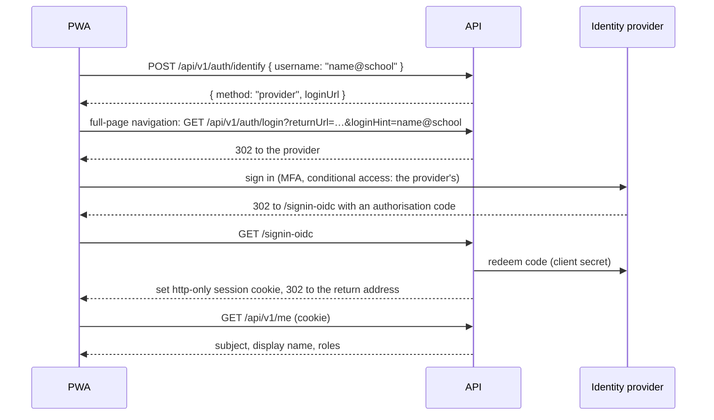

# Authorisation, roles and audit

The API holds all authority. The browser never holds a token, every endpoint names a policy, every write records who made it, and the audit trail cannot be edited, even by the application's own database account. The app hides what a role cannot do, but that is a convenience: the server's `403` is the rule.

## Identity providers

`IdentitySetup.ResolveProvider` chooses the provider at start-up, and local accounts ([ADR-0065](../adr/0065-built-in-local-accounts.md)) are registered beside every one of them except the demo's:

| Provider | Selected when | Used for |
|---|---|---|
| **Local accounts** | Always, except on a demo host. With no provider configured, everyone signs in this way | Every school deployment: the only sign-in of a school with no identity provider, and the backup administrator of one with Entra or ADFS |
| **Entra ID** | `Identity:Provider=Entra`, or `AzureAd:TenantId` and `AzureAd:ClientId` are set | School deployments (Microsoft.Identity.Web, OIDC) |
| **ADFS** | `Identity:Provider=Adfs`, or `Adfs:Authority` and `Adfs:ClientId` are set | School deployments on on-premises ADFS 2019+ (standard OpenID Connect handler, authorisation-code flow) |
| **Development header** | nothing above is configured, the host runs in the `Development` environment, and `Identity:DevAuth:Enabled=true` | Local development and tests only. A request carrying the header uses it; any other uses the session cookie, so local accounts work in development too |
| **Demo session** | `Identity:Provider=Demo` (never inferred) with demo mode enabled | The public demo. A demo host maps no local-account endpoints |

An explicit `Identity:Provider` wins; otherwise the populated configuration section decides. Two guards keep the weak schemes out of a school deployment:

- The development header scheme is registered only in the `Development` environment. Anywhere else, a host with no provider configured authenticates local accounts only. When the scheme is registered, the API logs a critical warning at start-up.
- The demo scheme refuses to start if dev header auth or any Entra or ADFS setting is also present.

Setting up Entra or ADFS is covered in [self-hosting](../admin/self-host.md#4-sign-in).

### Development header and demo session

- **Development header**: the caller is whoever `X-Dev-Subject` names, with roles from `X-Dev-Roles` and groups from `X-Dev-Groups` (`X-Dev-Upn` optional). The Vite dev build sends these from the official picked on its sign-in screen. Anyone who can reach such a host can be anyone, which is why it is Development-only.
- **Demo session**: `POST /api/v1/demo/sessions` creates a visitor's private database and sets an http-only, `SameSite=Strict` cookie. Each visitor is `SystemAdministrator` of their own database.

## Sign-in: one box, one cookie

Every sign-in starts at the app's sign-in screen (`#/login`) and ends in the same server-side session cookie. The PWA never sees a token.

1. The screen reads `GET /api/v1/auth/methods`, which answers `{ provider: "Entra" | "Adfs" | null }`. The box is labelled "Username or school email" with a provider and "Username" without.
2. The person types a name, and the app sends `POST /api/v1/auth/identify { username, returnUrl }`:
   - with no provider, the answer is always `password`;
   - beside a provider, a name of at most 64 characters with no `@` that matches a local account answers `password`; anything else answers `provider` with a `loginUrl` of `/api/v1/auth/login?returnUrl=…&loginHint=<name>`. The app navigates only to that path, and the provider receives the name as its login hint. This answer tells a caller whether a plain name is a local account.
3. A `password` answer leads to the local sign-in below; a `provider` answer to the provider's flow.

### Local sign-in

`POST /api/v1/auth/local { username, password, code?, recoveryCode?, enrolmentCode? }` is stateless: every step sends the password again.

| Answer | When | The app then |
|---|---|---|
| `200 { status: "codeRequired" }` | The password is right and the account has an authenticator | Asks for the 6-digit code, or one recovery code, and resends with `code` or `recoveryCode` |
| `200 { status: "enrolmentRequired", secret, otpauthUri }` | The school requires an authenticator and the account has none | Shows the QR code and key; resends with `enrolmentCode`, the first code the app shows |
| `200 { status: "signedIn", me, recoveryCodes? }` | Every step passed; the session cookie is set | Adopts `me`; when this sign-in enrolled an authenticator, shows the ten recovery codes once |
| `401 SIGN_IN_FAILED` | Unknown name, wrong password, locked out, disabled, or awaiting setup | One answer and one sentence for all of them |
| `401 CODE_INVALID` | Wrong, reused or expired authenticator code, recovery code or enrolment code | Asks again |
| `403 LOCAL_SIGN_IN_NOT_ALLOWED` | The credentials (and code) were right, but beside a provider this account may not sign in locally (below) | Starts again at the name |

Every `SIGN_IN_FAILED` path verifies one password hash (a dummy one for an unknown name or a refused account), except a password over 1,024 characters, which is refused before any lookup or hashing, and the lockout queries run for an unknown name too, so neither the answer nor its timing says which names exist or why the attempt failed. Who may sign in is checked only once the credentials are proven, so a refusal tells a guesser nothing.

```mermaid
sequenceDiagram
  participant P as PWA
  participant A as API
  P->>A: GET /api/v1/auth/methods
  A-->>P: { provider }
  P->>A: POST /api/v1/auth/identify { username }
  A-->>P: { method: "password" }
  P->>A: POST /api/v1/auth/local { username, password }
  A-->>P: { status: "codeRequired" }
  P->>A: POST /api/v1/auth/local { username, password, code }
  A-->>P: set http-only session cookie; { status: "signedIn", me }
```

**Passwords** (`LocalPasswordValidator`) are 15 to 256 characters, counted as Unicode code points after NFKC normalisation; input over 1,024 characters is refused before it is normalised or hashed. There are no composition rules and no expiry. A password is refused when it, or it with trailing non-letters removed, is on the bundled list of 102,578 common and breached passwords (`Identity/LocalAccounts/common-passwords.txt`, source and licence in `common-passwords.SOURCE.md`); when it has fewer than 5 distinct characters; or when fewer than 8 letters remain after removing the school's words (the school name, house codes and names, the username and the display name, each word of 3 or more letters). Hashes are Identity's PBKDF2-HMAC-SHA512 at 220,000 iterations; an older hash is upgraded at its next successful check.

**Usernames** are plain names, never email addresses: 2 to 64 characters of `a–z`, `0–9`, `.`, `_` and `-`, starting with a letter or digit, stored lower-case, and never a configured bootstrap administrator entry. Display names are at most 100 characters.

**The authenticator** is TOTP (RFC 6238): HMAC-SHA1, 30-second steps, 6 digits, accepted one step either side of now. Each account remembers the newest step it accepted, and a code at or before it is refused, through a conditional write, so two requests racing with one code cannot both pass. There is no "remember this device", because devices are shared ([ADR-0031](../adr/0031-shared-device-hygiene.md)). Enrolling creates ten recovery codes, shown once; each signs in once in place of a code, and redeeming one is audited with the number left. Enrolling from My account (`POST /account/authenticator { currentPassword }`, then `POST /account/authenticator/confirm { code }`) asks for the password again, so an unattended signed-in device cannot enrol someone else's phone. An account that has an authenticator keeps it until an administrator resets the account or the host command issues it a new link.

### Who may hold a local account

`LocalAccountPolicy` decides, at sign-in and on every request of a local session:

- **No provider configured**: every local account may sign in.
- **Beside Entra or ADFS**: as the school setting `localAccounts` says: `SystemAdministrators` (the default) or `Everyone`. "System administrators only" means an active in-app `SystemAdministrator` assignment bound to the account, read from the database.

So beside a provider, narrowing the setting signs every local account without the role out at its next request, and while it is narrow, so does revoking a local account's last `SystemAdministrator` assignment. The second setting, `requireAuthenticator` (off by default), makes every local sign-in without an authenticator answer `enrolmentRequired`; sessions already open run to their end. Both are edited in the app under School → School settings → Sign-in, by a System administrator ([configuration](../admin/configuration.md#sign-in-settings)).

### Setup links

An account gets its password through a setup link; the platform sends no email or SMS.

- **Issued by** an administrator creating or resetting an account (School → People), the first deploy (the first administrator), and the host command (below). Each carries 32 random bytes as a base64url token; only its SHA-256 is stored.
- **Shape**: `https://<site>/#/setup/<token>`. A hash route, so the token reaches neither the proxy's nor the API's request log. The app moves the token into memory and replaces the address with `#/setup` before anything paints; it never stores it.
- **Single use, 24 hours.** Opening a link calls `POST /auth/setup/inspect { token }`, which never uses it up, so a link preview or a mail scanner's fetch leaves it good. Setting the password (`POST /auth/setup/complete { token, password, username?, displayName? }`) uses it, recording the time and the client address, in the same transaction that sets the password. Setup then continues as a sign-in: the session cookie, or `enrolmentRequired` when the school requires an authenticator, or `LOCAL_SIGN_IN_NOT_ALLOWED`.
- **A new link revokes the old one** for the same account; disabling an account revokes its live link. A link is answered `410 SETUP_LINK_INVALID` when it is unknown, used, revoked, expired or its account is disabled, without saying which.
- **The first-administrator link** belongs to no account: the person chooses the username and display name and becomes a System administrator (a `role-assignment.grant` by `host`, reason "First administrator"). It stops working as soon as any local account exists.

The link the host command prints is built from `Site:Address` (`SITE_ADDRESS`). The link School → People shows is built from the address the administrator's browser is using.

### Provider sign-in

Entra and ADFS use the same flow. The API is a confidential OIDC client.



On an Entra host the default scheme is the cookie and only the challenge is OIDC, so a local account's cookie authenticates there too.

### The session cookie

- **`__Host-carnival_session`**: http-only, `Secure`, path `/`, no domain, `SameSite=Lax` (the provider's callback arrives as a top-level GET), and **12 hours, fixed, not sliding**, for both kinds of session. The ID token of a provider session is kept inside the encrypted cookie only so sign-out can name the account to the provider. The encryption keyring is on a Docker volume, so sessions survive a redeploy.
- **A local session** carries the subject `local:<id>`, the display name, the username, the account's security stamp at sign-in and a random session id.
- **Per-request validation, for local sessions only** (`LocalSessions`). On every request the cookie is checked against the database: the account exists and is not disabled, its security stamp still matches, the session has not been signed out, and `LocalAccountPolicy` still permits it. Any failure refuses the cookie, clears it and answers `401`; a database fault answers `500` rather than signing the person out. The stamp changes on reset, disable, setting a password through a link or the host command, a password change, enrolling an authenticator, and a password-hash upgrade. A change the person makes to their own account re-issues their own cookie, keeping its session id and its original 12-hour expiry, so only their other sessions end. A provider session is not re-checked: its claims stand until the cookie expires.
- **`/me`** returns `{ subject, displayName, roles, localAccount }`. The app calls it at every start-up: a session means signed in (and resumes a paused outbox); a `401` means signed out; a network failure keeps the official signed in. `localAccount` shows My account.
- **`returnUrl`** is honoured only if it is an app-local path; anything absolute, protocol-relative or containing control characters becomes `/`, so neither the login endpoint nor the identify answer can become an open redirect.
- **API calls never redirect.** A fetch under `/api` without `Accept: text/html` gets a `401` or `403` with a JSON body instead of a redirect to the provider or to an access-denied page (`ApiChallengeSuppression`; with no provider the cookie handler answers a status for every challenge). A redirect would be opaque to `fetch()` and read as "server unreachable", or be followed into a `404` the outbox treats as terminal. Browser navigations to the provider still redirect.

The app keeps a copy of `{ subject, displayName, roles, localAccount }` in `localStorage` to render the shell and decide what to show. It is never sent as a credential.

### Sign-out

Sign-out is a full-page navigation to `GET /api/v1/auth/logout`, mapped on every host except a demo host. The app clears its device caches first, waiting at most 1.5 seconds. What the server does depends on the session:

| Session | Sign-out |
|---|---|
| Local account | Records the session id in `EndedLocalSessions` with the cookie's expiry, clears the cookie and redirects to `/`. A copy of the cookie is refused from then on. A local cookie that has already expired or been refused is cleared the same way and never sends the person to the provider's sign-out |
| Provider, on a provider host | Clears the cookie and signs out of the provider too, so an expired cookie on a shared device cannot leave the provider signing the next person in |
| Any other (development) | Clears the cookie |

`/auth/login` exists only when Entra or ADFS is configured.

### Who the caller is

`PlatformClaims` reads identity from the claims:

- **Subject** (stable, what roles and audit bind to): `oid`, then `sub`, then the name identifier. Never the display name. A local account's subject is `local:<id>`.
- **UPN** (how an administrator names a provider user): `upn`, `preferred_username` or `email`. A local account has none, so it can never match a provider user's role assignment or a bootstrap entry.
- **Display name**: shown and recorded alongside, never used for a decision.

## Roles

Four roles (`PlatformRole`, [ADR-0016](../adr/0016-role-model-simplification.md)):

| Role | Purpose |
|---|---|
| `SystemAdministrator` | School configuration, roster imports, role assignment, local accounts; also everything a carnival administrator can do, so a one-technician school is not locked out |
| `CarnivalAdministrator` | Running carnivals: setup, lifecycle and finalisation, schedule, settings, adjustments, records, reports, category overrides |
| `Recorder` | The deck: marshalling entries and relays, capturing and correcting results on any event |
| `Viewer` | Read only |

A person may hold several roles; their rights are the union. Per-event official assignments exist as data (they drive "My events") but do not gate anything.

### Policy matrix

Built from the policy tables in `CarnivalAuthorization`, `ImportAuthorization`, `SchoolAuthorization`, `RoleAuthorization` and `LocalAccountAuthorization`, which `IdentitySetup` registers as `RequireRole` policies.

| Policy | SystemAdministrator | CarnivalAdministrator | Recorder | Viewer | Covers |
|---|:-:|:-:|:-:|:-:|---|
| `carnivals:view` | ✓ | ✓ | ✓ | ✓ | Reading carnivals, events, entries, results, races, schedule, standings, progress, carnival settings, adjustments, event definitions, records; reporting a device's own sync status |
| `carnivals:marshal` | ✓ | ✓ | ✓ | | Eligible-student search, creating and removing entries and relay teams, materialising a division's race, heat and lane placement |
| `results:submit` | ✓ | ✓ | ✓ | | Submitting results, attempts and high-jump marks; raising the bar; attempts per height |
| `results:correct` | ✓ | ✓ | ✓ | | Correcting a result |
| `carnivals:administer` | ✓ | ✓ | | | Creating and editing carnivals and their status, applying templates, scheduling and editing events, officials, event definitions, races, schedule streams and slots, carnival settings, adjustments, record administration, all reports and exports, the device list, listing event templates (`GET /admin/event-templates`) |
| `school:administer` | ✓ | | | | School settings, including the two sign-in settings; previewing and applying a template reconcile (`GET` and `POST /admin/event-templates/{id}/reconcile`) |
| `imports:view`, `imports:manage` | ✓ | | | | Every roster-import endpoint |
| `roles:administer` | ✓ | | | | Role assignment |
| `accounts:administer` | ✓ | | | | Local accounts: `GET`, `POST /admin/local-accounts`; `POST /admin/local-accounts/{id}/reset`, `/disable`, `/enable`, `/clear-lockout` |

Outside the matrix:

- **Any signed-in user, even with no role**: `/me`, `/version`, `/school/houses`. A fallback policy requires authentication on every endpoint that does not name one, so a new endpoint cannot be anonymous by omission.
- **A signed-in local account, with or without a role**: `GET /account`, `POST /account/password`, `POST /account/authenticator`, `POST /account/authenticator/confirm` (My account). A provider session is refused `403 NOT_A_LOCAL_ACCOUNT`.
- **Anonymous**: `/branding` (school name and colour, for the sign-in screen), `/health`; `/auth/methods`, `/auth/identify`, `/auth/local`, `/auth/setup/inspect`, `/auth/setup/complete` and `/auth/logout` (every host except a demo host); `/auth/login` (provider hosts only); the demo session endpoints (demo hosts only); and the OpenAPI document (Development only).
- **In-handler checks**: entry creation is a marshal action, but a category override on it requires `carnivals:administer` (`403 CATEGORY_OVERRIDE_FORBIDDEN`); a device may report only its own sync status (`403 DEVICE_ID_MISMATCH`); an administrator cannot reset, disable, enable or clear the lockout of their own local account (`409 ACCOUNT_SELF_CHANGE`).

## Where roles come from

`GroupToRoleClaimsTransformation` runs on **every authenticated request**, whatever the scheme, and adds role claims. For a provider session, three sources union; none takes a role away.

1. **Group mapping.** `Identity:GroupToRoleMappings` maps a group identifier to a role name. The groups are read from the claim named by `Identity:GroupsClaimType` (default `groups`: Entra object IDs; ADFS emits a school-defined claim, often group names). Keys match exactly, including case; an unmapped group is logged and grants nothing. Group membership comes from the sign-in, so a membership change takes effect at the next sign-in.
2. **Bootstrap administrators.** `Identity:BootstrapAdministrators` (subject ids or UPNs; `BOOTSTRAP_ADMIN_UPN` in `.env`) grants `SystemAdministrator` to provider accounts. Every value, whether the plain key or an indexed child such as the `__0` entry Compose sets, is split on commas, trimmed and stripped of blanks, so `BOOTSTRAP_ADMIN_UPN=a@school,b@school` names two people. It is read from configuration on every request and never stored, so editing `.env` and restarting recovers a provider account's access.
3. **In-app assignments.** Active rows in `RoleAssignments` ([ADR-0048](../adr/0048-in-app-role-assignment.md)).

**A local session's roles are its in-app assignments alone.** The group mapping and the bootstrap entries are skipped: a local account has no groups and no UPN. Its assignments are read fresh from the database on every request, past the cache, because the host command grants from another process; if that read fails, the last good list is served.

Role names are parsed by `PlatformRoles.TryParse`, which accepts the current names case-insensitively and the retired names as aliases (`EventAdministrator`, `Verifier`, `RecordsManager` → `CarnivalAdministrator`; `ResultsOfficial` → `Recorder`; `ReadOnlyViewer` → `Viewer`), logging each alias use. Numbers are refused.

### In-app role assignment

`GET|POST|DELETE /api/v1/admin/role-assignments`, `SystemAdministrator` only, shown in the app under School → Roles.

- **Grant** by UPN (stored lower-case) or by a local account's username, with a role and a reason (up to 500 characters). A duplicate active grant is `409 ROLE_ASSIGNMENT_DUPLICATE`, enforced by a filtered unique index.
- **A username** (a plain name with no `@`) must name an existing local account, or the grant is `422 ROLE_LOCAL_ACCOUNT_UNKNOWN`. The row is bound to the account's `local:<id>` subject at once, since a local account has no UPN to bind by at sign-in.
- **Binding a UPN.** On the person's first authenticated request the transformation matches the unbound row by UPN, writes their subject id, and audits `role-assignment.bind` as `system`. From then on the row matches by subject id only, so a later UPN rename does not move the role.
- **Revoke** with a reason. Rows are never deleted; revocation stamps who, when and why, and also revokes any other active row for the same role held by the same person under an older UPN. Nobody can revoke their own `SystemAdministrator` (`409 ROLE_SELF_REVOKE`); another administrator can.
- **Immediate effect.** Every grant or revoke invalidates the cached assignment list synchronously, so it applies on the person's next request, inside their current session. If the assignment read fails, the last good list is served and the error logged once.
- The list also shows bootstrap administrators, marked as configuration-derived and not revocable in-app, and marks a local account's rows.

## Local accounts

### Administration

School → People (`/admin/local-accounts`, `accounts:administer`) lists every local account with its status (awaiting setup, active, disabled), whether it has an authenticator, whether it is a System administrator, whether it is locked out at any address, its last sign-in, and its newest setup link (valid until, or used when and from which address).

| Action | Effect |
|---|---|
| Add | Creates the account (username, display name) with no password and returns a setup link, shown once. Roles are granted separately, under School → Roles |
| Reset | Clears the password, the authenticator and the recovery codes, ends every session of the account at its next request, and returns a new setup link. Refused for a disabled account (`409 ACCOUNT_DISABLED`) |
| Disable | Stops sign-in, ends every session at its next request and revokes the live setup link. Accounts are disabled, never deleted |
| Enable | Lifts a disable; the person signs in with their existing password |
| Clear lockout | Ends the lockout at every address |

### Lockout

Lockout is derived from the `SignInAttempts` rows, **per account and client address** (`SignInAttemptLog`): an account is locked at an address while its 10 most recent failures there all fall inside the last 15 minutes, with no success at that address and no lockout clear since the oldest of them. It ends by itself once the oldest of the ten is 15 minutes old. None of these figures is a setting.

- **Only failures count**: a wrong password at sign-in, a wrong authenticator, recovery or enrolment code, a wrong current password on My account, and a wrong code when confirming an authenticator there. Successes are never throttled, so staff behind one shared school address can sign in while someone at the same address is locked out.
- Because the count is per address, a guesser cannot lock an account out from everywhere; the account's owner signs in from another network.
- While locked, the right password still answers `401 SIGN_IN_FAILED`. Attempts while locked, on a disabled account or by a refused account are recorded but are not failures, so they do not extend the lockout. Attempts on an unknown name are recorded with no account, so they count towards no account.
- The client address is the connection's, after `X-Forwarded-For` from a private-network proxy; it is stored as text, with `unknown` when there is none.
- An administrator clears a lockout under School → People; the host command clears it too.

### The host command

On the host, from the clone's directory, `docker compose exec -T api dotnet CarnivalApp.Api.dll accounts …` runs the API binary as a one-off command against the live database. Shell access to the host is the trust anchor, as `.env` already is.

| Command | Does | Prints on stdout |
|---|---|---|
| `accounts first-admin` | Issues a first-administrator link, when no local account exists yet | `First administrator: open https://<site>/#/setup/<token>  (valid 24 hours)` |
| `accounts setup-link <username>` | Creates the account as a System administrator if it does not exist; otherwise clears its password, authenticator and recovery codes, enables it, and grants it `SystemAdministrator` if it lacks an active grant. Clears its lockout and issues a setup link either way | `Setup link for <username>: open https://<site>/#/setup/<token>  (valid 24 hours)` |

Exit codes: `0` done; `2` nothing to do, with the reason on stderr (for `first-admin` when a local account already exists); `1` failure, with usage or the error on stderr. All logging goes to stderr. The command never migrates: on a database with pending migrations it prints `database not migrated yet: deploy the API first` and exits `1`. Its changes are audited with the actor `host`, and a grant reaches a running API at the account's next request. The first deploy runs `accounts first-admin` itself ([self-hosting](../admin/self-host.md#4-sign-in)).

### Same-origin writes

`SameOriginWrites` runs on every request before authentication. An unsafe request (anything but `GET`, `HEAD` and `OPTIONS`) under `/api` is refused `403 CROSS_SITE_REQUEST_REFUSED` when:

- it carries `Sec-Fetch-Site` with any value other than `same-origin` or `none`; or
- it carries no `Sec-Fetch-Site` but an `Origin` that differs from the request's own scheme and host (after forwarded headers).

A request carrying neither header passes: that is not a browser that can run the app (curl, the deploy's smoke checks). Paths outside `/api` are exempt, because the OIDC callback is a cross-site form post by design. A password form makes cross-site sign-in requests worth refusing; the rule covers every write, not only sign-in.

## Shared devices

Event-day devices are shared iPads, laptops and staff phones ([ADR-0031](../adr/0031-shared-device-hygiene.md)). Every official signs in as themselves; there are no shared role accounts. The shell always shows who is signed in.

| Rule | How |
|---|---|
| Session lifetime | 12-hour fixed cookie, long enough for a carnival day; not sliding, so a device left signed in does not renew itself |
| Idle sign-out | After 60 minutes without a tap or key press (`auth/idleGuard.ts`), the app probes `/health`. If the server answers, it signs out (in a server-session build, through `/auth/logout`). If not, it covers the screen with a privacy overlay ("Tap to resume") and retries the probe every 5 minutes and on the `online` event; it does not sign out while unreachable, because the cached roster could not be fetched again. Afterwards a local account types its password (and code) again; a provider account is often signed straight back in by the provider |
| Sign-out and handover | Signing out, or a different official signing in, clears the cached rosters and the service worker's cached API reads; the in-memory read cache is cleared on any session change. A clear that fails is retried at the next start, before anyone can sign in |
| Cached reads | The service worker caches only an allowlist of carnival-day GET routes, for at most 24 hours. Imports, reports, eligible students, `/me` and `/version` are never cached |
| Outbox | Never cleared by sign-out. Queued captures belong to the device and keep the official who made them |

A revoked role takes effect on the device's next request; anything still queued from that official is refused (`403`) and lands as a rejected outbox item, so drain a device before revoking. The same holds for a disabled or reset local account, whose session ends at its next request.

## The captured actor

A capture can be delivered after the device has changed hands, under someone else's session. So the outbox sends the official signed in **at capture** with every queued write:

- `X-Captured-Actor`: their subject;
- `X-Captured-Actor-Name`: their display name, URI-encoded.

The server records the captured subject as the actor of the write (`Result.RecordedBySubject`, `Entry.CreatedBySubject`, the revision and the audit row) and records the session that delivered it beside it (`syncSessionSubject`, `syncSessionRole`, `deviceId` in the audit values). The actor's role is recorded only when the captured subject is the session's own; otherwise it is unknown and left null rather than guessed. Authorisation always uses the delivering session's roles.

The header is device-asserted and not checked against the directory (the official may have left by the time it syncs). Every `/api/v1` request is filtered: a captured subject longer than 128 characters or containing control characters is `400 CAPTURED_ACTOR_INVALID`. Captured actors are honoured on result captures and corrections, entry and relay creation, placement, race creation and materialisation, and house-point adjustments; every other write is attributed to the session.

## Audit trail

`AuditService.Record` adds an `AuditEvent` to the same unit of work as the change it describes, so the two commit or roll back together. Every write endpoint records one, except device sync reports and sign-in attempts, which are kept in `SignInAttempts` for 90 days instead.

| Field | Content |
|---|---|
| `ActorSubject`, `ActorRole` | Who, and their roles (`;`-joined); `system` for automated acts, `host` for the host command |
| `AtUtc`, `SchoolTimezone` | When, and the school's configured timezone (`Australia/Melbourne` when unset or blank) |
| `Action` | A catalogue value (below) |
| `EntityType`, `EntityId` | What was changed; soft references, so rows outlive deleted entities |
| `PriorValuesJson`, `NewValuesJson` | Before and after |
| `Reason` | The stated reason, where the action takes one |
| `ImportBatchId`, `ApplicationVersion`, `RuleVersion` | The roster import involved, the API build, and the validation or scoring rule version |

Results also keep their own immutable revision history (`ResultRevisions`): a correction adds a revision with a reason; nothing is overwritten.

There is no API for reading the audit trail; it is examined in the database.

### Append-only, enforced in the database

- The API never updates or deletes an audit row.
- The application's database role has `UPDATE` and `DELETE` on `AuditEvents` revoked (`deploy/db/init-roles.sql`, re-run on every deploy), and is not granted `TRUNCATE`.
- A `BEFORE UPDATE OR DELETE` trigger, `AuditEvents_append_only`, refuses the statement whatever the grants say, because a schema owner could grant itself back. PostgreSQL only; the SQLite development database has no trigger.

See [ADR-0047](../adr/0047-the-database-stays-on-the-host.md) for the two database roles.

### Action catalogue

`Auditing/AuditActions.cs`; values are `<entity>.<verb>` and never change once written.

| Area | Actions |
|---|---|
| Carnivals | `carnival.create`, `.update`, `.status`, `.settings`, `.apply-template` |
| Event catalogue | `event-definition.create`, `.update`, `.deactivate`; `event-template.reconcile` |
| Carnival events | `carnival-event.schedule`, `.update`, `.division-change`, `.unschedule`, `.status`, `.open-all`, `.assign-officials`, `.raise-bar`, `.attempts-per-height` (`.finalise` appears only on older rows) |
| Schedule | `schedule-stream.*`, `schedule-slot.*` (create, update, delete, place-event, remove-event) |
| Races and entries | `race.create`, `.update`, `.delete`, `.materialise`; `entry.create`, `.remove`, `.marshal`, `.category-override`; `team-entry.create` |
| Results | `result.submit`, `.attempt`, `.jump`, `.correct`, `.finalise` (`result.verify` and `result.return-to-provisional` appear only on older rows) |
| Records and points | `school-record.mint`, `.void`; `house-adjustment.create`, `.void` |
| Reports | `report.export` |
| Roster import | `import.stage`, `.approve`, `.reject`, `.promote` |
| Configuration and access | `school.settings`; `role-assignment.grant`, `.revoke`, `.bind` |
| Local accounts | See below |
| Development | `dev.seed` |

| Local-account action | Written when | Actor |
|---|---|---|
| `local-account.create` | An administrator adds an account, or the host command creates one | The administrator, or `host` |
| `local-account.reset` | An administrator resets an account | The administrator |
| `local-account.disable`, `local-account.enable` | An administrator disables or enables an account | The administrator |
| `local-account.lockout-clear` | An administrator clears a lockout | The administrator |
| `local-account.setup-link` | The host command issues a link (`first-admin` or `setup-link`) | `host` |
| `local-account.setup-complete` | A setup link is used: username, display name, the link's purpose, and the time and client address it was used from | The account |
| `local-account.password-change` | The person changes their password on My account | The account |
| `local-account.authenticator-enrol` | The person enrols an authenticator, at sign-in or on My account | The account |
| `local-account.recovery-code-redeem` | The person signs in with a recovery code, with the number left | The account |

## Errors for sign-in and access

Every non-2xx response under `/api` is JSON: `{ "error": "MACHINE_CODE", "detail": "…" }` ([ADR-0011](../adr/0011-api-error-contract.md)). Clients branch on `error`, never on `detail`.

| Status | Code | When |
|---|---|---|
| 401 | `AUTHENTICATION_REQUIRED` | No valid session, or a local session the per-request check refused. Filled in by `ApiErrorAuthorizationResultHandler` for the framework's bodyless challenge |
| 401 | `SIGN_IN_FAILED` | Local sign-in: unknown name, wrong password, locked out, disabled or awaiting setup |
| 401 | `CODE_INVALID` | Local sign-in: a wrong authenticator, recovery or enrolment code. The same code answers `422` when confirming an authenticator on My account |
| 403 | `FORBIDDEN` | Signed in, but no role the endpoint's policy accepts |
| 403 | `LOCAL_SIGN_IN_NOT_ALLOWED` | Right credentials, but beside a provider this account may not sign in locally |
| 403 | `NOT_A_LOCAL_ACCOUNT` | A provider session on My account |
| 403 | `CROSS_SITE_REQUEST_REFUSED` | An unsafe `/api` request from another origin |
| 403 | `CATEGORY_OVERRIDE_FORBIDDEN`, `DEVICE_ID_MISMATCH` | The in-handler checks above |
| 404 | `ROUTE_NOT_FOUND` | No route matched. Answered before authorisation, signed in or not, so a typo is never mistaken for a sign-out |
| 404 | `ACCOUNT_NOT_FOUND` | School → People names no such account |
| 409 | `ACCOUNT_USERNAME_TAKEN`, `ACCOUNT_DISABLED`, `ACCOUNT_SELF_CHANGE`, `AUTHENTICATOR_ALREADY_ENROLLED` | Adding a taken username; resetting a disabled account; acting on one's own account; enrolling a second authenticator |
| 410 | `SETUP_LINK_INVALID` | The setup link is unknown, used, revoked or expired, its account is disabled, or it is a first-administrator link and a local account already exists |
| 422 | `PASSWORD_TOO_SHORT`, `PASSWORD_TOO_LONG`, `PASSWORD_TOO_COMMON`, `PASSWORD_TOO_PREDICTABLE` | A new password breaks a rule above |
| 422 | `CURRENT_PASSWORD_WRONG` | My account: the current password is wrong (counted as a failure) |
| 422 | `ACCOUNT_USERNAME_INVALID`, `ACCOUNT_USERNAME_RESERVED`, `ACCOUNT_DISPLAY_NAME_INVALID` | A username of the wrong shape or a bootstrap entry; a display name empty or too long |
| 422 | `ROLE_LOCAL_ACCOUNT_UNKNOWN` | A role grant to a username that is not a local account |
| 422 | `VALIDATION_FAILED` | Sign-in without a username or password, or an unusable name at identify |
| 429 | `TOO_MANY_REQUESTS` | A rate limit below |

In the app, a `401` on a read is shown as an error like any other (the session itself is re-checked through `/me` at start-up); a `401` during sync pauses the whole outbox until someone signs in again; a `403` during sync rejects that item. See [offline outbox](offline-outbox.md#classifying-the-answer).

## Rate limiting

The rate limiter runs after authorisation, so a school deployment partitions the bulk-data limit by the signed-in subject.

| Policy | Applies to | Limit | Partition |
|---|---|---|---|
| `bulk-data` | Roster import upload, validation and reconciliation reads; standings, results and district CSV exports | 10 per minute (`RateLimiting:BulkDataPerMinute`) | subject |
| `sign-in` | Every password or code check: `/auth/local`, `/auth/setup/complete`, `/account/password`, `/account/authenticator`, `/account/authenticator/confirm` | Concurrency: half the host's processors (at least 1) at once, then a queue of 16, oldest first | one for the whole host |
| global (demo only) | every request | 1,200 per minute | client address |
| `demo-provision` (demo only) | starting a demo session | 10 per hour | client address |

A refusal is `429 TOO_MANY_REQUESTS` with a `Retry-After` header (5 seconds for `sign-in`). Ordinary carnival traffic, including outbox delivery, is not rate-limited on a school deployment. Client addresses come from `X-Forwarded-For` only when the request arrives from a private-network proxy.

The `sign-in` limiter keeps a password-guessing attack from slowing anything but sign-in, and it is **load-bearing for the lockout count**: the lockout check and the recording of an attempt are not one atomic step, so the limiter bounds how many parallel guesses can pass the check before the tenth failure is recorded.

## Accepted risks

Known limits of local accounts:

- **A database reader can defeat the second factor.** Authenticator seeds are stored as Identity stores them, unencrypted, and recovery codes as unsalted SHA-256 of random codes of about 47 bits. Anyone who can read the database (or a decrypted backup) can generate codes. The database stays on the host and the backups are `age`-encrypted ([ADR-0047](../adr/0047-the-database-stays-on-the-host.md)). Password hashes are PBKDF2 as above.
- **No list of a person's own other sessions, and no way to end them** except changing the password, which ends them all.
- **No "end everyone's sessions"** button. Restarting the API with an empty `dp-keys` volume signs everyone out.
- **No server-side idle timeout.** A local session lasts its 12 hours on the server; only the app's idle guard signs a device out after 60 minutes.
- **Logout is a GET**, so another site can sign a person out by linking to it.
- **A write carrying neither `Sec-Fetch-Site` nor `Origin` is allowed.** Every browser that can run the app sends one of them.
- **On an Entra host the default scheme is the cookie**, with the OIDC handler for the challenge only, so that a local account's cookie is accepted there.
- **A work-factor upgrade signs other devices out once.** Upgrading an old password hash at sign-in rotates the security stamp (Identity's behaviour), which ends the account's other sessions.

## In the code

- `api/src/CarnivalApp.Api/Identity/`: provider selection (`IdentitySetup`), `/me`, `/auth/login` and `/auth/logout` (`AuthEndpoints`), redirect suppression, dev header scheme, claims (`PlatformClaims`), role names (`PlatformRoles`), group → role transformation, role assignment
- `api/src/CarnivalApp.Api/Identity/LocalAccounts/`: the anonymous sign-in and setup endpoints (`LocalAuthEndpoints`), sign-in (`LocalSignInService`), sessions and per-request validation (`LocalSessions`), lockout (`SignInAttemptLog`), setup links (`SetupLinks`), who may sign in (`LocalAccountPolicy`), passwords (`LocalPasswordValidator`, `common-passwords.txt`), usernames, TOTP, recovery-code hashing (`LocalAccountStore`), My account (`AccountEndpoints`, `LocalAccountSelfService`), School → People (`LocalAccountAdminEndpoints`, `LocalAccountAdministration`), the host command (`AccountsCommand`, `AccountsCommandHost`)
- `api/src/CarnivalApp.Api/Data/Entities/`: `LocalAccount`, `LocalAccountSetupLink`, `SignInAttempt`, `EndedLocalSession`; `Data/RetentionSweep.cs` ages out the last three
- `api/src/CarnivalApp.Api/School/`: `LocalAccountAccess`, and the two sign-in settings in `SchoolSettingsProvider` and `SchoolSettingsEndpoints`
- `api/src/CarnivalApp.Api/Carnivals/CarnivalAuthorization.cs`, `School/SchoolAuthorization.cs`, `Imports/ImportEndpoints.cs` (`ImportAuthorization`), `Identity/RoleAuthorization.cs`, `Identity/LocalAccounts/LocalAccountAuthorization.cs`: the policy tables
- `api/src/CarnivalApp.Api/Auditing/`: `AuditService`, `AuditActions`, `CapturedActor`, `SessionActor`
- `api/src/CarnivalApp.Api/Http/`: `ApiError`, `ErrorCodes`, `ApiErrorAuthorizationResultHandler`, `RateLimiting`, `SameOriginWrites`
- `api/src/CarnivalApp.Api/Program.cs`: the `accounts` command entry and the middleware order
- `api/src/CarnivalApp.Api/Migrations/20260822112310_ProtectAuditEventsFromUpdateAndDelete.cs`, `deploy/db/init-roles.sql`
- `api/src/CarnivalApp.Api/Demo/DemoAuthentication.cs`
- `app/src/auth/`: session state, sign-in hand-off and sign-out (`entra.ts`), local-account calls and the in-memory setup token (`localAccounts.ts`), idle guard, device id, demo start
- `app/src/screens/`: `SignInScreen`, `SetupScreen`, `MyAccountScreen`, `SchoolPeopleScreen`, `SchoolSettingsScreen` (the Sign-in section)
- `scripts/deploy/vm-deploy.sh`: the first-administrator link at deploy
