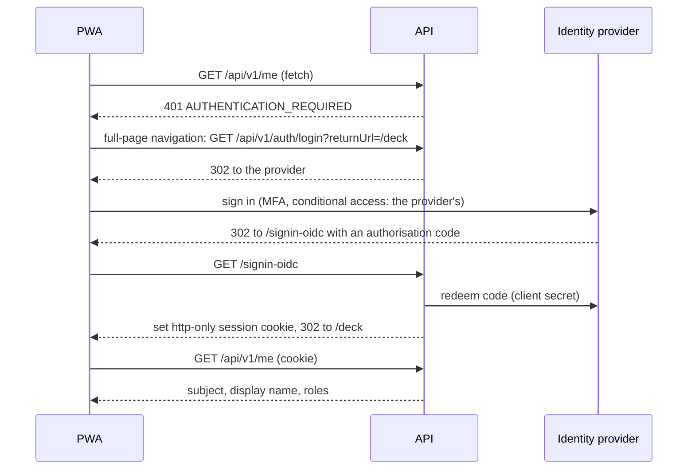

# Authorisation, roles and audit

The API holds all authority. The browser never holds a token, every endpoint names a policy, every write records who made it, and the audit trail cannot be edited, even by the application's own database account. The app hides what a role cannot do, but that is a convenience: the server's `403` is the rule.

## Identity providers

Exactly one authentication scheme is active, chosen at start-up by `IdentitySetup.ResolveProvider`:

| Provider | Selected when | Used for |
|---|---|---|
| **Entra ID** | `Identity:Provider=Entra`, or `AzureAd:TenantId` and `AzureAd:ClientId` are set | School deployments (Microsoft.Identity.Web, OIDC) |
| **ADFS** | `Identity:Provider=Adfs`, or `Adfs:Authority` and `Adfs:ClientId` are set | School deployments on on-premises ADFS 2019+ (standard OpenID Connect handler, authorisation-code flow) |
| **Development header** | nothing above is configured, the host runs in the `Development` environment, and `Identity:DevAuth:Enabled=true` | Local development and tests only |
| **Demo session** | `Identity:Provider=Demo` (never inferred) with demo mode enabled | The public demo |

An explicit `Identity:Provider` wins; otherwise the populated configuration section decides. Two guards keep the weak schemes out of a school deployment:

- The development header scheme is registered only in the `Development` environment. Anywhere else, a host with no provider configured authenticates nobody and answers `401` to everything. When the scheme is registered, the API logs a critical warning at start-up.
- The demo scheme refuses to start if dev header auth or any Entra or ADFS setting is also present.

Built-in accounts and a generic OIDC provider are planned (see `docs/HANDOFF.md`); neither exists today. Setting up Entra or ADFS is covered in [self-hosting](../admin/self-host.md#4-sign-in).

### Development header and demo session

- **Development header**: the caller is whoever `X-Dev-Subject` names, with roles from `X-Dev-Roles` and groups from `X-Dev-Groups` (`X-Dev-Upn` optional). The Vite dev build sends these from the official picked on its sign-in screen. Anyone who can reach such a host can be anyone, which is why it is Development-only.
- **Demo session**: `POST /api/v1/demo/sessions` creates a visitor's private database and sets an http-only, `SameSite=Strict` cookie. Each visitor is `SystemAdministrator` of their own database.

## Sign-in: a server-side cookie session

Entra and ADFS use the same flow. The API is a confidential OIDC client; the PWA never sees a token.

- **The cookie** is http-only, `Secure`, `SameSite=Lax` (the provider's callback arrives as a top-level GET) and lasts **12 hours, fixed, not sliding**. The ID token is kept inside the encrypted cookie only so sign-out can name the account to the provider. The encryption keyring is on a Docker volume, so sessions survive a redeploy.
- **`/me`** returns `{ subject, displayName, roles }`. The app calls it at every start-up: a session means signed in (and resumes a paused outbox); a `401` means signed out; a network failure keeps the official signed in.
- **`returnUrl`** is honoured only if it is an app-local path; anything absolute, protocol-relative or containing control characters becomes `/`, so the login endpoint cannot be used as an open redirect.
- **Sign-out** is a full-page navigation to `GET /api/v1/auth/logout`, which ends both the cookie session and the provider session. The app clears its device caches first, waiting at most 1.5 seconds.
- **API calls never redirect.** A fetch under `/api` without `Accept: text/html` gets a `401` or `403` with a JSON body instead of a redirect to the provider or to an access-denied page (`ApiChallengeSuppression`). A redirect would be opaque to `fetch()` and read as "server unreachable", or be followed into a `404` the outbox treats as terminal. Browser navigations still redirect.
- `/auth/login` and `/auth/logout` exist only when Entra or ADFS is configured.

The app keeps a copy of `{ subject, displayName, roles }` in `localStorage` to render the shell and decide what to show. It is never sent as a credential.

### Who the caller is

`PlatformClaims` reads identity from the claims:

- **Subject** (stable, what roles and audit bind to): `oid`, then `sub`, then the name identifier. Never the display name.
- **UPN** (how an administrator names a person): `upn`, `preferred_username` or `email`.
- **Display name**: shown and recorded alongside, never used for a decision.

## Roles

Four roles (`PlatformRole`, [ADR-0016](../adr/0016-role-model-simplification.md)):

| Role | Purpose |
|---|---|
| `SystemAdministrator` | School configuration, roster imports, role assignment; also everything a carnival administrator can do, so a one-technician school is not locked out |
| `CarnivalAdministrator` | Running carnivals: setup, lifecycle and finalisation, schedule, settings, adjustments, records, reports, category overrides |
| `Recorder` | The deck: marshalling entries and relays, capturing and correcting results on any event |
| `Viewer` | Read only |

A person may hold several roles; their rights are the union. Per-event official assignments exist as data (they drive "My events") but do not gate anything.

### Policy matrix

Built from the policy tables in `CarnivalAuthorization`, `ImportAuthorization`, `SchoolAuthorization` and `RoleAuthorization`, which `IdentitySetup` registers as `RequireRole` policies.

| Policy | SystemAdministrator | CarnivalAdministrator | Recorder | Viewer | Covers |
|---|:-:|:-:|:-:|:-:|---|
| `carnivals:view` | ✓ | ✓ | ✓ | ✓ | Reading carnivals, events, entries, results, races, schedule, standings, progress, carnival settings, adjustments, event definitions, records; reporting a device's own sync status |
| `carnivals:marshal` | ✓ | ✓ | ✓ | | Eligible-student search, creating and removing entries and relay teams, materialising a division's race, heat and lane placement |
| `results:submit` | ✓ | ✓ | ✓ | | Submitting results, attempts and high-jump marks; raising the bar; attempts per height |
| `results:correct` | ✓ | ✓ | ✓ | | Correcting a result |
| `carnivals:administer` | ✓ | ✓ | | | Creating and editing carnivals and their status, applying templates, scheduling and editing events, officials, event definitions, races, schedule streams and slots, carnival settings, adjustments, record administration, all reports and exports, the device list, listing event templates (`GET /admin/event-templates`) |
| `school:administer` | ✓ | | | | School settings; previewing and applying a template reconcile (`GET` and `POST /admin/event-templates/{id}/reconcile`) |
| `imports:view`, `imports:manage` | ✓ | | | | Every roster-import endpoint |
| `roles:administer` | ✓ | | | | Role assignment |

Outside the matrix:

- **Any signed-in user, even with no role**: `/me`, `/version`, `/school/houses`. A fallback policy requires authentication on every endpoint that does not name one, so a new endpoint cannot be anonymous by omission.
- **Anonymous**: `/branding` (school name and colour, for the sign-in screen), `/health`, `/auth/login`, `/auth/logout`, the demo session endpoints (demo hosts only), and the OpenAPI document (Development only).
- **In-handler checks**: entry creation is a marshal action, but a category override on it requires `carnivals:administer` (`403 CATEGORY_OVERRIDE_FORBIDDEN`); a device may report only its own sync status (`403 DEVICE_ID_MISMATCH`).

## Where roles come from

`GroupToRoleClaimsTransformation` runs on **every authenticated request**, whatever the scheme, and adds role claims from three sources. They union; none takes a role away.

1. **Group mapping.** `Identity:GroupToRoleMappings` maps a group identifier to a role name. The groups are read from the claim named by `Identity:GroupsClaimType` (default `groups`: Entra object IDs; ADFS emits a school-defined claim, often group names). Keys match exactly, including case; an unmapped group is logged and grants nothing. Group membership comes from the sign-in, so a membership change takes effect at the next sign-in.
2. **Bootstrap administrators.** `Identity:BootstrapAdministrators` (subject ids or UPNs; `BOOTSTRAP_ADMIN_UPN` in `.env`) grants `SystemAdministrator`. Every value, whether the plain key or an indexed child such as the `__0` entry Compose sets, is split on commas, trimmed and stripped of blanks, so `BOOTSTRAP_ADMIN_UPN=a@school,b@school` names two people. It is read from configuration on every request and never stored, so a locked-out deployment is recovered by editing `.env` and restarting.
3. **In-app assignments.** Active rows in `RoleAssignments` ([ADR-0048](../adr/0048-in-app-role-assignment.md)).

Role names are parsed by `PlatformRoles.TryParse`, which accepts the current names case-insensitively and the retired names as aliases (`EventAdministrator`, `Verifier`, `RecordsManager` → `CarnivalAdministrator`; `ResultsOfficial` → `Recorder`; `ReadOnlyViewer` → `Viewer`), logging each alias use. Numbers are refused.

### In-app role assignment

`GET|POST|DELETE /api/v1/admin/role-assignments`, `SystemAdministrator` only, shown in the app under School → Roles.

- **Grant** by UPN (stored lower-case), role and a reason (up to 500 characters). A duplicate active grant is `409 ROLE_ASSIGNMENT_DUPLICATE`, enforced by a filtered unique index.
- **Binding.** On the person's first authenticated request the transformation matches the unbound row by UPN, writes their subject id, and audits `role-assignment.bind` as `system`. From then on the row matches by subject id only, so a later UPN rename does not move the role.
- **Revoke** with a reason. Rows are never deleted; revocation stamps who, when and why, and also revokes any other active row for the same role held by the same person under an older UPN. Nobody can revoke their own `SystemAdministrator` (`409 ROLE_SELF_REVOKE`); another administrator can.
- **Immediate effect.** Every grant or revoke invalidates the cached assignment list synchronously, so it applies on the person's next request, inside their current session. If the assignment read fails, the last good list is served and the error logged once.
- The list also shows bootstrap administrators, marked as configuration-derived and not revocable in-app.

## Shared devices

Event-day devices are shared iPads, laptops and staff phones ([ADR-0031](../adr/0031-shared-device-hygiene.md)). Every official signs in as themselves; there are no shared role accounts. The shell always shows who is signed in.

| Rule | How |
|---|---|
| Session lifetime | 12-hour fixed cookie, long enough for a carnival day; not sliding, so a device left signed in does not renew itself |
| Idle sign-out | After 60 minutes without a tap or key press (`auth/idleGuard.ts`), the app probes `/health`. If the server answers, it signs out (in a server-session build, through `/auth/logout`). If not, it covers the screen with a privacy overlay ("Tap to resume") and retries the probe every 5 minutes and on the `online` event; it does not sign out while unreachable, because the cached roster could not be fetched again |
| Sign-out and handover | Signing out, or a different official signing in, clears the cached rosters and the service worker's cached API reads; the in-memory read cache is cleared on any session change. A clear that fails is retried at the next start, before anyone can sign in |
| Cached reads | The service worker caches only an allowlist of carnival-day GET routes, for at most 24 hours. Imports, reports, eligible students, `/me` and `/version` are never cached |
| Outbox | Never cleared by sign-out. Queued captures belong to the device and keep the official who made them |

A revoked role takes effect on the device's next request; anything still queued from that official is refused (`403`) and lands as a rejected outbox item, so drain a device before revoking.

## The captured actor

A capture can be delivered after the device has changed hands, under someone else's session. So the outbox sends the official signed in **at capture** with every queued write:

- `X-Captured-Actor`: their subject;
- `X-Captured-Actor-Name`: their display name, URI-encoded.

The server records the captured subject as the actor of the write (`Result.RecordedBySubject`, `Entry.CreatedBySubject`, the revision and the audit row) and records the session that delivered it beside it (`syncSessionSubject`, `syncSessionRole`, `deviceId` in the audit values). The actor's role is recorded only when the captured subject is the session's own; otherwise it is unknown and left null rather than guessed. Authorisation always uses the delivering session's roles.

The header is device-asserted and not checked against the directory (the official may have left by the time it syncs). Every `/api/v1` request is filtered: a captured subject longer than 128 characters or containing control characters is `400 CAPTURED_ACTOR_INVALID`. Captured actors are honoured on result captures and corrections, entry and relay creation, placement, race creation and materialisation, and house-point adjustments; every other write is attributed to the session.

## Audit trail

`AuditService.Record` adds an `AuditEvent` to the same unit of work as the change it describes, so the two commit or roll back together. Every write endpoint records one, except device sync reports.

| Field | Content |
|---|---|
| `ActorSubject`, `ActorRole` | Who, and their roles (`;`-joined); `system` for automated acts |
| `AtUtc`, `SchoolTimezone` | When, and the school's configured timezone (`Australia/Melbourne` when unset or blank) |
| `Action` | A catalogue value (below) |
| `EntityType`, `EntityId` | What was changed; soft references, so rows outlive deleted entities |
| `PriorValuesJson`, `NewValuesJson` | Before and after |
| `Reason` | The stated reason, where the action takes one |
| `ImportBatchId`, `ApplicationVersion`, `RuleVersion` | The roster import involved, the API build, and the validation or scoring rule version |

Results also keep their own immutable revision history (`ResultRevisions`): a correction adds a revision with a reason; nothing is overwritten.

There is no API for reading the audit trail; it is examined in the database.

### Append-only, enforced in the database

- The API never updates or deletes an audit row.
- The application's database role has `UPDATE` and `DELETE` on `AuditEvents` revoked (`deploy/db/init-roles.sql`, re-run on every deploy), and is not granted `TRUNCATE`.
- A `BEFORE UPDATE OR DELETE` trigger, `AuditEvents_append_only`, refuses the statement whatever the grants say, because a schema owner could grant itself back. PostgreSQL only; the SQLite development database has no trigger.

See [ADR-0047](../adr/0047-the-database-stays-on-the-host.md) for the two database roles.

### Action catalogue

`Auditing/AuditActions.cs`; values are `<entity>.<verb>` and never change once written.

| Area | Actions |
|---|---|
| Carnivals | `carnival.create`, `.update`, `.status`, `.settings`, `.apply-template` |
| Event catalogue | `event-definition.create`, `.update`, `.deactivate`; `event-template.reconcile` |
| Carnival events | `carnival-event.schedule`, `.update`, `.division-change`, `.unschedule`, `.status`, `.open-all`, `.assign-officials`, `.raise-bar`, `.attempts-per-height` (`.finalise` appears only on older rows) |
| Schedule | `schedule-stream.*`, `schedule-slot.*` (create, update, delete, place-event, remove-event) |
| Races and entries | `race.create`, `.update`, `.delete`, `.materialise`; `entry.create`, `.remove`, `.marshal`, `.category-override`; `team-entry.create` |
| Results | `result.submit`, `.attempt`, `.jump`, `.correct`, `.finalise` (`result.verify` and `result.return-to-provisional` appear only on older rows) |
| Records and points | `school-record.mint`, `.void`; `house-adjustment.create`, `.void` |
| Reports | `report.export` |
| Roster import | `import.stage`, `.approve`, `.reject`, `.promote` |
| Configuration and access | `school.settings`; `role-assignment.grant`, `.revoke`, `.bind` |
| Development | `dev.seed` |

## Error contract for 401 and 403

Every non-2xx response under `/api` is JSON: `{ "error": "MACHINE_CODE", "detail": "…" }` ([ADR-0011](../adr/0011-api-error-contract.md)). Clients branch on `error`, never on `detail`.

| Status | Code | When |
|---|---|---|
| 401 | `AUTHENTICATION_REQUIRED` | No valid session. Filled in by `ApiErrorAuthorizationResultHandler` for the framework's bodyless challenge |
| 403 | `FORBIDDEN` | Signed in, but no role the endpoint's policy accepts |
| 403 | `CATEGORY_OVERRIDE_FORBIDDEN`, `DEVICE_ID_MISMATCH` | The in-handler checks above |
| 404 | `ROUTE_NOT_FOUND` | No route matched. Answered before authorisation, signed in or not, so a typo is never mistaken for a sign-out |

In the app, a `401` on a read is shown as an error like any other (the session itself is re-checked through `/me` at start-up); a `401` during sync pauses the whole outbox until someone signs in again; a `403` during sync rejects that item. See [offline outbox](offline-outbox.md#classifying-the-answer).

## Rate limiting

The rate limiter runs after authorisation, so a school deployment partitions by the signed-in subject.

| Policy | Applies to | Limit | Partition |
|---|---|---|---|
| `bulk-data` | Roster import upload, validation and reconciliation reads; standings, results and district CSV exports | 10 per minute (`RateLimiting:BulkDataPerMinute`) | subject |
| global (demo only) | every request | 1,200 per minute | client address |
| `demo-provision` (demo only) | starting a demo session | 10 per hour | client address |

A refusal is `429 TOO_MANY_REQUESTS` with a `Retry-After` header. Ordinary carnival traffic, including outbox delivery, is not rate-limited on a school deployment. Client addresses come from `X-Forwarded-For` only when the request arrives from a private-network proxy.

## In the code

- `api/src/CarnivalApp.Api/Identity/`: provider selection (`IdentitySetup`), sign-in endpoints and `/me` (`AuthEndpoints`), redirect suppression, dev header scheme, claims (`PlatformClaims`), role names (`PlatformRoles`), group → role transformation, role assignment
- `api/src/CarnivalApp.Api/Carnivals/CarnivalAuthorization.cs`, `School/SchoolAuthorization.cs`, `Imports/ImportEndpoints.cs` (`ImportAuthorization`), `Identity/RoleAuthorization.cs`: the policy tables
- `api/src/CarnivalApp.Api/Auditing/`: `AuditService`, `AuditActions`, `CapturedActor`, `SessionActor`
- `api/src/CarnivalApp.Api/Http/`: `ApiError`, `ErrorCodes`, `ApiErrorAuthorizationResultHandler`, `RateLimiting`
- `api/src/CarnivalApp.Api/Migrations/20260822112310_ProtectAuditEventsFromUpdateAndDelete.cs`, `deploy/db/init-roles.sql`
- `api/src/CarnivalApp.Api/Demo/DemoAuthentication.cs`
- `app/src/auth/`: session state, sign-in hand-off (`entra.ts`), idle guard, device id, demo start
