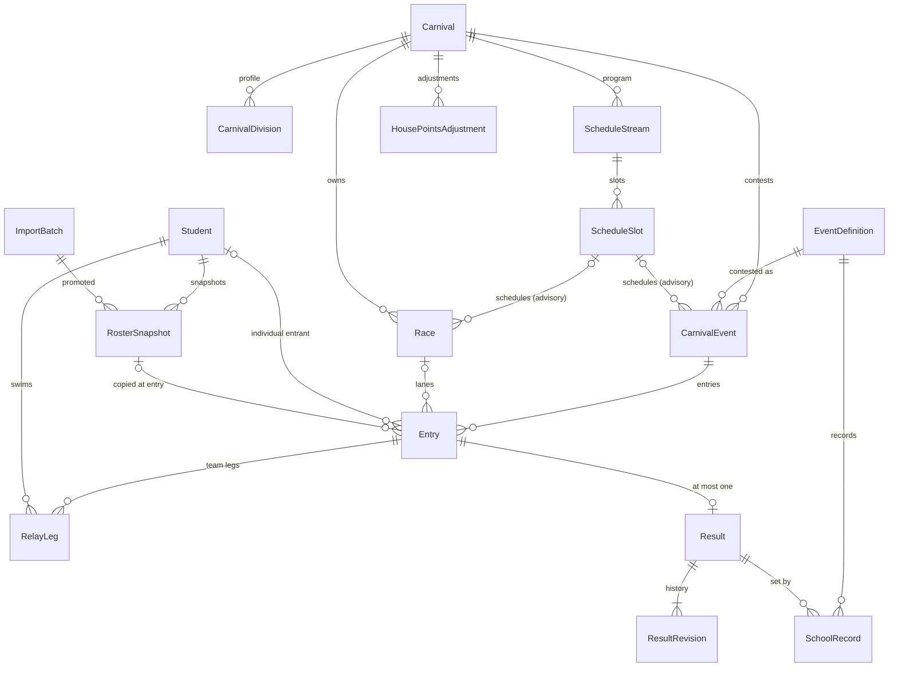

# Data model

The API's state lives in one PostgreSQL database per school (SQLite in local development), mapped with EF Core. The model stays provider-clean: enums are stored as strings, there is no PostgreSQL-only SQL or column type, and concurrency tokens are plain integers or timestamps rather than `xmin`. Identifiers are GUIDs, generated as UUIDv7. The server mints most of them; a result's id comes from the client, and so may an entry's, a race's or an adjustment's (see [Idempotency keys](#idempotency-keys)).

## Vocabulary

| Word on screen | Entity | Meaning |
|---|---|---|
| **Event** | `EventDefinition` | A catalogue item: "Freestyle 50m". Shared by every carnival. |
| **Division** | `CarnivalEvent` | One contest of an event at one carnival: "Freestyle 50m · 13 · Boys · Competitive". |
| **Category** | `CompetitionCategory` | `M`, `F` or `S`, shown as Boys / Girls / Open. A competition grouping, not a gender record. |
| **Division profile** | `CarnivalDivision` | The ages × categories × tiers a carnival contests: the menu divisions are generated from. |

An absent axis means "all": a division with age `OPEN` is open to every age, and a division with no category is open to every category.

## Core entities

Not drawn: `CarnivalEventOfficial` and `DeviceSyncStatus` (both hang off a division or carnival), and the four free-standing tables `SchoolConfiguration`, `RoleAssignment`, `AuditEvent` and `IdempotencyKey`.

Foreign keys restrict deletes wherever history depends on the parent: a student, roster snapshot, event definition, result, or entry with a result cannot be deleted while something refers to it. Optional links to schedule slots and races are cleared by the endpoints, so removing a slot or a race never removes divisions or entries.

## Carnivals

`Carnival` holds a name, type (`Swimming`, `Athletics`, `CrossCountry`, `Other`), date, optional venue, status and owner.

- **Status** is `Draft → Open ⇄ Closed → Finalised`; see [result lifecycle](result-lifecycle.md#the-carnival-lifecycle).
- **`SettingsJson`** holds the scoring rules (place points, participation floor, DNF/DNS/DQ points, social per-entry points), the configured adjustment categories, the venue's lane count and whether lanes auto-fill. Null means the defaults. It is capped at 4,000 characters and validated on write and on read, so a hand-edited blob falls back to defaults rather than scoring garbage. A legacy `Divisions` key, where present, is carried verbatim and read by nothing (the profile lives in `CarnivalDivision`); a settings write drops it only when keeping it would exceed the cap.
- **`RuleVersion`** is the scoring rule version, copied from the settings on every settings save and stamped on audit events.
- **`Version`** is the concurrency token, bumped by every status transition, details edit and settings write.

## Events and divisions

### Event definitions

`EventDefinition` is the catalogue, shared by all carnivals. `Code` (for example `SW-50-FREE`) is unique.

| Field | Meaning |
|---|---|
| `MeasureType` | `Time` (seconds, lower wins), `Distance` or `Height` (metres, higher wins), `Count` (whole number, higher wins). It also decides the capture mode: a `Height` event is always contested on a bar. |
| `AttemptCount` | 1–6 for a field event captured attempt by attempt; null for a single typed measure. Refused on `Time` and `Height`. |
| `LadderJson`, `AttemptsPerHeight` | `Height` only: suggested opening height and rise (pre-fill, never a rule), and the default 2 or 3 attempts per height stamped onto each new division. |
| `Format`, `TeamSize`, `LegsJson` | `Individual` or `Team`; a team event has a fixed team size and optional ordered leg strokes (medley order). |
| `ScoringWeight` | Multiplies a placing's points (relays score double). |
| `RecordCategoriesJson` | The ages × categories that keep school records for this event; null means none. `OPEN` is refused as an age (`400 VALIDATION_FAILED`): an all-ages division sets no record. |
| `IsActive` | Definitions are deactivated, never deleted. An inactive definition cannot be scheduled. |

Once results exist, the measure type, units and attempt count are frozen (`MEASURE_FROZEN`, `ATTEMPT_COUNT_FROZEN`): changing them would reinterpret every recorded result. Once any school record cites the definition, its record categories are frozen too (`RECORD_CATEGORIES_FROZEN`, compared by the categories they mean, so a re-serialised blob is not a change). Template reconciliation additionally freezes the scoring weight once a finalised carnival scores the definition.

### Divisions

`CarnivalEvent` is one definition contested at one carnival for one **age × category × tier**.

- **Age** is one age code (`"13"`, `"SNR"`) or `OPEN`: letters and digits only, at most 16 characters. Ranges such as `13-14` are refused, because eligibility matches by string equality ([ADR-0058](../adr/0058-one-age-per-division.md)).
- **Category** is `M`, `F`, `S` or null (all categories).
- **Tier** is `Competitive` or `Social`. Both score house points; only Competitive divisions set school records.
- **Scoring**: `ScoringMode` null means the tier decides (`Places` for Competitive, `Social` for Social). `ScoresPoints = false` keeps a division out of the standings entirely.
- **Uniqueness**: one division per (carnival, definition, age, category, tier). The unique index treats a null category as distinct, so the endpoints also check it.
- **Locks**: the age, category and tier cannot change once the division has entries (`EVENT_DIVISION_LOCKED`), and a division with entries or results cannot be removed; it is closed instead (`EVENT_HAS_ENTRIES`).
- `HeightsJson` is the bar heights contested so far (Height events): ascending and append-only. `AttemptsPerHeight` is fixed once the first mark lands.
- `Status` (`Scheduled`, `Open`, `Closed`) gates capture; `Version` is its concurrency token and also serialises heat numbering.

`CarnivalEventOfficial` records which officials are assigned to a division. It is advisory and never gates capture: a race can span two divisions, and a recorder may capture for any of them.

### Division profile

`CarnivalDivision` rows are the carnival's division profile: the full cross product of the ages, categories and tiers it contests, in age → category → tier order. They are the menu the division generator offers, not the divisions themselves; no `CarnivalEvent` points at them.

- Unique per (carnival, age, category, tier); the age is never `OPEN`; at most 32 ages.
- No rows means "not configured". The settings read then offers a default computed from the current roster's age groups (M and F, Competitive), which is not stored until saved.
- A settings save replaces the rows wholesale; applying a template seeds them only when none exist.

## Students and the roster

The school's student system is the system of record. The platform holds a minimal identity and a history of snapshots taken from imports.

**`Student`**: `ExternalStudentId` (the source system's key, unique), surname, first name, optional preferred name, and `IsActive` (false when the latest promoted import marks the student as left). Nothing else.

**`RosterSnapshot`**: the student's competition context as of one import.

| Field | Meaning |
|---|---|
| `SchoolYear` | The competition year chosen at import. |
| `YearLevel`, `HouseCode`, `HomeGroup` | From the import. |
| `CompetitionAgeGroup` | Age at the cut-off, or a configured senior band. Derived at import; never `OPEN`. |
| `CompetitionCategory` | `M`/`F` from the import's gender column, anything else `S`. Used only for server-side eligibility and never sent to a client. |
| `IsCurrent` | Marks the snapshot entries are taken from; promotion keeps one per student. |

Snapshots are never rewritten. Promotion marks the previous snapshot not current and adds a new one; one snapshot per (student, import batch). A student marked inactive gets no new snapshot.

**`ImportBatch`**: one roster import, moving `Staged → Validated` (or `ValidationFailed`) `→ Approved` (or `Rejected`) `→ Promoted`. It keeps the source file name and SHA-256, the mapping version, who imported and reviewed it, and the new / changed / inactive / unmatched / rejected counts. The staged rows (`StagedRowsJson`) and per-row issues (`ValidationResultsJson`) are needed for review, so a batch keeps them only until it is settled: promotion discards both in its own transaction, rejection discards both, and the retention sweep discards them 7 days after upload from a batch never promoted ([ADR-0032](../adr/0032-staged-rosters-are-not-kept.md), [ADR-0062](../adr/0062-retention-windows-for-operational-data.md)). The batch row and its counts stay.

## Entries

An `Entry` puts one competitor into one division.

- **Two shapes**, enforced by a check constraint: an individual entry has `StudentId` and no `HouseCode`; a team entry has `HouseCode`, no `StudentId`, and `RelayLeg` children.
- **Snapshot fields** (`SnapshotDisplayName`, `SnapshotYearLevel`, `SnapshotHouseCode`, `SnapshotAgeGroup`, `SnapshotCategory`, `RosterSnapshotId`) are copied from the current roster snapshot when the entry is created and never rewritten. A later import does not move a student's points to a new house or change a historical result's division.
- **Creation** needs the carnival to be `Draft` or `Open` and the division `Scheduled` or `Open`, an active student with a current snapshot, and an eligible division.
- **Removal** is refused once the entry has a result (`ENTRY_HAS_RESULT`).

### Eligibility

One implementation (`EligibilityService`) serves every entry path:

- **Age**: the division is `OPEN`, or its age equals the snapshot's age group.
- **Category**: the division has no category, or is `S` (open to everyone), or the student's effective category equals the division's, or the effective category is `S` (which also clears Boys and Girls divisions).
- **One entry per event, per tier**: a student may hold at most one entry across the divisions of one definition at one tier in one carnival (`ENTRY_IN_OTHER_DIVISION`). Entering both the Competitive and the Social version of a stroke is allowed ([ADR-0023](../adr/0023-open-category-eligibility-and-one-entry-per-event.md)).
- Unique indexes back this up: one entry per (division, student) and one per (division, house).

### Category overrides

A carnival administrator may override an individual entry's category, with a required reason. The override sits beside the snapshot (`CategoryOverride`, plus actor, time and reason) and never rewrites it: the effective category is `CategoryOverride ?? SnapshotCategory`. A marshal can create entries but not overrides. Every override is audited (`entry.category-override`). Team entries have nothing to override.

### Relay teams

A team entry is one house's team in one division.

- The house must be one of the school's configured houses, and has at most one team per division (`TEAM_EXISTS`).
- The team has exactly `TeamSize` distinct swimmers, in leg order. `RelayLeg` stores leg order, stroke (null for freestyle), student and a per-leg snapshot; unique per (entry, leg order) and (entry, student).
- Each swimmer must belong to the team's house and be eligible for the division's age and category (no override applies to legs).
- A swimmer cannot be legged into two teams of the same definition, tier and age that differ only by category. Swimming both an age relay and the Open-age relay is allowed.
- The team entry's display name is "*house* team"; its category is the division's category, or the first leg's when the division has none.
- A leg records who swam, not a split time: the team's single result lives on the entry.

## Schedule

- **`ScheduleStream`**: a column of the program that runs concurrently with the others (for example "Pool" and "Field"). Unique name per carnival. Slot order is meaningful only within a stream.
- **`ScheduleSlot`**: a block in a stream, with an order, optional local start and end times (clock times, not instants, so a postponed carnival keeps its times), a label, and a kind: `Events`, or `Item` for a non-competition program item. An optional `AdjustmentCategory` labels a block whose points are awarded as an adjustment.
- A division or a race sits in at most one slot. Deleting a slot unschedules its divisions and detaches its races; it never deletes them.

The schedule is advisory: no entry, result, eligibility or lifecycle rule reads it.

## Races, heats and lanes

Three separate ideas ([ADR-0015](../adr/0015-heats-races-and-lanes.md)):

| Concept | Where | Scope | Purpose |
|---|---|---|---|
| **Race** | `Race` | carnival | What goes off together. Owns the lanes. May hold heats of more than one division. Optionally scheduled in a slot; optionally stamped with the division it was created for (attribution only). |
| **Heat** | `Entry.Heat` | division | The placing unit for Time events: placings and points are computed per heat. Field events rank across the whole division. Heat numbers are never compared across divisions. |
| **Lane** | `Entry.Lane` | race | A position in a race. Unique per race; requires a race; between 1 and the venue's lane count (64 when none is set). |

Heats and lanes are assigned at the marshalling point and stay correctable after a result lands. Races are created on demand. Deleting a race unassigns its entries but keeps their heats, so recorded results stay in the same placing pool. `Race.SortOrder` and `Label` are display only.

## Results

A `Result` is the one result of one entry; the unique index on `EntryId` is what holds that rule when two captures race (`RESULT_EXISTS`).

| Field | Meaning |
|---|---|
| `Id` | Client-generated UUIDv7, also the request's `Idempotency-Key`. Never database-generated. |
| `Status` | `Ok`, `Dns`, `Dnf`, `Dq` or `Nm`. Only `Ok` carries a value. |
| `MeasuredValue` | Canonical unit: seconds, metres or a count; `decimal(10,3)`. Null unless `Ok`. |
| `AttemptsJson` | On an attempts event, the ordinal series (`[{"value":4.32},{"foul":true},null]`); on a Height event, the jump card (`[{"height":1.25,"marks":"XO"}]`). Told apart by shape. The value and status are derived from it. |
| `LifecycleState` | `Verified` on capture, `Final` after finalisation. |
| `CurrentRevision` | Revision counter and optimistic-concurrency token. |
| `RecordedBySubject`, `RecordedAtUtc`, `CreatedAtUtc`, `DeviceId` | Who captured it (the captured actor, not necessarily the signed-in session that synced it), the device clock at capture, server receipt time, and the device. |

`Place` is never written: placings are computed on read.

A `ResultRevision` is appended for every change, including the initial capture, each attempt or jump, each correction and finalisation. It holds the revision number (unique per result), prior and new values, actor, role, time and reason. Revisions are never updated or deleted. See [result lifecycle](result-lifecycle.md).

## House-point adjustments

`HousePointsAdjustment` awards or deducts points for a house outside the results: novelty events, bonuses, penalties.

- House (must be configured), non-zero points (negative is a deduction), a category from the carnival's configured list, and a required reason.
- It references a house, never a student, entry or result, so it can never set a record.
- It is never edited: it is voided (with a reason) and recorded again. A voided adjustment stays in the table and stops counting.
- Allowed until the carnival is finalised.

## School records

A `SchoolRecord` is one record for one (event definition, age group, category).

- Records are minted only by carnival finalisation, so a row is `Ratified` from birth. They are considered only for Competitive divisions in Boys or Girls categories listed in the definition's `RecordCategoriesJson`, and a record must be strictly beaten: equalling does not supersede.
- Superseding writes a new row pointing at the previous one (`PreviousRecordId`); the old row becomes `Superseded` with an `EffectiveTo` date.
- Voiding sets `VoidedAtUtc`, actor and reason; the row and its status stay.
- The current record is `Ratified`, `EffectiveTo` null and `VoidedAtUtc` null. One current record per category is enforced in code, not by an index.
- `RecordValue` and `HolderDisplayName` are copied at mint for stable reporting. A relay's holder is the team entry's name.
- `Candidate` and `RejectedCandidate` are unused statuses.

## School configuration

`SchoolConfiguration` is one row per deployment (the first by id is the school): an identifier (unique), name, IANA timezone, `HousesJson` (an array of `{code, name, colour}`), `BrandingJson` (brand colour) and `SettingsJson`. `UpdatedAtUtc` is the concurrency token, so two saves from one rendering of the settings form cannot both land. Houses, events and scoring are data, never code.

## Role assignments

`RoleAssignment` grants one of the four roles (`CarnivalAdministrator`, `Recorder`, `Viewer`, `SystemAdministrator`) to a user by UPN. Roles can also arrive from identity-provider groups through the deployment's group → role mapping; those are configuration and are not stored here.

- The UPN is stored lower-case. `SubjectId` is null until the user first signs in, when it binds (audited as a system action) and is never re-matched.
- Rows are never deleted: revocation sets `RevokedAtUtc`, actor and reason, so the table is its own history.
- A filtered unique index allows one active row per (UPN, role) while keeping revoked rows.
- Assignments are deployment-wide; `Scope` and the review columns are unused.

## Audit events

`AuditEvent` is the append-only trail. Each row is written in the same transaction as the change it records.

- Actor subject (`system` for automated acts) and the `;`-joined list of the actor's roles, time, the school's timezone, an action code (`result.correct`, `carnival.status`), entity type and id, prior and new values as JSON, reason, application version, rule version and, for imports, the batch id.
- References are soft (type and id strings) with no foreign keys, so audit rows survive deletion of what they describe.
- The application's database role has `UPDATE` and `DELETE` revoked on this table.
- For a queued write, the row records both the captured actor and the session that synced it.

## Idempotency keys

`IdempotencyKey` makes a retried write apply once.

- Key (the client's UUIDv7), SHA-256 of the canonicalised payload, the response status and body, actor and device.
- Written only for a 2xx response, in the same transaction as the write. A refused request records nothing, so its key stays usable once the state changes.
- A replay with the same payload returns the stored response; a different payload under the same key is refused (`IDEMPOTENCY_PAYLOAD_MISMATCH`).
- Required on result capture (the key is the result id). Optional on entry, team-entry, race, placement and adjustment writes, where a supplied key becomes the new row's id.
- Rows are deleted 30 days after creation by the retention sweep (`Data/RetentionSweep.cs`), a background job that runs at startup and daily on school deployments (PostgreSQL only; not in demo mode or SQLite development). Thirty days is far beyond any device's retry window: a device prunes its own outbox after 7.

## Device sync status

`DeviceSyncStatus` is telemetry for the organiser's device panel, keyed by (carnival, device id). Each device reports its last-seen time, last drain, pending and parked counts, the age of its oldest pending item and its app version; the server adds the signed-in subject. It is last-write-wins, not audited, and holds counts only, never anything that names a student.

## What is deliberately not stored

| Not stored | Instead |
|---|---|
| Birth dates | Read at import to derive the competition age group, then dropped. |
| Gender | Only the competition category, used server-side for eligibility. |
| Addresses, contact, family or health data | Never imported. |
| The import file | Only its name and SHA-256. |
| Staged rows and row issues of a settled batch | Discarded on promotion or rejection, or 7 days after upload if never promoted; the batch keeps counts. |
| Relay split times | One team result per entry. |
| Placings and house standings | Computed on read from results and adjustments. |
| Event completion | Derived on read (entries vs results). |
| Wind readings, plausibility bands | Not modelled. |
| Unsynced captures | Live only in the device's outbox until the server accepts them. |

## Related

- [Result lifecycle and corrections](result-lifecycle.md), [scoring](scoring.md), [records](records.md), [roster import](imports.md), [offline outbox](offline-outbox.md)

## In the code

- `api/src/CarnivalApp.Api/Data/Entities/`: the entities and enums
- `api/src/CarnivalApp.Api/Data/Configurations/`: keys, indexes, constraints, delete behaviour
- `api/src/CarnivalApp.Api/Data/CarnivalAppDbContext.cs`
- `api/src/CarnivalApp.Api/Carnivals/EligibilityService.cs`, `EntryEndpoints.cs`, `RaceEndpoints.cs`, `DivisionProfile.cs`, `AgeScope.cs`
- `api/src/CarnivalApp.Api/Imports/RosterImportService.cs`, `CompetitionDerivation.cs`
- `api/src/CarnivalApp.Api/Records/RecordDetection.cs`
- `api/src/CarnivalApp.Api/Idempotency/IdempotencyService.cs`
- `api/src/CarnivalApp.Api/Data/RetentionSweep.cs`: the idempotency-key and staged-row retention job
- `deploy/db/init-roles.sql`: the audit-table grants
