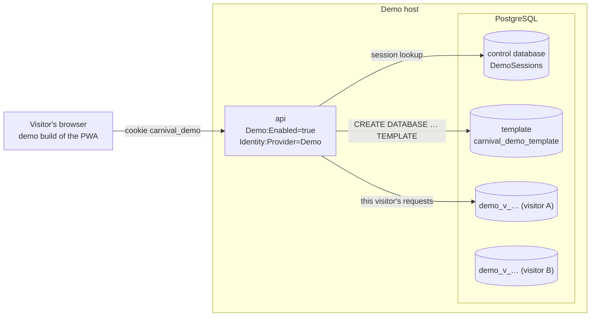

# Demo mode

The public demo lets anyone try the whole product without signing in. Each visitor gets a private sandbox: their own PostgreSQL database, cloned from a seeded template, holding synthetic data only. Demo mode is a separate configuration of the same API plus a separate build of the app. It is off in every school deployment and cannot be combined with real sign-in.

The isolation boundary is the database. The product stays single-tenant; a demo host simply runs one tenant per visitor, so no query, policy or entity needs a tenant key. See [ADR-0061](../adr/0061-demo-showcase-per-visitor-instances.md).

## Shape

## Sessions

`POST /api/v1/demo/sessions` (anonymous):

1. A live `carnival_demo` cookie: `200` with the existing session's expiry.
2. Otherwise, under one lock shared with eviction and cleanup: check capacity, run `CREATE DATABASE "demo_v_<id>" TEMPLATE "<template>"`, write the session row, set the cookie, `201` with the expiry.

`GET /api/v1/demo/sessions/me` returns the expiry, or `401 DEMO_SESSION_REQUIRED`.

| Property | Value |
|---|---|
| Cookie | `carnival_demo`: a random 256-bit token, `HttpOnly`, `Secure`, `SameSite=Strict`, path `/`, expires at the absolute limit. `SameSite=Strict` is the CSRF control; the demo has no cross-site sign-in callback. |
| Stored | The control database's `DemoSessions` table holds the token's SHA-256 (never the token), the database name, created and last-seen times. |
| Identity | Subject `demo-<session id>`, name "Demo visitor", role **SystemAdministrator** in their own database, so every screen can be shown. |
| Expiry | 24 hours after creation or 2 hours after last use, whichever comes first. Last-seen is written at most once a minute. |

The cookie authenticates through the `DemoSession` scheme: it hashes the token, finds a live session, selects that session's database for the request, and only then runs the claims transformation (which reads role assignments from that database).

### Capacity and provisioning limits

| Limit | Key | Default | When exceeded |
|---|---|---|---|
| Live sessions | `Demo:MaxSessions` | 100 | Evict the least recently used session idle 30 minutes or more; if none, `503 DEMO_AT_CAPACITY`, `Retry-After: 300` |
| New sessions per client address | `Demo:ProvisionsPerIpPerHour` | 10 | `429 TOO_MANY_REQUESTS` |
| New sessions across the host | `Demo:ProvisionsPerMinute` | 30 | `429`, `Retry-After: 60` |

Database creation ignores request cancellation, so a visitor leaving mid-provision cannot orphan a database; if writing the session row fails, the new database is dropped.

### Cleanup

`DemoCleanupService` runs every `Demo:CleanupIntervalMinutes` (default 10). Each sweep ends every expired session (`DROP DATABASE … WITH (FORCE)`, clear that database's connection pool, delete the row) and drops any `demo_v_*` database with no live session. There is no scheduled full wipe: a live session is never cut short by a clock. The school deployments' retention sweep (idempotency keys, staged roster rows) is not registered on a demo host, because a visitor database is short-lived. The control database is created with `EnsureCreated`, not migrated, so it never evolves in place: a demo deploy recreates it, which ends every session.

## Per-request database

In demo mode, `CarnivalAppDbContext` gets its connection string per request from `VisitorDatabase`:

- The name must match `^demo_v_[0-9a-f]{32}$` before it reaches a connection string or SQL, so a session row can never steer a request to another database.
- With no visitor database selected, resolution throws. It never falls back to the configured database.
- Each visitor's pool is small (`Demo:VisitorPoolSize`, default 3) with `MinPoolSize=0` and a 60-second idle lifetime, so idle visitors hold no server connections.
- The two singleton caches that hold database state, `SchoolSettingsProvider` and `RoleAssignmentProvider`, keep one slot per database (`IDatabaseKey`) and forget a slot when its database is dropped. Outside demo mode, `IDatabaseKey` is a single constant key. Any new singleton that caches database rows must do the same.

Creating and dropping databases runs on a separate connection, `ConnectionStrings:DemoControl`, as a provisioner role with `CREATEDB` that owns the control database. The application role is unchanged (see [ADR-0047](../adr/0047-the-database-stays-on-the-host.md)), and grants made in the template, including the audit-table revokes, are copied into every clone.

## The template

The template database (`Demo:TemplateDatabase`, default `carnival_demo_template`) holds the demonstration school: houses and branding, a promoted synthetic roster, a record book and a swimming carnival part-way through the day. A demo host never migrates or bootstraps databases at startup: the template is migrated and seeded when it is built, and a schema change reaches visitors only by rebuilding the template and redeploying. The scripts that build the template and deploy a demo host are not yet in this repository.

Before a visitor has a session, `GET /api/v1/branding` answers from `Demo:SchoolName` (default "Example Synthetic College") without opening any database, so the landing page can paint and the template is never connected to.

## Demo guard

`UseDemoGuard` runs on a demo host only, after the exception handler and before idempotency buffering and authentication, so its answer never depends on who asks:

- **Imports refused.** Every request under `/api/v1/imports` other than `GET`, `HEAD` or `OPTIONS` gets `403 DEMO_IMPORTS_DISABLED`. It matches the path prefix, so an import route added later is refused without a code change. The template's generated roster is the only roster a demo database ever holds.
- **Not indexed.** Every API response carries `X-Robots-Tag: noindex, nofollow`. The HTML is served by the proxy, not the API, so the demo build of the app also carries a `robots` `noindex, nofollow` meta tag.

CSV exports stay available; they are part of the demonstration and read only the visitor's own database.

## Rate limits

On top of the provisioning limits above, a demo host adds a global fixed-window limiter on every request, keyed on the client address (`Demo:RequestsPerIpPerMinute`, default 1200 per minute, sized for a staff room behind one NAT). School deployments have no global limiter. The per-user `bulk-data` limit on exports applies as everywhere. A device's outbox treats a `429` as throttled, not refused: the item stays queued and the worker waits, honouring `Retry-After` ([offline outbox](offline-outbox.md#backoff)).

The client address is the one forwarded by the proxy; forwarded headers are trusted from private ranges only. The limits key on the full address, so an IPv6 client rotating addresses within its /64 is bounded only by the host-wide provisioning limit and capacity eviction.

## The demo build of the app

The app is built in demo mode with `VITE_DEMO_MODE=true`. Vite inlines the flag, so the demo app is a different image (`carnival-app-web-demo`), never a runtime switch ([ADR-0049](../adr/0049-images-are-built-in-ci-and-pulled-by-digest.md)). In a demo build (`isDemoBuild()`):

| Behaviour | Demo build | School build |
|---|---|---|
| Banner | "PUBLIC DEMO — synthetic data only, your copy is temporary" on every screen | none |
| No session | Every route shows `DemoLandingScreen`: what the product is and a **Start demo** button | sign-in |
| Start demo | `POST /demo/sessions`, then `GET /me`, then adopt the session | OIDC redirect |
| Expired session | The landing page says "Your previous demo has ended"; nothing is re-provisioned silently | sign in again |
| Sign-in controls | No Sign in, Sign out or Switch; `/login` redirects home | Entra or ADFS sign-in |
| Identity | The same-origin cookie; no `X-Dev-*` headers (those are sent by the Vite dev server only) | the OIDC session cookie |
| `index.html` | `robots` `noindex, nofollow` meta tag | none |

The demo routes are not in the generated API client (that is generated from a non-demo API), so `auth/demo.ts` calls them with plain `fetch`. The Vite dev server is never a demo build; it exposes the landing page at `/dev/demo-landing` for the screenshot pass.

## Configuration, and keeping it out of school deployments

| Key | Purpose |
|---|---|
| `Demo:Enabled` | `true` turns demo mode on (default `false`) |
| `Identity:Provider` | Must be `Demo` on a demo host; never inferred from other settings |
| `ConnectionStrings:DemoControl` | Provisioner connection to the control database; required |
| Application connection string | The server and role visitor databases are reached with; its database name is replaced per request |
| `Demo:TemplateDatabase`, `Demo:VisitorPoolSize`, `Demo:MaxSessions`, `Demo:ProvisionsPerIpPerHour`, `Demo:ProvisionsPerMinute`, `Demo:RequestsPerIpPerMinute`, `Demo:CleanupIntervalMinutes`, `Demo:SchoolName` | Tuning, defaults above |
| `VITE_DEMO_MODE=true` | App build argument; selects the `carnival-app-web-demo` image |

The API refuses to start on any mixed configuration:

- `Demo:Enabled=true` with SQLite, or without `Identity:Provider=Demo`.
- `Identity:Provider=Demo` without `Demo:Enabled=true`.
- `Identity:Provider=Demo` with dev header authentication enabled or any Entra or ADFS tenant, client or authority value (`DEMO_COEXISTENCE_FORBIDDEN`).

A demo host logs a critical "DEMO IDENTITY ACTIVE — no real authentication" message at startup. Every demo-only service (the session handler, control context, provisioner, cleanup job and guard) is registered only when `Demo:Enabled=true`; a school deployment's request path is unchanged.

## In the code

- `api/src/CarnivalApp.Api/Demo/`: `DemoMode.cs` (keys and defaults), `DemoAuthentication.cs` (cookie scheme, startup refusals), `DemoSessions.cs` (provisioning, capacity, sweep), `DemoEndpoints.cs` (routes, cleanup service), `DemoGuard.cs`, `VisitorDatabase.cs`, `VisitorDatabases.cs`, `DemoControlDbContext.cs`
- `api/src/CarnivalApp.Api/Program.cs`: demo registration and startup checks
- `api/src/CarnivalApp.Api/Http/RateLimiting.cs`: demo limiters
- `app/src/auth/demo.ts`, `app/src/screens/DemoLandingScreen.tsx`, `app/src/api/client.ts` (`isDemoBuild`), `app/src/shell/AppShell.tsx` (banner), `app/vite.config.ts` (`demoNoindex`)
- Tests: `DemoSessionTests`, `DemoGuardTests`, `VisitorDatabaseTests`, `VisitorDatabasesPostgresTests` (Docker only)
