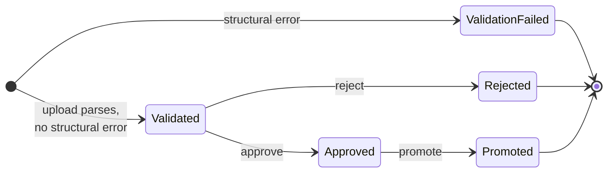

# Roster import

The platform never owns student identity. A system administrator uploads a CSV export from the school's student system; the API stages it, validates every row, shows what would change, and only writes the roster when the batch is approved and promoted. The importer reads a CASES21 ST-shaped export today.

A generic canonical CSV template (any school, built from date of birth, with CASES21 as one preset and status, gender and year-level values in configuration) is planned; see `docs/HANDOFF.md`. This page describes what exists now.

## Pipeline



| Step | Endpoint | What happens |
|---|---|---|
| **Stage** | `POST /api/v1/imports` | Parse, map, validate each row, reconcile against the current roster, store the staged rows and issues on an `ImportBatch`. Nothing touches `Student` or `RosterSnapshot`. |
| **Review** | `GET /api/v1/imports/{id}/validation`, `…/reconciliation` | Structural errors and per-row issues; every staged row with its disposition, plus active students missing from the file. |
| **Approve / reject** | `POST /api/v1/imports/{id}/approve` with `{ approve, note }` | Only a `Validated` batch can be reviewed (`409 IMPORT_BATCH_WRONG_STATE` otherwise). Records reviewer, time and note. Rejection discards the staged rows and issues. |
| **Promote** | `POST /api/v1/imports/{id}/promote` | Only an `Approved` batch. Writes students and snapshots in one transaction, then discards the staged rows. |

`ImportBatchStatus` also has a `Staged` value; it is the entity default and is never persisted, because staging writes the batch already `Validated` or `ValidationFailed`. A `ValidationFailed` batch cannot be approved; fix the file and upload it again.

Every transition writes an audit event: `import.stage` (file name, SHA-256, mapping version, status, competition year, counts), `import.approve` / `import.reject` (with the note as reason), `import.promote` (counts and year).

## The upload

- `multipart/form-data` with a `file` part and an optional `competitionYear` field.
- The file must end in `.csv`; a content type, if present, must be `text/csv`, `text/plain`, `application/csv` or `application/vnd.ms-excel`. At most 2 MB (`413` beyond that; the limit is applied before the body is read).
- Only the file's base name is kept (cut at `/` or `\`, at most 260 characters), with the SHA-256 of the bytes.
- Upload and the two review reads share the per-user `bulk-data` rate limit with the CSV exports (`RateLimiting:BulkDataPerMinute`, default 10).

### CSV parsing

`CsvTable` is a small RFC 4180 reader with no third-party dependency:

- **Encoding:** UTF-8 with or without a BOM; if the bytes are not valid UTF-8, Windows-1252.
- Comma-separated; a field opening with `"` is quoted, `""` is a literal quote; CRLF or LF line ends; blank lines are skipped.
- The first record is the header. Header names and every field are trimmed; header matching is case-insensitive; short rows are padded to the header width.

### Date encodings

`BIRTHDATE` is accepted in any of these forms, whatever the mapping file says:

| Form | Example | Notes |
|---|---|---|
| Excel serial day number | `36526` (= 2000-01-01) | 61 to 80000; day 0 is 1899-12-30 |
| ISO | `2000-01-01`, `2000-01-01T00:00:00`, `2000-01-01 00:00:00` | |
| Day/month/year | `1/1/2000`, `1/1/2000 0:00`, `1/1/2000 12:00:00 AM` | never month-first |

## The mapping file

`Imports:MappingPath` names a JSON file, read from disk on every upload and defaults read. If the setting is missing, the file does not exist or cannot be read, or it is not valid JSON or not a valid mapping (for example a missing `cutOff`, a refused `openLabel`, a column whose value is `null`, or two column names that differ only by case), those requests answer `500 IMPORT_MAPPING_UNAVAILABLE` with the reason in `detail`. The example is `config/import-mapping.example.json`.

```json
{
  "columns": {
    "STKEY":     { "maps_to": "external_student_id", "required": true },
    "BIRTHDATE": { "maps_to": "competition_age_group", "required": true }
  },
  "ageGroupRule": { "cutOff": "12-31", "openFromAge": 17, "openLabel": "SNR" }
}
```

What the API reads from it:

| Key | Effect |
|---|---|
| `columns.<NAME>` | A source column. With `required: true`, a file without that header fails structurally. |
| `columns.<NAME>.maps_to` | Loaded but not used: the importer reads fixed CASES21 column names (below). |
| `ageGroupRule.cutOff` | `MM-DD`, the day of the competition year ages are taken at. Required. `02-29` falls on 28 February in a common year. |
| `ageGroupRule.cutOffDate` | Legacy `YYYY-MM-DD`; only its month and day are used. Read only when `cutOff` is absent. |
| `ageGroupRule.openFromAge` | Optional. Every student this age or older derives the senior band instead of a number. |
| `ageGroupRule.openLabel` | The senior band's code, uppercased; default `SNR`. `OPEN` is refused (it is the event age scope meaning every age), as is a purely numeric label (indistinguishable from a plain age). |

The file's base name is recorded on each batch as its mapping version. `source`, `unique`, `fallback`, `validate`, `transform`, `store_source_value` and `$comment` keys in the example are documentation for the reader and are ignored by the API.

### Columns the importer reads

| Column | Becomes | Checked |
|---|---|---|
| `STKEY` | `Student.ExternalStudentId` | every row: present, unique in the file |
| `SURNAME`, `FIRST_NAME` | student names | every row: present |
| `PREF_NAME` | preferred name (blank stays blank) | |
| `STATUS` | active or inactive | every row: present and recognised |
| `SCHOOL_YEAR` | snapshot year level | active rows: an integer 7 to 12 |
| `HOUSE` | snapshot house code | active rows: present, matches a configured house (case-insensitive) |
| `HOME_GROUP` | snapshot home group | |
| `BIRTHDATE` | snapshot competition age group | active rows: present, parseable, not after the cut-off; then discarded |
| `GENDER` | snapshot competition category | active rows: present |

`SECOND_NAME`, `TITLE` and every column not listed are never read.

## Validation

**Structural errors** fail the whole batch (`ValidationFailed`): a file with no header row, a required column missing, or no data rows.

**Row issues** reject only their row. A row is either active or inactive by its `STATUS`:

| Status | Treatment |
|---|---|
| `ACTV` | Active: fully validated, promoted with a snapshot |
| `LEFT`, `DEL`, `INAC`, `FUT`, `LVNG` | Inactive: identity checks only, promoted as an inactive reference |
| anything else | `UNKNOWN_STATUS`, row rejected |

| Code | Rows | Severity |
|---|---|---|
| `MISSING_STKEY`, `MISSING_SURNAME`, `MISSING_FIRST_NAME`, `MISSING_STATUS`, `UNKNOWN_STATUS` | all | Error |
| `DUPLICATE_STKEY` | every row sharing the key | Error |
| `INVALID_YEAR_LEVEL`, `UNKNOWN_HOUSE`, `MISSING_BIRTHDATE`, `INVALID_BIRTHDATE`, `BIRTHDATE_AFTER_CUT_OFF`, `MISSING_GENDER` | active | Error |
| `MISSING_HOUSE` | active | Exception: rejects the row, but marks it as work to fix in the source system rather than bad data |

Inactive rows skip the house, year-level, birth-date and gender checks: departed students carry houses that no longer exist. `BIRTHDATE_AFTER_CUT_OFF` catches a birth date later than the competition year's cut-off day, from which no age can be derived (usually a wrong date in the source system or the wrong competition year at upload). Issue messages never echo the birth-date value, because issues are stored and served back.

## Reconciliation

Each row gets a disposition, compared against the current roster:

| Disposition | Meaning |
|---|---|
| `New` | Active, no student with this `STKEY` |
| `Changed` | Active, existing student whose names, active flag, or current snapshot (year level, house, age group, category, home group, competition year) differ |
| `Unchanged` | Active and identical on all of those |
| `Inactive` | A recognised non-active status |
| `Rejected` | At least one Error or Exception issue |

**Unmatched** students (active on the current roster, absent from the file) are listed for information only. Promotion does not deactivate them; they keep their existing snapshot.

## Age group and category

The age group is the student's exact age on the cut-off day of the **competition year**, as a string (`"13"`), or the senior band when `openFromAge` is set and reached.

| Born | Competition year | Cut-off | Age group |
|---|---|---|---|
| 2014-03-05 | 2027 | `12-31` | `13` |
| 2016-01-01 | 2027 | `12-31` | `11` |
| 2009-06-01 | 2027 | `12-31`, `openFromAge: 17` | `SNR` |

The competition year is chosen per import, not configured. If the upload names none, the server uses the year of the earliest carnival dated today or later (looking no further than the end of next year), else the current year, so a November import for a February carnival lands on the carnival's year. "Today" is the school's date in `School:Timezone` (`Australia/Melbourne` when absent or blank; UTC when the zone is unknown). A year more than one from the current year is refused with `400 IMPORT_COMPETITION_YEAR_INVALID`, and nothing is staged. `GET /api/v1/imports/defaults` returns the default, the allowed range and the cut-off, which the upload form uses to pre-fill a year picker and state "Ages as at 31 December 2027". Ages only move when the roster is imported again. See [ADR-0060](../adr/0060-the-competition-year-is-chosen-at-import.md).

The **competition category** comes from `GENDER`: `M` → `M`, `F` → `F`, any other non-blank value → `S`. It is a competition grouping default used only for server-side eligibility, and it does not leave the server except in the import review below ([ADR-0026](../adr/0026-the-student-category-is-server-side-only.md)).

The roster's distinct age groups seed a carnival's default divisions, and division eligibility matches them exactly, so the cut-off and senior band decide which divisions a school can run.

## What is stored and what is discarded

| Data | Fate |
|---|---|
| Birth date | Read in memory to derive the age group; never stored or echoed back |
| Staged rows (`StagedRowsJson`): key, names, status, house, home group, year level, age group, category, disposition, issues | Kept on the batch for review; set to null inside the promotion transaction, on rejection, or 7 days after upload if never promoted |
| Row issues (`ValidationResultsJson`) | Same lifetime as the staged rows |
| Batch row: file name, SHA-256, mapping version, importer, reviewer, note, timestamps, five counts | Kept: this and the audit events are the evidence of what was imported |
| `Student`: external ID, surname, first name, preferred name, active flag | Created or updated on promotion |
| `RosterSnapshot`: competition year, year level, house, age group, category, home group, effective date | One new current snapshot per active row on each promotion; the previous one stays as history |

Intake always stores the rows, so a batch without them was promoted, rejected or expired:

| Batch | `…/reconciliation` | Approve, reject or promote |
|---|---|---|
| Promoted or rejected | `409 IMPORT_ROWS_PURGED` | `409 IMPORT_BATCH_WRONG_STATE` |
| Not promoted within 7 days of upload (any other status) | `409 IMPORT_BATCH_EXPIRED` | Approve or promote: `409 IMPORT_BATCH_EXPIRED`. Reject: accepted on a `Validated` batch, which becomes `Rejected` |

`…/validation` returns the batch metadata with `validation: null` in every case. The review screen says the report was discarded on rejection, or that the batch expired and the file must be uploaded again, and disables all three review buttons on an expired batch (Reject included, although the API accepts it).

The 7-day expiry is applied by the retention sweep, a background job that runs at startup and daily on school deployments (PostgreSQL only; not in demo mode or local SQLite development). It clears the two columns and keeps the batch row and its counts. See [ADR-0032](../adr/0032-staged-rosters-are-not-kept.md) and [ADR-0062](../adr/0062-retention-windows-for-operational-data.md).

## Promotion

In one database transaction, for every non-rejected row:

1. Create the `Student` by `STKEY`, or update its names and active flag.
2. For an active row, mark the student's current snapshot not current and add a new one. Every active row gets a new snapshot, `Unchanged` rows included. The effective date is the UTC date of promotion.
3. For an inactive row, set `IsActive = false` and add no snapshot. Entry creation, eligibility, participation and adjustments all ignore inactive students.

The batch becomes `Promoted`, the staged payloads are dropped, and the audit event is written in the same transaction. A failed promotion rolls back and leaves the batch `Approved` with its rows.

## Who can do what

Every import endpoint, reads included, needs **SystemAdministrator** (`imports:manage` and `imports:view` both map to that role alone): reconciliation returns staged roster rows verbatim, and an import is where real student data enters the system. The app shows the import screen (`/import`, reached from the School hub) to system administrators only, and the service worker never caches `/api/v1/imports/*`.

The reconciliation table is the one screen that shows a student's raw `M`/`F`/`S` category beside their name, so an administrator can check the derivation before promoting.

On the public demo, every import write is refused ([demo mode](demo-mode.md)).

## Test data

Tests and development use `data/synthetic/`, produced by `scripts/generate_synthetic_roster.py`. Its `--st-export` output rebuilds the awkward shape of a real whole-school export from invented data: thousands of departed students, legacy house codes, blank fields, one active student with no house. Output from `scripts/sanitize_export.py`, which de-identifies a real export, is never committed ([ADR-0033](../adr/0033-the-real-shape-fixture-is-generated.md)).

## In the code

- `api/src/CarnivalApp.Api/Imports/ImportEndpoints.cs`: routes, upload checks, policies, competition-year handling
- `api/src/CarnivalApp.Api/Imports/RosterImportService.cs`: stage, validate, reconcile, approve, promote
- `api/src/CarnivalApp.Api/Data/RetentionSweep.cs`: the 7-day purge of unpromoted batches
- `api/src/CarnivalApp.Api/Imports/ImportMapping.cs`: mapping file and `AgeGroupRule`
- `api/src/CarnivalApp.Api/Imports/CsvTable.cs`, `CompetitionDerivation.cs`, `CompetitionYears.cs`
- `api/src/CarnivalApp.Api/Data/Entities/ImportBatch.cs`, `Student.cs`, `RosterSnapshot.cs`
- `config/import-mapping.example.json`
- `app/src/screens/ImportReviewScreen.tsx`, `app/src/features/imports/`
- Tests: `MappingValidationTests`, `DerivationTests`, `CsvTableTests`, `ImportPipelineSqliteTests`, `ImportAuthorizationTests`, `StagedRosterPurgeTests`, `RetentionSweepTests`
