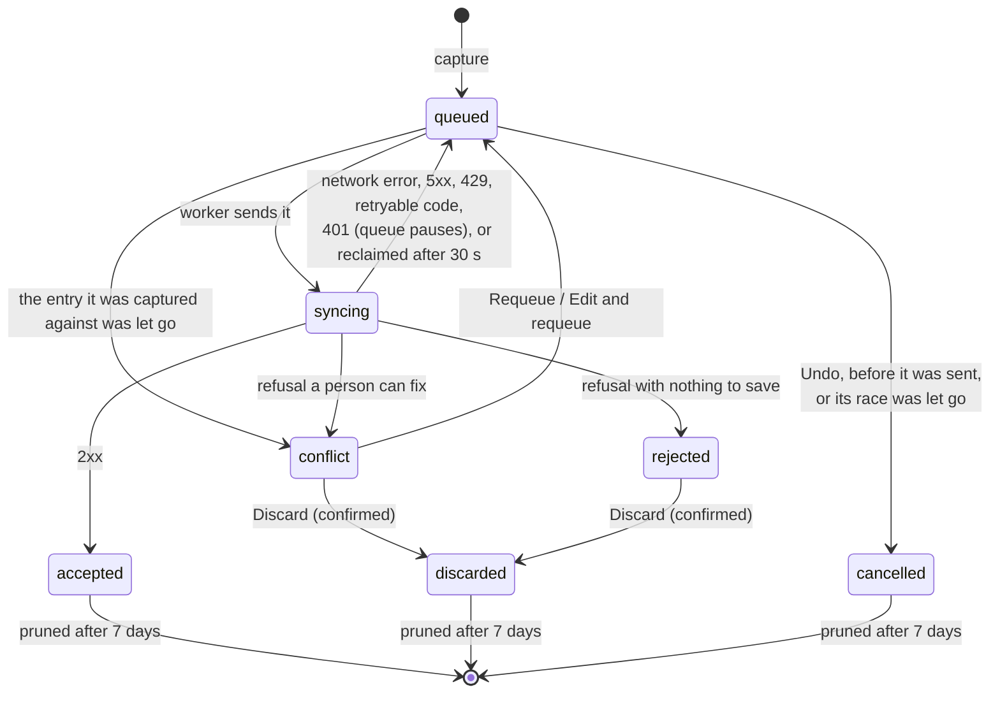
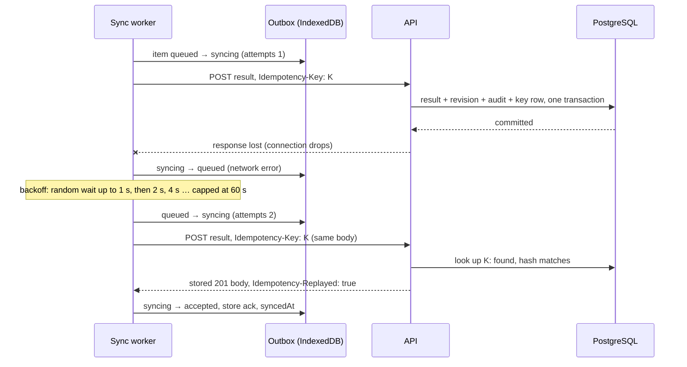

# Offline outbox and idempotency

Devices are online during a carnival and results appear live. The outbox exists so that a dropped connection, a killed app or a lapsed session never loses a capture: every write is saved on the device first, then delivered, and a retried delivery applies once. It is not a mode for running a carnival disconnected; reads still come from the server, with a cache that covers a short gap.

## What goes through it

**Captures on the deck** go through the outbox: results, attempts and high-jump marks, entries and relay teams, heat and lane placements, races minted on the deck, and house-point adjustments.

**Corrections** are sent directly while the device is online, so a stale-revision clash (`409 CONCURRENCY_CONFLICT`) reaches the official at once; if the request fails in transport, or the device is offline, the correction is queued instead (`results/correctResult.ts`).

**Administration** (carnival setup, schedule, event status, finalisation, settings, roster import, role assignment, voiding records and adjustments) calls the API directly and shows its result or error on the spot; it is not queued. So do two high-jump controls on the deck: raising the bar and setting attempts per height.

Reads go through TanStack Query; no write uses `useMutation` ([ADR-0012](../adr/0012-client-data-layer.md)).

A capture is:

1. written to IndexedDB with a client-generated UUIDv7, the signed-in official and a timestamp;
2. shown at once on the screen, built from the outbox row;
3. sent by the sync worker with that UUIDv7 as the `Idempotency-Key`;
4. marked `accepted` when the server answers 2xx, and pruned later.

## The outbox store

IndexedDB through Dexie, database `sports-platform`, table `outbox`, primary key `id`, indexed on `status`, `capturedAt`, `[status+syncedAt]` and `[status+resolvedAt]`.

| Field | Meaning |
|---|---|
| `id` | UUIDv7 minted at capture. The id of the row the write creates and, for every kind but `result.correct`, the `Idempotency-Key`. Sorts in capture order. |
| `kind` | What the write is (table below) |
| `payload` | The request inputs, plus a `display` block (student name, measure type) that is never sent and only feeds the screen |
| `actorSubject`, `actorDisplayName` | The official signed in at capture, never at sync |
| `capturedAt` | Capture time; sent as `recordedAtUtc` on result captures |
| `status` | State (below) |
| `attempts`, `lastError` | Send count and the last failure, for the outbox screen |
| `baseVersion` | Corrections only: the result revision the official was looking at |
| `serverResponse` | A narrowed copy of the server's answer (see [Acknowledgements](#acknowledgements)) |
| `syncedAt`, `syncingAt` | When it was accepted; when the current send started |
| `resolvedBy`, `resolvedAt` | Who let a parked item go, and when |
| `editedBySubject`, `editedByDisplayName` | A different official who edited a parked item before requeueing it |

Other tables: `syncMeta` (queue pause flag, last prune, storage-persistence result), `eventRosters` (cached eligible-student lists, see [Offline entry creation](#offline-entry-creation)) and `appSettings` (last-seen branding).

A schema upgrade never deletes, re-statuses or re-orders an outbox row.

### Kinds

| Kind | Request | Idempotency |
|---|---|---|
| `result.submit` | `POST /carnivals/{id}/events/{eventId}/entries/{entryId}/results` | key required; becomes the result id |
| `result.attempt` | `PUT …/entries/{entryId}/attempts/{ordinal}` | key required; becomes the result id if this attempt creates it |
| `result.jump` | `PUT …/entries/{entryId}/jumps/{height}` | key required; as above |
| `result.correct` | `POST /results/{resultId}/correct` | no key; `expectedRevision` makes a replay a `409` |
| `entry.create` | `POST …/events/{eventId}/entries` | optional key; becomes the entry id |
| `team.create` | `POST …/events/{eventId}/team-entries` | optional key; becomes the entry id |
| `entry.assign` | `PUT …/entries/{entryId}/placement` | optional key; deduplication only |
| `race.create` | `POST /carnivals/{id}/races` | optional key; becomes the race id. Nothing enqueues it; the transport still delivers one an older build queued |
| `race.materialise` | `POST /carnivals/{id}/races/materialise` | optional key; becomes the race id |
| `adjustment.create` | `POST /carnivals/{id}/adjustments` | optional key; becomes the adjustment id |

Every request also carries `X-Device-Id` (a per-device UUIDv7 kept in `localStorage`, not a credential) and the captured actor headers (see [authorisation and audit](authorisation-and-audit.md#the-captured-actor)). An unknown kind is refused locally as `rejected` and never sent.

## Item states

| State | Meaning |
|---|---|
| `queued` | Waiting to be sent. Never pruned. |
| `syncing` | A send is in flight. A row left here by a killed app is put back in the queue after 30 seconds (`reclaimStuckSyncing`), longer than any request the transport waits on. |
| `accepted` | The server applied it. |
| `conflict` | Refused, but the capture is real and a person can recover it. The only parked state with a way back into the queue. |
| `rejected` | Refused for good. Can only be discarded. |
| `cancelled` | Withdrawn in the undo window before the worker picked it up, or a queued placement into a race whose mint was discarded; the server never saw it. Stamped with `resolvedAt`. |
| `discarded` | Parked, then let go by a named official. |

`transition()` enforces this table inside a Dexie transaction and throws on any other move, so sync code never drops or resurrects an item. Nothing in the sync path deletes a row; only retention does.

## Idempotency: the server's half

`Idempotency/IdempotencyService.cs`. The key is the UUID from the `Idempotency-Key` header.

1. Look up the key. If it exists, **replay**: the same SHA-256 of the request body returns the stored status and body with `Idempotency-Replayed: true`; a different body is `422 IDEMPOTENCY_PAYLOAD_MISMATCH`. The hash covers the body bytes, not the route.
2. Otherwise open a transaction and run the handler. The handler mutates through the request's `DbContext` and never commits on its own.
3. **Only a 2xx is recorded.** The key row (key, payload hash, response status and body, session subject, device id, time) is inserted in the same transaction as the write and its audit event. Any other outcome rolls back and leaves the key unburned: refusals depend on server state, and a burnt key would strand a capture that would succeed later.
4. Two requests racing on one key: the loser's insert violates the primary key, and it replays the winner's stored response. A unique violation raised by the write itself (for example `ENTRY_EXISTS`) is not a key race and surfaces as the handler's own refusal.

Endpoints come in two shapes. Result captures use `IdempotencyEndpointFilter`, which requires the header (`400 IDEMPOTENCY_KEY_REQUIRED` without it). The create and placement endpoints use `OptionalIdempotency`: no header means an ordinary online create; a header that is present but not a UUID is a `400`, never silently treated as "no key". `UseIdempotencyBuffering` makes the body re-readable for hashing; if it is missing the server answers `500 IDEMPOTENCY_BUFFERING_UNAVAILABLE`, which the device retries.

Endpoints that adopt the key as the new row's id (results, entries, relay teams, races) also guard the id itself: a different row already holding it is `409 SUBMISSION_ID_CONFLICT`. Corrections carry no key; the revision the official saw (`expectedRevision`) is the replay guard, so a correction that landed and is resent comes back `409 CONCURRENCY_CONFLICT` and parks.

Key rows are deleted 30 days after creation by the server's retention sweep (school deployments on PostgreSQL; [ADR-0062](../adr/0062-retention-windows-for-operational-data.md)). A device prunes its own outbox long before then, so a late resend still replays its stored response. A device that resends a write after more than 30 days could apply it twice.

## The sync worker

`sync/syncWorker.ts`, created once in `api/syncSetup.ts` and started from `main.tsx`. Foreground only: no Background Sync is registered, because it is unreliable on iOS Safari.

### When it runs

- at start-up;
- every 15 seconds while idle;
- on the browser's `online` event (which moves the next tick rather than starting a second loop);
- immediately after a capture (`syncNow()`), coalescing onto a pass already in flight;
- after sign-in (`resumeAfterSignIn`), and from **Sync now** on the outbox screen.

A pass that drains cleanly and finds new work queued meanwhile runs one follow-up pass.

### A pass (`drainOnce`)

1. Stop if the queue is paused or `navigator.onLine` is false.
2. Reclaim stale `syncing` rows.
3. Read `queued` items in id order, which is capture order.
4. Skip, without stopping, an item that is waiting on something else on this device:
   - it names a race or entry (`raceId`, `entryId`) minted by another outbox item not yet accepted, so a result waits for its entry and a placement for its race;
   - it is a high-jump mark or card correction for an athlete whose earlier mark is parked, because marks on a card must reach the server in order.
5. Move the item to `syncing`, send it, classify the answer, and either continue or stop.

The pass **stops at the first item that should be retried**, so a later capture never overtakes an earlier one.

### Classifying the answer

The transport reads the machine code in the error body first and falls back to the status only when there is none (`api/outboxTransport.ts`, `api/errorCodes.ts`; the contract is [ADR-0011](../adr/0011-api-error-contract.md)).

| Answer | Outcome | Effect |
|---|---|---|
| 2xx | accepted | Store the narrowed ack and `syncedAt`; continue. |
| 401 | pause | Item back to `queued`; queue paused; pass stops. |
| Network failure, or 5xx (including `INTERNAL_ERROR`, `IDEMPOTENCY_BUFFERING_UNAVAILABLE`) | retry | Item back to `queued`; pass stops; worker backs off. |
| 4xx with a retryable code: `CARNIVAL_NOT_OPEN`, `EVENT_NOT_OPEN`, `ROSTER_SNAPSHOT_MISSING`, `NOT_ASSIGNED_OFFICIAL` | retry | Item back to `queued`; pass stops ("retry later"); next ordinary poll. |
| 429 (`TOO_MANY_REQUESTS`, or no code) | retry | Item back to `queued`; pass stops ("throttled"); worker waits (below). The rate limiter refuses before any key is stored, so the resend is safe. |
| A conflict code (concurrency, duplicates, finalised, validation, marshalling, eligibility, `IDEMPOTENCY_PAYLOAD_MISMATCH`, `REQUEST_INVALID`, `WRITE_REFUSED` and others in `CONFLICT_CODES`) | conflict | Parked for a person; continue. |
| `ENTRY_NOT_FOUND` on a result or placement; `CARNIVAL_NOT_FOUND`/`EVENT_NOT_FOUND` on `race.materialise` | conflict | Parked rather than rejected, since the missing row may be a parked create on this device. |
| Any other 409 or 422, with or without a code | conflict | Parked. |
| Any other 4xx (for example `403 FORBIDDEN`) | rejected | Terminal; continue. |

A code is retryable only when the same payload will succeed once server state moves on. A malformed or over-long body is a conflict, never a retry: the same bytes fail forever, and a retry holds capture order, so one item would block every later capture.

### Backoff

Only network errors and 5xx count as failures. The delay before the next pass is full-jitter exponential: a random value up to `min(60 s, 1 s × 2^(failures − 1))`. Any pass that ends another way resets the count. "Retry later" refusals and auth pauses do not back off; they wait for the 15-second poll or a resume.

A throttled pass (a `429`, which in practice only the public demo's per-address limit produces) waits the longest of: the 15-second poll, a full-jitter backoff on its own count (a random value up to `min(60 s, 15 s × 2^(throttles − 1))`), and the server's `Retry-After` in seconds when sent. Any pass that ends another way resets the throttle count. A throttled pass counts as the server reached, not as a failure.

### What pauses the drain

A `401` from any outbox request writes `outbox.paused` to `syncMeta` with a reason. While paused, no pass sends anything; nothing is dropped. The pause clears when a session is established again: the app adopts a valid server cookie at start-up, the official signs in, or someone taps **Resume queue** on the outbox screen. The server returns `404 ROUTE_NOT_FOUND`, not `401`, for an unmatched route, so a mistyped path cannot pause a device's queue.

### Retry sequence

## Acknowledgements

The row keeps only what its readers need (`sync/ackShape.ts`, [ADR-0051](../adr/0051-outbox-ack-narrowing.md)): for result kinds the result `id` and `currentRevision` (what a later correction bases itself on); for `race.materialise` the implausibility `warnings`; for creates nothing, because the item id already is the created row's id. A refusal keeps `error` and `detail`. Classification reads the full body before it is narrowed.

After each pass (`afterDrain` in `api/syncSetup.ts`):

- any acceptance marks every cached query stale without refetching, so each screen refetches when next shown;
- the reachability signal is updated: a pass stopped by a network error or a 5xx marks the server unreachable; a pass that got any other answer (a "retry later" or a throttle included) marks it reachable (`navigator.onLine` stays true when the venue access point is up and the uplink is dead);
- a pass that drained cleanly runs the retention sweep;
- the device status report is sent (below).

Other devices' captures reach a screen only when it re-reads: the event deck polls every 60 seconds while the server is reachable, and stops while it is not (`screens/EventResultsScreen.tsx`).

## Retention

`sync/retention.ts`, run at start-up and after each clean pass, using only indexed range deletes ([ADR-0013](../adr/0013-outbox-retention.md)).

| Rows | Kept |
|---|---|
| `queued`, `syncing`, `conflict`, `rejected` | until delivered or resolved; never on a timer |
| `accepted` | 7 days after `syncedAt`; the student name in `display` is stripped after 1 hour |
| `discarded` | 7 days after `resolvedAt` |
| `cancelled` | 7 days after `resolvedAt`; a row an older build left unstamped ages on `capturedAt` |
| cached rosters | 72 hours after fetch, and cleared on sign-out |

The server's audit trail is the durable record; the device's copy exists so an official can see their work landed. The outbox screen says so, and reports once how many finished items were tidied.

## The stuck-outbox alarm

`sync/stuckOutbox.ts` derives one cause, worst first, and `shell/StuckOutboxBanner.tsx` shows a full-width banner with one action:

| Cause | Condition | Action |
|---|---|---|
| paused | the queue is paused (immediately, no grace period) | Sign in to resume |
| stalled | online and the server reachable, something pending, and the oldest pending capture is 5 minutes old | Open the Outbox |
| parked | a `conflict` or `rejected` item 5 minutes old | Open the Outbox |

Being offline alone never raises the banner. The banner re-evaluates on a 15-second clock, since a queue that has stopped moving produces no database changes, so a stall or a parked item shows at most about 5 minutes 15 seconds after the capture. The paused banner is assertive (`role="alert"`); the others are polite.

While the device is offline or the server is unreachable, the shell's connectivity strip (`shell/AppShell.tsx`) names the backlog instead: "Offline" or "Can't reach the server", how many captures are waiting, and that they are saved on the device. It reads the same queue counts as the banner, so the two never disagree.

The header's outbox chip (`shell/OutboxIndicator.tsx`) shows the counts at all times: pending, needing attention, paused, or all synced.

## The outbox screen

`screens/OutboxScreen.tsx`, at `/outbox` ([ADR-0025](../adr/0025-outbox-recovery.md)). It names students captured by other officials, so a signed-out device gets a sign-in offer there instead of the queue; the header chip and the banner show counts only and stay visible. Signed in, it shows:

- the device's id (last eight characters, as the organiser's Devices panel shows it), counts by state, the pause notice with **Resume queue**, and **Sync now**;
- **Waiting or needing attention**: queued, syncing, parked and cancelled items in capture order, each naming exactly what was captured, by whom, any edit, and the server's refusal;
- **Synced or discarded**: the last 50 accepted and every discarded item.

Recovery actions on a parked item need a signed-in official, who is recorded:

| Action | Available on | Effect |
|---|---|---|
| Requeue | `conflict` | Back to `queued` with the same id, so it keeps its place and a replay is still deduplicated |
| Edit and requeue | `conflict` on a result submit, a typed correction or a non-foul attempt | Changes the value, records the editor beside the original capturer, requeues |
| Discard… | `conflict`, `rejected` | Two-step confirm; `discarded` with `resolvedBy` and `resolvedAt` |

A correction parked on `CONCURRENCY_CONFLICT` cannot be requeued (resending the same revision parks again); it must be retyped from the event's deck or let go. A high-jump card correction is redone from the card.

Discarding a create also settles what was queued behind it: queued entry and relay adds into a race that will never exist are re-pointed to no heat; results captured against a let-go entry are parked with a note to retype them; other queued placements into that race are cancelled.

## Storage persistence on iOS Safari

IndexedDB is evictable until the browser grants persistent storage; iOS may clear an unsynced site's data after about seven days or under storage pressure. At every start-up the app calls `navigator.storage.persist()` (`sync/storagePersistence.ts`) and records the result in `syncMeta`. If the grant is refused or unsupported, the outbox chip carries a warning that queued work may be cleared if left unsynced. Installing the PWA to the home screen gives the best chance of a grant.

## Device sync status

Each device tells the server how its queue stands, so an organiser can see captures that have not arrived ([ADR-0034](../adr/0034-organiser-queue-visibility.md)).

**Reporting.** After a pass, `reportDeviceStatus` sends `PUT /carnivals/{id}/devices/{deviceId}/sync-status` with counts only: pending (`queued` + `syncing`), parked (`conflict` + `rejected`), the oldest pending capture time and the app version. It reports only with a selected carnival and the platform online; at once when the pass moved something or on first contact; otherwise at most once a minute, and only while something is outstanding. A report gives up after 10 seconds, and failures are silent. There is no registration step: first contact makes the device known.

**Server.** Any role that can view carnivals may report, but only for itself: `X-Device-Id` must match the route (`403 DEVICE_ID_MISMATCH`), and the id must be at most 64 letters, digits, `-`, `_`, `.` or `:`. Display name and app version are truncated to fit (128 and 32 characters) rather than refused. The row, keyed by carnival and device, is last-write-wins and not audited. It records last seen, last drain (set only when the pending count falls), the counts, the oldest pending time (clamped to server time), the last subject and display name, and the app version. No student data is sent.

**Organisers.** `GET /carnivals/{id}/devices` needs `carnivals:administer` and returns the fleet with the server's clock, so the app can correct for skew. The Manage screen's Devices panel and a dashboard row classify each device:

| State | Condition |
|---|---|
| reporting | heard within 15 minutes |
| quiet | not heard for 15 minutes, nothing pending (a drained device stops reporting by design) |
| not reporting | not heard for 15 minutes with captures pending |
| not draining | still reporting, captures pending, nothing drained for 15 minutes; a signed-out device looks like this |

Finalising a carnival shows a warning for not-draining, not-reporting or parked devices, or if the list could not be read. Confirming past not-draining or not-reporting devices sends a reason the audit keeps ("Finalised with 2 devices not drained (5 captures not yet on the server)."), and an unreadable list sends its own; otherwise the server's default reason stands. The warning does not block: an offline device and a lost one look the same from the server, and a hard gate would give any one device a veto over publication.

## Offline entry creation

A marshal can add a late competitor while the connection is down ([ADR-0010](../adr/0010-offline-entry-creation.md)):

- The eligible-student list for an event (`GET …/eligible-students`) is cached in `eventRosters` when fetched, so search works from the cache. The cache records whether the server truncated the list. It is cleared on sign-out or handover and pruned after 72 hours.
- Adding a student enqueues `entry.create` whose item id is the new entry's id and its idempotency key. The entry appears at once, built from the outbox row; its lane stays empty until the server assigns one.
- A result can be captured against the queued entry immediately. The worker holds the result until the entry is accepted, then sends it.
- The server applies the same eligibility rules whoever minted the id. A refusal parks the add for a person; letting it go parks any results captured against it rather than dropping them.

## In the code

- `app/src/db/db.ts`: Dexie schema and upgrades
- `app/src/sync/outbox.ts`: enqueue, transitions, dependencies, recovery operations
- `app/src/sync/syncWorker.ts`: drain pass, scheduling, backoff
- `app/src/api/outboxTransport.ts`, `app/src/api/errorCodes.ts`: requests per kind, response classification
- `app/src/api/syncSetup.ts`: worker wiring, after-drain housekeeping, device reports
- `app/src/sync/ackShape.ts`, `retention.ts`, `stuckOutbox.ts`, `storagePersistence.ts`, `deviceReporter.ts`, `uuidv7.ts`
- `app/src/screens/OutboxScreen.tsx`, `app/src/shell/OutboxIndicator.tsx`, `app/src/shell/StuckOutboxBanner.tsx`
- `app/src/devices/deviceFleet.ts`, `app/src/features/devices/DevicesPanel.tsx`
- `app/src/entries/submitEntry.ts`, `app/src/db/roster.ts`
- `api/src/CarnivalApp.Api/Idempotency/`: key handling
- `api/src/CarnivalApp.Api/Carnivals/DeviceEndpoints.cs`: device sync status
