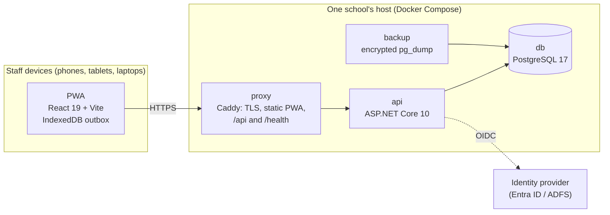
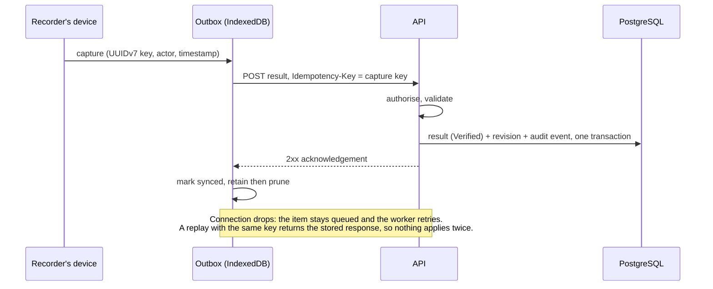

# Architecture overview

Carnival App is a progressive web app (PWA) backed by an ASP.NET Core API and PostgreSQL. Each school runs its own isolated stack; nothing is shared between schools.

## Components

| Component | Responsibility |
|---|---|
| **PWA** (`app/`) | Every screen. Reads through the API; writes results and entries through a local outbox so a dropped connection never loses a capture. Installable; works on iOS Safari, Android, Chromebooks and desktops. |
| **proxy** (`deploy/Caddyfile`) | The only published service. Terminates TLS, serves the built PWA, forwards `/api/*` and `/health` to the API on the same origin, sets security headers. |
| **api** (`api/`) | All authority: authentication, authorisation, validation, the result lifecycle, scoring, audit. Versioned JSON API under `/api/v1`. |
| **db** | The system's state. Two roles: one owns the schema and runs migrations, the other (used by every request) has data access only, with updates and deletes revoked on the audit table. |
| **backup** | Writes an `age`-encrypted `pg_dump` on an interval and prunes old dumps. |

The proxy and API share an `edge` network; the API, database and backup share an internal `data` network, so the proxy has no route to Postgres. See [self-hosting](../admin/self-host.md).

## The API

Minimal-API endpoints grouped by feature folder in `api/src/CarnivalApp.Api/`:

| Folder | What it owns |
|---|---|
| `Carnivals/` | Carnivals and their lifecycle, event definitions and templates, divisions, schedule, races (heats and lanes), entries and relay teams, results and corrections, field attempts and high-jump ladders, device sync status |
| `Scoring/` | Placings, house standings, progress for the dashboard, bonus and novelty adjustments |
| `Records/` | School records: detection, minting on carnival finalisation, administration |
| `Reporting/` | Results book and CSV exports, district team selection |
| `Imports/` | Roster import: staging, validation, reconciliation review, promotion |
| `School/` | School settings (name, houses, colours, brand) |
| `Identity/` | Sign-in providers, the four roles, group → role mapping, in-app role assignment |
| `Auditing/` | Append-only audit events; the acting user and role on every write |
| `Idempotency/` | `Idempotency-Key` handling so a retried request applies once |
| `Http/` | The error contract (stable error codes), rate limiting, field limits, OpenAPI |
| `Data/` | EF Core context, entities and configurations, the retention sweep for operational rows |
| `Demo/` | Public demo mode: a database per visitor (off in school deployments) |

### Request pipeline

In order, for every request:

1. **Forwarded headers**: honour `X-Forwarded-Proto` from the proxy, so redirects and OIDC callbacks use `https`.
2. **Exception handler**: unhandled faults become the standard error response; database serialisation conflicts become `409 CONCURRENCY_CONFLICT`.
3. **Status-code pages**: the framework's own bodyless refusals get the standard error body: `404 ROUTE_NOT_FOUND`, `405 METHOD_NOT_ALLOWED`, `415 UNSUPPORTED_MEDIA_TYPE`.
4. **Demo guard** (demo mode only): refuses roster imports and marks responses `noindex`.
5. **Idempotency buffering**: lets a response be stored against its `Idempotency-Key`.
6. **Authentication**: the session cookie, set by the server-side OIDC sign-in (no token ever reaches the browser).
7. **Unmatched routes** answer `404 ROUTE_NOT_FOUND`, not the fallback `401`: the outbox pauses all syncing on an authentication error, so a typo'd route must not look like a sign-out.
8. **Authorisation**: every endpoint names a policy; the four roles map to policies on the server.
9. **Rate limiting**: report exports and roster uploads, per signed-in subject (demo mode also limits every request per client address). Ordinary carnival traffic is not rate-limited.
10. **Endpoint**: validates, applies the change, writes the audit event, and returns.

Errors are always JSON, `{error, detail}`, with a stable code in `error` (for example `RESULT_FINALISED`, `CONCURRENCY_CONFLICT`); the app maps codes to messages and decides whether a queued write should retry. Over-long text fields are refused up front as `400 VALIDATION_FAILED` against the column sizes in `Http/FieldLimits.cs` (measured trimmed), so they never reach PostgreSQL as a retryable `500` that would stall the outbox.

## The app

`app/src/`:

| Folder | What it owns |
|---|---|
| `api/` | The typed client (types generated from the API's OpenAPI document), query keys, error-code text, outbox transport |
| `auth/` | Session state, sign-in hand-off to the server, idle sign-out on shared devices, device ID |
| `db/` | IndexedDB (Dexie): the outbox and a cached roster |
| `sync/` | The outbox, the sync worker, retention of acknowledged and cancelled items, the stuck-outbox alarm, UUIDv7 keys |
| `screens/` | One component per route |
| `features/` | Feature components shared across screens (results, races, records, standings…) |
| `shell/` | App frame: navigation, outbox indicator, toasts, theme and outdoor (high-contrast) mode |
| `tokens.css`, `tokens.json` | The design tokens; no colour or size literal lives anywhere else |

Server state is read through TanStack Query. The app never decides authority: hiding a button is a convenience, the API's `403` is the rule.

## How a result travels

- A result is **Verified on arrival**: validation is automatic. A correction writes a new revision with a reason, never an overwrite.
- **Standings are computed on read** from the current results and adjustments, so a correction is reflected immediately.
- **Finalising a carnival** turns its results **Final** (no further corrections) and mints any new school records.
- An item the server refuses for good (for example, a result for an entry since removed) is shown on the device's outbox screen for a person to resolve. A stuck outbox raises a banner rather than failing silently.

## Deployment shapes

| Shape | Database | Sign-in |
|---|---|---|
| School deployment | PostgreSQL, one per school | Entra ID or ADFS (built-in accounts planned) |
| Local development | SQLite, seeded with synthetic data | development header sign-in |
| Public demo | PostgreSQL, one database cloned per visitor from a seeded template | anonymous demo session cookie; imports refused |

## Where to go next

- Decisions behind this shape: [ADR-0001 technology stack](../adr/0001-technology-stack.md), [ADR-0002 offline sync](../adr/0002-offline-sync-design.md), [ADR-0047 the database stays on the host](../adr/0047-the-database-stays-on-the-host.md)
- Running it: [self-hosting](../admin/self-host.md)
- Developing it: [local development](../development/local-dev.md)
