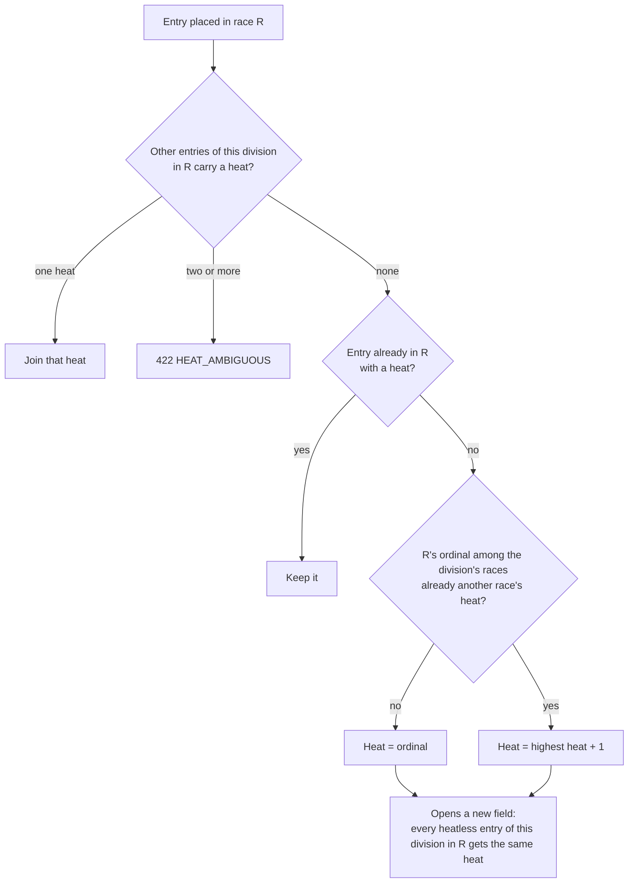
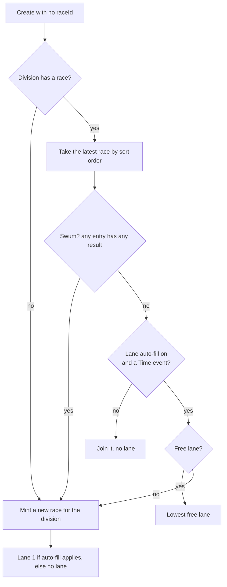

# Races, heats and lanes

A swimming or track division usually draws more competitors than the venue has lanes, so it is run in several passes. Three separate ideas model this ([ADR-0015](../adr/0015-heats-races-and-lanes.md)):

| Idea | Stored as | Scoped to | What it answers |
|---|---|---|---|
| **Race** | `Race` row | carnival | What goes off together. Owns the lanes. |
| **Heat** | `Entry.Heat` (1–99) | division (`CarnivalEvent`) | Whose field is this: the placing unit for Time events. |
| **Lane** | `Entry.Lane` | race | Where in the race. Unique per race; needs a race. |

Heats and lanes are assigned live at the marshalling point, with no seeding, and stay correctable after a result lands. The heat number is never typed on the deck: the server derives it from race membership, so a placing pool cannot split on a tap.

## Races

A race belongs to a carnival. It carries:

- **`CarnivalEventId`**: the division it was minted for. This is attribution, not ownership: it is how an empty race is found for its division. A race may still hold entries of more than one division, and a race created through `POST …/races` carries no division.
- **`ScheduleSlotId`**: optional. A race may sit in one schedule slot of kind `Events`; the schedule is advisory and a race with no slot runs exactly the same.
- **`SortOrder`** and **`Label`**: display only. A new race is appended after the carnival's last race.

A division's races are the races stamped with it **plus** any race holding one of its entries, ordered by `SortOrder` then id. The deck and the server use this same rule (`racesOfEvent` in the app, `DivisionOrdinalAsync` on the server), so the number on the deck and the stored heat agree.

| Endpoint | Policy | Purpose |
|---|---|---|
| `GET /carnivals/{id}/races` | view | Every race with its entries in lane order (unlaned last) |
| `POST /carnivals/{id}/races/materialise` | marshal | Mint a race for one division (the deck's only way to create a race) |
| `POST /carnivals/{id}/races` | administer | Create an unstamped race. No screen uses it |
| `PUT /carnivals/{id}/races/{raceId}` | administer | Replace slot and label; an omitted sort order keeps its place. No screen uses it |
| `DELETE /carnivals/{id}/races/{raceId}` | administer | Delete a race. No screen uses it |
| `PUT /carnivals/{id}/events/{eventId}/entries/{entryId}/placement` | marshal | Set or clear an entry's race, lane and heat |

Race changes are refused only once the carnival is Finalised; races can still be tidied when it is Closed. Materialising and placing follow the capture gates instead (carnival Draft or Open, division Scheduled or Open; see [result lifecycle](result-lifecycle.md)).

A create or materialise with an `Idempotency-Key` adopts the key as the race id. If its schedule slot was deleted or changed kind while the item sat in the outbox, the race is created unscheduled rather than refused (refusing would strand every queued placement naming that id); the audit row records the slot it asked for. Without a key, a bad slot is refused (`SCHEDULE_SLOT_NOT_FOUND`, `SCHEDULE_SLOT_KIND_MISMATCH`).

### Deleting a race

Deletion is API-only: there is no control for it in the app, so **an empty heat cannot be removed from the deck**. Deleting detaches every entry (race and lane cleared) but **keeps each entry's heat**, so recorded results stay in the same placing pool. The audit row counts the entries detached. If an entry is placed in the race while it is being deleted, the delete answers `409 CONCURRENCY_CONFLICT` and the race stays; re-read and retry.

## Lane count

The lane count is venue configuration, one per carnival, held in the carnival settings with `autoFillLanes` beside it ([configuration](../admin/configuration.md)). Both are edited under **Manage → Lanes**.

- 1 to 64. With none set, a lane is bounded only by the ceiling of 64.
- It cannot be lowered below a lane already assigned in the carnival (`LANE_COUNT_INVALID`).
- `autoFillLanes: true` needs a lane count (`AUTO_FILL_LANES_REQUIRES_LANE_COUNT`): "the race is full" is the only thing that starts the next race, and no count is ever assumed.

## Heat numbers

A placement may name a heat explicitly (1–99; only API callers do). Otherwise the server derives it when an entry joins a race:

- **The heat is the race's ordinal** within the division ("Heat 2" on the deck is heat 2 in scoring). The fallback to highest + 1 applies only where that number is already taken by another race of the division (legacy data or an explicit heat), because taking it would merge two placing pools. Existing heats are never renumbered. Past 99 the placement is refused (`ENTRY_HEAT_INVALID`).
- **Opening a field heats the whole cohort**: every heatless entry of the same division already in the race gets the new heat in the same write, so one field never becomes two pools with two winners.
- **Clearing a placement clears the heat.** Materialising a race and deleting a race never touch heats.

### Concurrent heat opening

Only a placement that opens a new field increments the division's `Version` (its concurrency token), so ordinary marshalling takes no contention. If two marshals open fields in one division at the same moment, the loser's save fails on the token; the server discards the attempt and **re-derives**, so it joins or numbers after the winner's heat rather than duplicating it. After 4 attempts it answers `500 INTERNAL_ERROR`, which the outbox retries. On the entry-create path (below), exhausting the attempts leaves the entry created and unplaced instead.

## Placing an entry

`PUT …/placement` replaces the whole placement: `{ raceId, lane, heat }`.

- `{ raceId: null }` clears race, lane and heat (the deck's **Remove**).
- `{ raceId: R, lane: null }` puts the entry in R without a lane: an ordinary state, and the heat is kept or derived as above.
- A lane without a race is refused (`ENTRY_LANE_INVALID`): stored alone it would bind to whichever race the entry joined later.
- A lane must be 1 to the lane count (64 with none set) and free in that race. The unique `(RaceId, Lane)` index decides under concurrency; a lost claim answers `409 LANE_TAKEN`.
- An unknown or concurrently deleted race answers `404 RACE_NOT_FOUND`.
- The race does not have to belong to the entry's division: a race may hold several divisions' heats.
- An entry with a result can still be placed: placement is correctable. The deck limits this (see below).

Every placement is audited as `entry.marshal` with the prior and new placement, any cohort the heat covered, and the capturing person and device.

## Creating entries in a race

No create leaves an entry raceless by design ([ADR-0039](../adr/0039-the-heat-is-the-context.md)). Individual and relay creates accept an optional `raceId` (a create may state a heat but never a lane). The placement runs inside the create, so a replayed outbox create returns the same placement.

**With a `raceId`** (the heat the marshal is standing at):

- It must name a race of this carnival that is stamped with the division or already holds one of its entries. Otherwise, including an unknown id, the create is refused with `422 RACE_NOT_IN_EVENT` **before the entry exists**, so nothing is written and the outbox item parks.
- The entry joins that race whatever its state: fullness and swum state are the marshal's call. With lane auto-fill on (Time events only) it takes the lowest free lane; in a full race, or with auto-fill off, it joins without a lane.
- If that placement cannot succeed (an ambiguous heat, contention, the race deleted), the server falls back to the rule below.

**Without a `raceId`** (an API caller, or a device that has not read the division's races) the server picks the place:

- **Latest** is the highest `SortOrder`, so reordering races changes which race fills. Earlier races are never considered: a gap left in an earlier heat by a removal or a swap may be in a heat that has already swum, and is never refilled automatically.
- **Swum** means any entry in the race has any result, a DNS included: a late swimmer would re-rank a heat already contested.
- **A race minted here holds only the new entry.** It does not sweep the division's unplaced entries, so a swimmer removed from a race (scratched) is not dragged back onto the deck.
- **Auto-fill never moves an existing swimmer**, and ticking the box does not back-fill entries already unplaced.
- **The entry is the record, the lane is a convenience.** A lane lost between the pick and the write is retried at the next free lane; a permanent refusal is not retried. After 4 attempts the create still succeeds and the response says where the entry actually is, possibly in no race. When the create finishes, whether it placed the entry or gave up, any race it minted that is still empty is deleted, audited as `race.delete` with `autoFillAbandoned: true`, so no create leaves an empty heat the deck cannot remove (a retry can land in a different race from the one an earlier attempt minted).
- The audit row marks an auto-filled lane `autoFilled: true` beside the creating person: a person created the entry, the system chose the lane.

A keyed (outbox) create runs the entry, any mint and the placement in one transaction. An unkeyed create commits them separately, so a crash between them can leave the entry unplaced.

Lane auto-fill applies only to Time-measured events. Distance, Height and Count entries still join a race, but never get a lane.

## Materialising: minting a race for a division

`POST …/races/materialise { eventId, scheduleSlotId?, label? }` mints one race stamped with the division, as one server operation. It **sweeps** every entry of the division that is in no race into the new race (membership only: lanes empty, heats untouched). Entries already in a race stay put, which makes a replay safe. A division with no entries can be materialised. If more entries join than the venue has lanes, the response carries a warning but the mint succeeds (a mass start is legitimate).

It is on the marshal policy, not administer, because the deck mints races lazily: without it a marshal could not place a division's first swimmer.

## On the deck

The deck (`EventResultsScreen`) shows one heat at a time for a Time event. Field events show no heat picker.

- **Heats are a selection axis.** The heat picker lists the division's races labelled "Heat N" by ordinal, each with its progress. The selected heat is URL state (`?heat=<raceId>`) and defaults to the **last** heat, the one being filled. A division with no race shows a prospective Heat 1. Entries in no race show under the first heat, marked "no heat".
- **Adding a swimmer** sends the selected heat's `raceId`. Where the division has no race yet, the device queues a `race.materialise` first and the create waits in the outbox behind it. Off an unresolved races read it names no race and the server places the swimmer.
- **"New heat"** is the last item of the heat picker. It queues a `race.materialise` and selects the new heat; the device moves nobody (any raceless entry of the division is swept in by the server). It is disabled, with the reason shown, while the races read is unresolved (a mint off an unknown state could duplicate a race), while the division has no entries (an empty heat cannot be removed from the deck), while this device's mint for the division is in flight, queued or refused.
- **The lane control** on each row lists free lanes grouped by heat, then swaps, then **Remove**. A lane in the row's own heat is one tap; a lane in another heat moves the swimmer between placing pools and arms a confirm, as does Remove. A swimmer with a result is offered only their own race and leaves it only through Remove. Lanes above the venue's count are not offered. Pointer and touch picks commit at once; keyboard arrows move the highlight and commit on Enter or blur, and Escape abandons.
- **Lane pending**: with auto-fill on, a newly added swimmer shows "lane pending" until the server's placement comes back.
- **Marshalling is paused** while the races read is unresolved: lane controls are drawn but disabled, so a tap never acts on a guess.

### One mint per device

The server has no duplicate-race guard, so the deck guards against minting twice:

- A per-division claim, taken before the first `await`, so two taps in one tick cannot both mint.
- A **held mint**: once this device has minted a heat for the division, later lane picks and adds join that race (while its outbox item is queued, syncing or accepted) instead of minting another. A refused or discarded mint releases it.
- A queued or refused `race.materialise` for the division disables "New heat".

These guards are per device. Two devices adding a heat at the same moment make two races; two devices finding the latest race full at once can mint two races, one holding a single swimmer.

### Lane swap

Two swimmers in each other's lanes is a routine fix ([ADR-0030](../adr/0030-lane-swap.md)). A row holding a lane lists each other occupied lane of the **same race** as "swap with *name*", and picking one arms a confirm. The swap is three ordinary `entry.assign` placements, enqueued in order before one sync nudge:

| # | Entry | Placement |
|---|---|---|
| 1 | A (tapped) | race R, no lane |
| 2 | B | race R, A's old lane |
| 3 | A | race R, B's old lane |

No write carries a heat, so a swap has no scoring effect. It is not a transaction: if a middle write is refused, the tapped swimmer is left without a lane (shown, and recoverable), never two swimmers in one lane. Swaps are never offered for lanes above the venue's count, nor while marshalling is paused. Moving swimmers between races is two independent placements.

### Rendering the race over the outbox

The races read is authoritative but not current. Each roster folds in this device's undelivered placements (`features/races/raceLanes.ts`): the newest placement per entry speaks for the row while it is queued or syncing. An **accepted** placement overlays the read only while it is newer than that read (`acceptedAfter`: acknowledged at or after the read's fetch time). Accepted items are retained for days, so without that bound an old acknowledgement would override a newer move from another device. With no successful read, nothing accepted overlays. A minted race that the read does not yet carry is shown from its outbox item, sorted after every race the server has positioned.

## Ranking

The heat is the placing unit for **Time** events only: each heat has its own 1st, 2nd and 3rd, and entries with no heat form their own field. **Distance, Height and Count** events rank across the whole division, whatever their races. Records and district selection always rank the whole division. See [scoring](scoring.md#two-ladders-over-one-set-of-results).

## In the code

- `api/src/CarnivalApp.Api/Carnivals/RaceEndpoints.cs`: race CRUD, placement, heat derivation, materialise, auto-fill and the context race
- `api/src/CarnivalApp.Api/Carnivals/EntryEndpoints.cs`: `raceId` on create, `PlacedAsync`
- `api/src/CarnivalApp.Api/Scoring/CarnivalSettings.cs`: lane count and auto-fill validation
- `app/src/screens/EventResultsScreen.tsx`: the deck, the mint guards, "New heat", the lane control wiring
- `app/src/features/races/`: `heats.ts`, `divisionRaces.ts`, `raceLanes.ts`, `deckPlacement.ts`, `HeatPicker.tsx`, `EntryLaneControl.tsx`, `VenueLanesEditor.tsx`
- `app/src/races/assignEntry.ts` (placements, swap), `app/src/races/submitRace.ts` (mints)
- Tests: `AutoFillLaneTests`, `ContextRaceTests`, `PlacementConcurrencyTests`, `RaceEndpointsTests`, `RaceLaneUniquenessTests`, `HeatScoringTests` in `api/tests/CarnivalApp.Api.Tests/`
