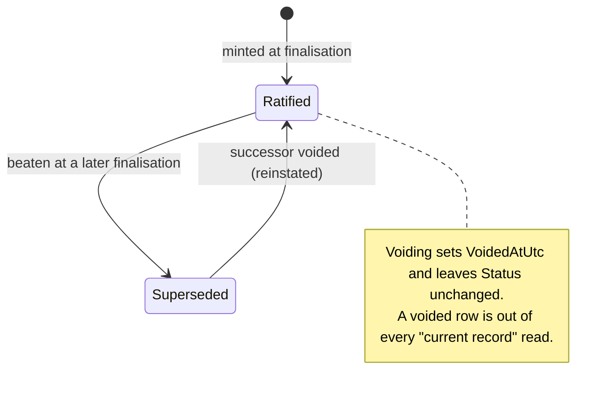
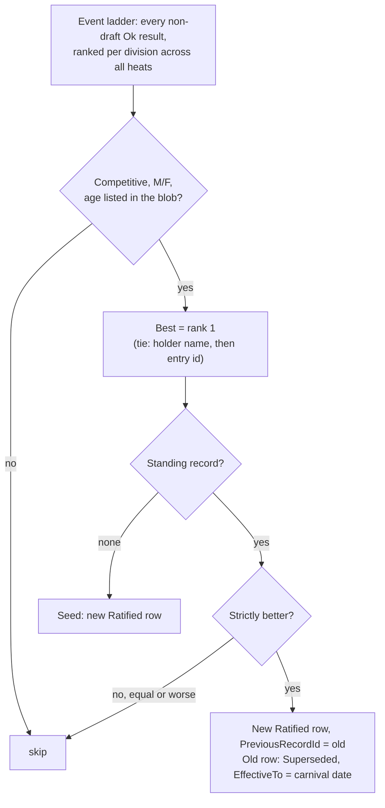

# Records

The platform keeps a school record book: the best mark ever set in each record category at a finalised carnival. Records are **minted by carnival finalisation and by nothing else**. There is no manual entry, no edit and no recalculation; an administrator can only void a record that should never have been set.

## Record categories

A record category is **(event definition, age group, competition category)**, for example *Freestyle 50m, 13, Girls*. A relay is its own definition, so relay records are separate from individual ones.

Eligibility is declared on the event definition in `RecordCategoriesJson`:

```json
{ "ageGroups": ["12", "13", "14"], "categories": ["M", "F"] }
```

- Null means the definition holds no records.
- The blob is read **failing closed**: unreadable JSON, an empty list, a blank age or an unknown category means the definition mints nothing. A missing record can be set at the next carnival; a false one would sit in the book. An `OPEN` age in a stored blob is skipped rather than failing it: the other ages still mint, and a blob naming only `OPEN` mints nothing.
- Event templates write the blob. A definition with `"schoolRecords": true` gets the template's age groups and categories; `false` gets null. The in-app event editor does not expose it.
- A definition create or update naming `OPEN` in `ageGroups` is refused (`400 VALIDATION_FAILED`): an all-ages division has no shelf in the book.
- Once any record row (voided rows included) cites the definition, the blob is frozen: a definition update that changes it is `409 RECORD_CATEGORIES_FROZEN`, and template reconciliation leaves it alone. The comparison is by the categories the blob means, so a re-serialised but equivalent blob is accepted, as is an update that only removes a stored `OPEN` age.

A division of a carnival event mints a record only when all of these hold:

| Condition | Why |
|---|---|
| The division's tier is **Competitive** | Social events never set records. Read from the carnival event, not the definition, because tier is per division |
| Its category is **M or F** | An Open (`S`) or category-less division is not a record category |
| Its age group is a single age listed in the blob | An all-ages (`OPEN`) division, such as the open house relay, has no shelf in a book indexed by age |
| It has at least one ranked result | Only `Ok` results with a value are on the event ladder; DNS, DNF, DQ and NM never are |

Whether the event scores house points does not matter. All four measure types are eligible, each compared in its own direction (lower Time wins; higher Distance, Height and Count win). Wind is not recorded and does not gate records.

## The standing record

The standing record for a category is the row with `Status = Ratified`, `EffectiveTo = null` and `VoidedAtUtc = null`. Should two such rows exist (possible only under concurrent finalisations), every read picks the same one: best value, then earliest `EffectiveFrom`, then id.

## Record states

`SchoolRecordStatus` has four values; two are used.



- **Ratified**: every minted row starts here. Finalisation is the ratifying act: one per carnival, not one per record ([ADR-0017](../adr/0017-automatic-result-validation.md)).
- **Superseded**: closed by a better mark; `EffectiveTo` is set.
- **Candidate** and **RejectedCandidate**: never written. They remain in the enum unused.
- **Voided** is not a status: it is `VoidedAtUtc`, `VoidedBySubject` and `VoidReason` on the row.

## Minting at finalisation

When a carnival is finalised (`CarnivalEndpoints.FinaliseCarnivalAsync`), record detection runs inside the same transaction, after every result is moved to Final. If minting fails, or the finalisation is refused at its final re-check, nothing is finalised and nothing is minted. See [ADR-0028](../adr/0028-records-and-district-selection.md).



- **Seeding.** An empty category takes the carnival's best, having beaten nothing. The book starts empty; there is no import of historical records.
- **Beating is strict.** Equalling a record does not supersede it; the earlier holder stays.
- **Ties for a new record** mint one row, chosen by the ladder's deterministic order. The other swimmer's equal mark stays an ordinary result.
- **The new row** stores the result id, the value, the holder's display name as captured on the entry (a relay's is the team entry's name), `EffectiveFrom` = the carnival's date, and the finaliser's subject, the finalisation time and reason in `ApprovedBySubject`, `ApprovedAtUtc` and `ApprovalNote`.
- **Back-dated carnivals.** If the superseded record's `EffectiveFrom` is later than this carnival's date, `EffectiveTo` is clamped to it rather than going negative.
- **Audit.** One `school-record.mint` event per minted record (with the superseded value and holder where there was one); the finalisation's own audit event carries the count as `recordsSet`.

## Administration: voiding

`/school/records` (the School area) lists every standing record and every voided one, grouped by event. Superseded rows are not listed. The screen needs the carnival administrator role, works online only, and has one action: **Void**, behind a two-step confirmation that requires a typed reason. See [ADR-0035](../adr/0035-records-administration.md).

`POST /api/v1/records/{id}/void` with `{ "reason": "…" }`:

- The row is never deleted and its value, holder and date never change. Voiding is one-way; a second void is `409 SCHOOL_RECORD_ALREADY_VOIDED`.
- A voided record is absent from the book, cannot be beaten and does not block: the next carnival can seed the category with a slower genuine mark.
- **Reinstatement.** Voiding the standing record walks `PreviousRecordId` back to the first non-voided predecessor and makes it stand again (`Ratified`, `EffectiveTo = null`). If there is none, the category is empty until a finalisation seeds it. Nothing is reinstated if another row already stands in the category.
- The void runs in a transaction and re-checks the category just before saving; a concurrent change answers `409 CONCURRENCY_CONFLICT` and voids nothing.
- One `school-record.void` audit event names the reinstated record, if any.

Voiding changes the record book only. The finalised result behind it, the results book and any exported district list are unchanged.

## How records appear in the app

| Surface | Source | Shows |
|---|---|---|
| **Record badge** on the deck row and in the results book | `GET /api/v1/records`, compared on the device | "record" on a result strictly better than the standing record for its division. Competitive divisions only (the tier is a required prop of `RecordBadge`). Inert while the book is empty |
| **Records today** on the dashboard | `GET …/progress` (`recordsToday`) | The best mark in each eligible division that beats (`new`) or equals (`equalled`) a standing record, labelled *candidate*; empty, "No record candidates yet". Nothing when the category has no record yet. Once the carnival is finalised, `new` rows are the records it minted (a first-ever seed and a voided mint are not shown), each beside the record it superseded, and the strip labels rows *new record* or *record equalled*; empty, "No records set at this carnival" |
| **School records** on the Reports screen | `GET /api/v1/records?sport=` | The standing book for the carnival's sport, printable; once finalised, the records set at this carnival |
| **School records** in the School area | `GET /api/v1/records/administration` | Standing and voided rows, with void reason, who and when |

`GET /api/v1/records` needs only the view permission (a record book is public within the school), excludes voided rows and never carries who voided what. It sits outside `/reports/` so the service worker caches it and the badge works at the venue; the administration route is not cached. `higherBetter` and `formattedValue` are computed by the server so the client never re-derives measure semantics.

## District selection

The district list is not built from the record book but from the same event ladder, so the two cannot disagree about who swam fastest. `GET /api/v1/carnivals/{id}/reports/district.csv` (carnival administrators, finalised carnivals only, otherwise `409 CARNIVAL_NOT_FINALISED`) lists the top two individual entries of each Competitive division across all heats; a tie at second gives three rows. Columns: event code, event, division, selection, name, year level, result. No house, category, student id or birth date.

## Not built

A per-school setting to turn records off is planned (see `docs/HANDOFF.md`). Today every school with record categories on its definitions keeps a book.

## In the code

- `api/src/CarnivalApp.Api/Records/RecordDetection.cs`: minting, standing-record order
- `api/src/CarnivalApp.Api/Records/RecordCategories.cs`: eligibility blob parser
- `api/src/CarnivalApp.Api/Records/RecordEndpoints.cs`: book, administration read, void and reinstatement
- `api/src/CarnivalApp.Api/Scoring/EventLadder.cs`: the division ladder
- `api/src/CarnivalApp.Api/Carnivals/CarnivalEndpoints.cs`: `FinaliseCarnivalAsync`
- `api/src/CarnivalApp.Api/Scoring/ProgressService.cs`: records today
- `api/src/CarnivalApp.Api/Reporting/DistrictSelection.cs`: district list
- `api/src/CarnivalApp.Api/Data/Entities/SchoolRecord.cs`
- `app/src/features/records/`, `app/src/screens/RecordsAdminScreen.tsx`, `app/src/screens/ReportsScreen.tsx`, `app/src/features/dashboard/RecordsStrip.tsx`
- Tests: `RecordDetectionTests`, `RecordEndpointsTests`, `RecordVoidTests`, `DistrictExportTests` in `api/tests/CarnivalApp.Api.Tests/`
