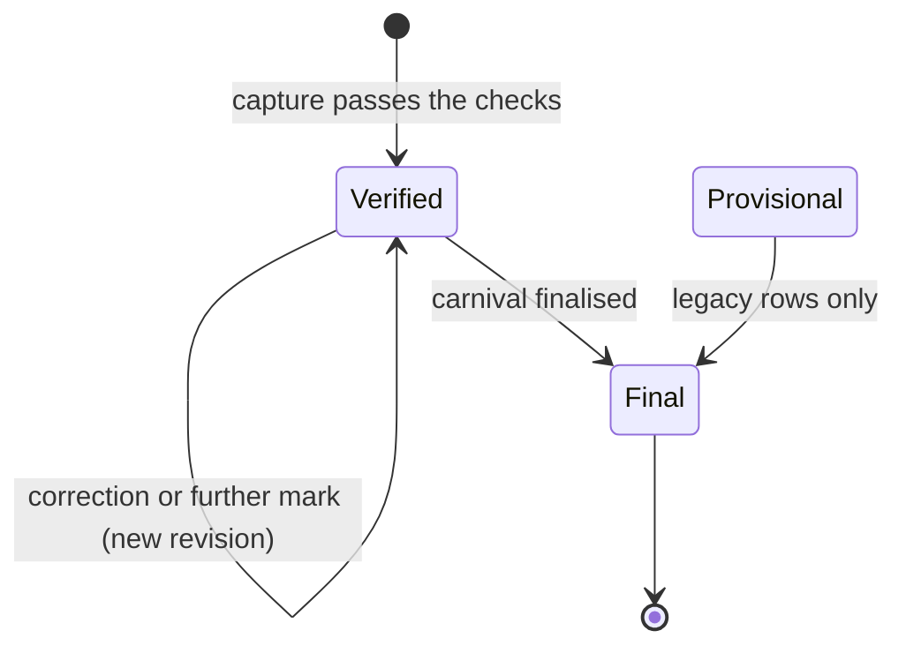
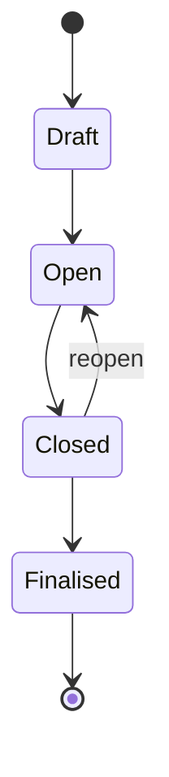

# Result lifecycle and corrections

A result is captured on a device, checked by the server, corrected with a reason when it is wrong, and made final when the carnival is finalised. There is no human verification step: a capture that passes the server's checks is verified ([ADR-0017](../adr/0017-automatic-result-validation.md)).

## States

### A result

| State | Used? | Meaning |
|---|---|---|
| `Draft` | No | Never written by the server. An unsynced capture lives in the device's outbox, which has its own states. Reads exclude `Draft` defensively. |
| `Provisional` | Legacy only | Rows captured before validation became automatic. Nothing writes it; finalisation still publishes such rows. |
| `Verified` | Yes | Every capture lands here. Counts in placings, standings and progress. |
| `Final` | Yes | Set on every result when the carnival is finalised. Cannot be corrected. |

"Provisional" on screen means something else: standings, progress and the results book are labelled provisional until the carnival is finalised.

### The carnival lifecycle

Only these transitions exist (`ILLEGAL_CARNIVAL_TRANSITION` otherwise), each audited (`carnival.status`) with an optional reason. Closed can reopen because capture needs Open and finalisation needs a result for every entry: without it, a missed DNS would be a dead end. Finalised is terminal.

### Division status

Each division (`CarnivalEvent`) has its own status, set by a carnival administrator: `Scheduled → Open ⇄ Closed`. "Open all scheduled" opens every scheduled division in one act. A legacy `Finalised` division can only move back to `Closed`; nothing enters `Finalised`. Division status changes are refused once the carnival is finalised.

### What each state allows

| Action | Carnival must be | Division must be |
|---|---|---|
| Create an entry or team, place it in a race | Draft or Open | Scheduled or Open |
| Capture a result, attempt or jump | Open | Open |
| Raise the bar, set attempts per height | Open | Scheduled or Open |
| Correct a result | any, while the result is not Final | any |
| Remove an entry (no result), change a category override | not Finalised | any |
| Edit a division's settings or status, races, the schedule, scoring settings, adjustments | not Finalised | |
| Edit carnival details, add, generate or remove divisions, apply a template | Draft or Open | |

State refusals on capture paths (`CARNIVAL_NOT_OPEN`, `EVENT_NOT_OPEN`) are retryable: the outbox keeps the item and sends it again once an administrator opens the carnival or division. Refusals on administration paths (`CARNIVAL_NOT_EDITABLE`) are final.

## Capturing a result

Three capture endpoints, all requiring the `results:submit` policy (Recorder, Carnival Administrator, System Administrator) and an `Idempotency-Key` that becomes the result's id:

| Endpoint | For |
|---|---|
| `POST …/entries/{entryId}/results` | A single typed measure, or a non-result status on any event |
| `PUT …/entries/{entryId}/attempts/{ordinal}` | One attempt of a field event with an attempt count |
| `PUT …/entries/{entryId}/jumps/{height}` | One mark at one bar height on a Height event |

Per-division official assignment is advisory; any recorder may capture for any division.

On success the server, in one transaction, writes the result as `Verified`, revision 1 (reason "Initial submission", or "Attempt 3", "Jump at 1.25 m"), an audit event (`result.submit`, `result.attempt`, `result.jump`) carrying the validation rule version, and the idempotency record. The attempt and jump endpoints create the result on the first mark and append to it after that, each mark adding a revision.

### Checks

Every rule runs on the server. A refusal is either incoherent (never valid, so the outbox parks it for a person) or state-dependent (not valid yet, so it retries).

- The entry exists in this division of this carnival.
- **Status and value agree**: `Ok` needs a value; `DNS`, `DNF`, `DQ` and `NM` carry none. A status must be spelled (`DQ`, not `3`).
- **`NM` is field-only**: refused on Time events (`NM_REQUIRES_FIELD_MEASURE`), where a runner who starts and does not finish is a DNF.
- **The value parses** for the measure (below).
- **The capture mode matches the event**: on an attempts event the best mark is derived, so a typed value or `NM` is refused (`ATTEMPTS_REQUIRED`); on a Height event the same applies to jumps (`LADDER_REQUIRED`). `DNS`, `DNF` and `DQ` can still be submitted directly on either.
- **One result per entry**: a second capture for the same entry is `RESULT_EXISTS`, parked for a person to resolve. Two officials disagreeing is the one case that needs a human.

Implausible values (a very fast time) are not refused. No plausibility bands exist.

### Statuses

| Status | Meaning | Ranks | Points |
|---|---|---|---|
| `Ok` | A measured value | yes | by placing |
| `DNS` | Did not start | no | `dnsPoints` (default 0) |
| `DNF` | Did not finish | no | `dnfPoints` (default 1) |
| `DQ` | Disqualified | no | `dqPoints` (default 0) |
| `NM` | No mark: attempted, nothing valid (field events) | no | as DNF |

Every status counts as a result for event completion and finalisation, with one exception: a Height result whose card has been corrected to empty counts as no result.

## Measures

| Measure | Typed as | Stored | Better |
|---|---|---|---|
| `Time` | `m:ss.ff` (`1:23.45`, up to three minute digits) or `ss.ff` (`34.56`, up to four digits); up to three fraction digits | seconds | lower |
| `Distance` | metres to the centimetre, up to three whole digits (`10.52`) | metres | higher |
| `Height` | not typed: jumps are recorded against ladder heights, whole centimetres from 0.01 to 5.00 m | metres | higher |
| `Count` | whole number, up to six digits | count | higher |

Every value must be greater than zero. Values are stored as `decimal(10,3)` and compared exactly, with no rounding. Formatting for display and exports goes through one server function, using the canonical unit (never the definition's free-text units). Once a definition has results, its measure type and units cannot change (`MEASURE_FROZEN`).

### Placings

Placings are computed on read, never stored, by one ranking implementation shared by the deck badge, the results book and scoring.

- Only `Ok` results with a value rank. Ties share a place and the next is skipped (1, 1, 3).
- Time events rank within each heat; a heatless entry is its own field. Field events rank across the whole division, whatever the heats.
- Only divisions scored by places get placings; a Social division scores a flat point per entry instead.

### Field attempts

A definition with an `AttemptCount` (1–6) is captured attempt by attempt. `AttemptsJson` holds the series: each ordinal is a mark, a foul, or not yet taken. Ordinals may arrive in any order from different devices.

- The best valid mark is `MeasuredValue`. If every taken attempt is a foul, the status is `NM`.
- An ordinal already recorded cannot be captured again (`ATTEMPT_ALREADY_RECORDED`); changing it is a correction.
- An entry recorded `DNS`, `DNF` or `DQ` takes no attempts until that result is corrected (`RESULT_STATUS_BLOCKS_ATTEMPTS`).
- **Countback**: tied athletes are compared on their valid marks sorted best first, so a tie on the best mark breaks on the second best, and so on.
- The attempt count is frozen once the definition has results.

### The high-jump heights ladder

A `Height` event is always contested on a bar ([ADR-0056](../adr/0056-high-jump-heights-ladder.md)).

- **The ladder** is per division (`HeightsJson`): ascending, whole centimetres from 0.01 to 5.00 m. A recorder raises the bar; it never comes down (`BAR_NEVER_LOWERED`). A raise that would overflow the stored ladder (2,000 characters of `HeightsJson`, far beyond a real competition) is refused as `400 VALIDATION_FAILED` before anything is saved. The definition's suggested start and rise only pre-fill the deck.
- **The card** is per athlete: for each height, a string of marks: `O` cleared, `X` failed, `-` passed. With three attempts per height the legal strings are `X`, `XX`, `XXX`, `O`, `XO`, `XXO`, `-`, `X-`, `XX-`.
- **A mark is refused** when the height is not on the ladder, when the athlete has already jumped higher, when the height is already cleared, passed or exhausted, or when the athlete is eliminated (`ATHLETE_ELIMINATED`).
- **Elimination**: at three attempts per height, three consecutive failures across the card (a pass does not break the run); at two, both attempts failed at one height.
- **Attempts per height** is 2 or 3, copied from the definition when the division is created, and fixed once a mark lands (`ATTEMPTS_PER_HEIGHT_FROZEN`).
- **Derived**: the best height cleared is `MeasuredValue`; until the first clearance the status is `NM`.
- **Countback**: best height, then fewest failures at that height, then fewest failures up to and including it.

## Corrections

`POST /results/{resultId}/correct`, under the `results:correct` policy: the same roles that capture. A correction carries:

- **`expectedRevision`**: the revision the corrector read. A mismatch is `CONCURRENCY_CONFLICT` with the current revision; two recorders who disagree are resolved by an administrator, not by last write wins.
- **`reason`**: required (`REASON_REQUIRED`), up to 1,000 characters.
- **The corrected value** in the event's own shape:
  - a single-measure event: a value, or a status;
  - an attempts event: the whole series, restated (`ATTEMPTS_SERIES_TRUNCATED` if it would drop a recorded ordinal), or `DNS`/`DNF`/`DQ` to clear it;
  - a Height event: the whole card, replayed mark by mark through the same rules as capture, so a correction cannot build a card capture would refuse; or `DNS`/`DNF`/`DQ`. An empty card leaves the result as `NM` with no card, which counts as no result.

A correction appends a `ResultRevision` with prior and new values, actor, role and reason, and an audit event (`result.correct`). Nothing is overwritten without history.

**Refused when:**

| Condition | Code |
|---|---|
| The result is `Final` (the carnival is finalised) | `RESULT_FINALISED` |
| `expectedRevision` is stale, or a concurrent change wins the save | `CONCURRENCY_CONFLICT` |
| No reason | `REASON_REQUIRED` |
| The new value fails the capture checks | as for capture |

A correction does not need the carnival or division to be open, so results can be fixed while the carnival is Closed for reconciliation.

## Event completion

A division is **complete** when it has at least one entry and every entry has a result, or, for a Social division, as soon as it has entries (Social divisions owe no results). An empty division is not complete, so "done" never hides a division nobody entered.

Completion is a derived readout on the division list and the dashboard (complete / in progress / not started). It is not a status and gates nothing: entries are created all day at the marshalling point, so a late entry simply makes the division incomplete again, and capture continues uninterrupted.

## Finalisation

`POST /carnivals/{id}/status` with `Finalised`, from `Closed`, by a carnival administrator. It is the one human act that turns the day's provisional results into the record. In one transaction:

1. **Gate**: every entry in every division not scored as Social must have a result (any status). A division with `ScoresPoints = false` still owes its results. Empty divisions do not block. If entries are owed, the response is `CARNIVAL_FINALISATION_BLOCKED` with the count and a sample of up to 20.
2. **Results become Final**: every non-draft result moves to `Final`, each with a revision (reason given, or "Carnival finalised") and an audit event (`result.finalise`).
3. **Records are minted**: each Competitive Boys or Girls division whose age and category the definition keeps records for is checked; a winning mark that strictly beats the current record (or sets the first) becomes a new `SchoolRecord`, and the old one is superseded. Audited as `school-record.mint`.
4. **The carnival becomes Finalised**, audited with the number of results finalised and records set.
5. **Re-check**: the gate runs again inside the transaction; an entry that appeared meanwhile aborts everything. The results are loaded with their revision tokens, so a correction landing mid-finalisation also aborts it (`CONCURRENCY_CONFLICT`). Nothing is partly finalised.

Finalisation does not wait for devices to drain: an offline device and a lost one look the same, and a drain gate would give a lost device a veto.

**After finalisation:**

- Results cannot be corrected or captured; entries, adjustments, scoring settings, division settings and races cannot change.
- **House points are frozen.** Standings are still computed on read, but every input is now fixed, and template reconciliation will not change the scoring weight of a definition a finalised carnival scores. Standings stop being labelled provisional.
- The carnival cannot be reopened.

## Related

- [Data model](data-model.md), [scoring](scoring.md), [records](records.md), [offline outbox](offline-outbox.md)

## In the code

- `api/src/CarnivalApp.Api/Carnivals/ResultEndpoints.cs`: capture, attempts, jumps, corrections, the finalisation transition
- `api/src/CarnivalApp.Api/Carnivals/CarnivalEndpoints.cs`: carnival transitions and finalisation
- `api/src/CarnivalApp.Api/Carnivals/CarnivalEventEndpoints.cs`: division status, raising the bar, attempts per height, completion
- `api/src/CarnivalApp.Api/Carnivals/CarnivalGuards.cs`: which state allows what
- `api/src/CarnivalApp.Api/Carnivals/ResultValueParser.cs`, `AttemptSeries.cs`, `JumpCard.cs`
- `api/src/CarnivalApp.Api/Scoring/Placement.cs`, `HeatPlacings.cs`, `ScoringService.cs`, `ProgressService.cs`
- `api/src/CarnivalApp.Api/Records/RecordDetection.cs`
- `api/tests/CarnivalApp.Api.Tests/ResultEndpointsTests.cs`, `JumpCardTests.cs`, `AttemptSeriesTests.cs`, `LifecycleConcurrencyTests.cs`, `ResultConcurrencyTests.cs`
