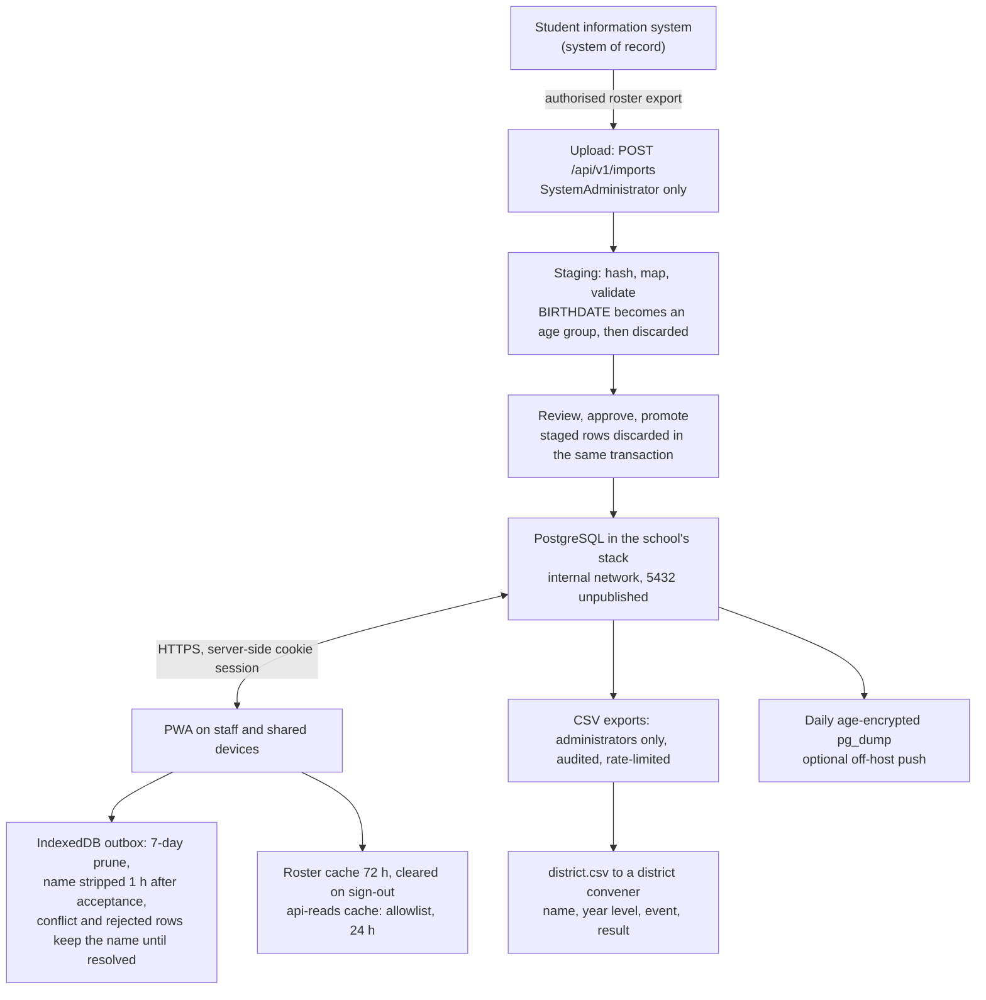

# Data inventory and Information Privacy Principle mapping

> **Template.** Sections 1–4 describe what Carnival App stores and where it flows, taken from the code; use them as input to your privacy impact assessment (PIA).
> Section 5 maps the software to the Victorian Information Privacy Principles; the gaps and open items are your school's to close. Anything in `[square brackets]` is yours to fill in.
> Check it against the version you deploy, and against your own import mapping if it differs from the example.

The school's student information system remains the system of record for identity and enrolment. Carnival App imports controlled snapshots of a minimal set of fields. Field-level detail is in the [data model](../architecture/data-model.md).

---

## 1. Personal data stored

Source column names are from `config/import-mapping.example.json`, written for a CASES21 `ST_*.csv` export (Victorian government schools). Fields with no source column are generated by the platform.

### 1.1 Identity: `Students`

| Field | Source | Purpose |
|---|---|---|
| `Id` (GUID) | generated | Internal identity |
| `ExternalStudentId` | `STKEY` | Stable link to the system of record; import matching |
| `Surname`, `FirstName` | `SURNAME`, `FIRST_NAME` | Identification on entry lists, results, ribbons |
| `PreferredName` | `PREF_NAME` (falls back to `FIRST_NAME`) | The name a student is called by on the deck |
| `IsActive` | derived from `STATUS` | Excludes departed students from new entries; the row is kept, not deleted |
| `CreatedAtUtc`, `UpdatedAtUtc` | generated | Audit context |

### 1.2 Eligibility context: `RosterSnapshots`

One snapshot per student per promoted import; snapshots are never rewritten.

| Field | Source | Purpose |
|---|---|---|
| `SchoolYear`, `EffectiveDate`, `IsCurrent` | generated | Which snapshot applies |
| `YearLevel` | `SCHOOL_YEAR` | Reporting, district selection |
| `HouseCode` | `HOUSE` | House scoring; validated against the configured houses |
| `HomeGroup` | `HOME_GROUP` | Operational grouping |
| `CompetitionAgeGroup` | **derived** from `BIRTHDATE` | Age eligibility. **The birth date itself is never stored** (§2) |
| `CompetitionCategory` (M/F/S) | **derived** from `GENDER` | Server-side eligibility only; never sent to a client (§2) |
| `ImportBatchId` | generated | Provenance |

### 1.3 Participation and results

| Entity | Personal fields | Purpose |
|---|---|---|
| `Entries` | `StudentId`, `SnapshotDisplayName`, `SnapshotYearLevel`, `SnapshotHouseCode`, `SnapshotAgeGroup`, `SnapshotCategory`, race, heat, lane, `CreatedBySubject` | Event-time context, so a historical result stays reproducible after later imports |
| `Entries` (override) | `CategoryOverride`, actor, time, reason | Audited per-entry category override, administrators only |
| `RelayLegs` | `StudentId`, per-leg snapshot (name, year level, house, age group, category) | Who swam which leg of a house relay |
| `Results` | `MeasuredValue`, `AttemptsJson`, `Status`, `LifecycleState`, `RecordedBySubject`, `RecordedAtUtc`, `DeviceId` | The result, who captured it, on which device. Places are computed on read, not stored |
| `ResultRevisions` | prior and new values, actor, role, reason | Immutable correction history |
| `SchoolRecords` | `HolderDisplayName`, `ApprovedBySubject`, `VoidedBySubject`, `VoidReason` | The record book |
| `HousePointsAdjustments` | `RecordedBySubject`, `RecordedByRole`, `Reason`, void fields | Novelty and bonus points; **references a house, never a student** |

### 1.4 Staff and operational data

| Entity | Fields | Purpose |
|---|---|---|
| `RoleAssignments` | `SubjectUpn`, `SubjectId` (bound at first sign-in), `SubjectDisplayName`, `Role`, `Reason`, `CreatedBySubject`, revocation actor, time and reason | In-app role grants (School → Roles). Rows are never deleted, so the table is its own history |
| `CarnivalEventOfficials` | `SubjectId`, `SubjectDisplayName`, `AssignedBySubject` | Advisory "who is expected at this event"; **not an access control** |
| `DeviceSyncStatuses` | `DeviceId`, `LastSubject`, `LastDisplayName`, `AppVersion`, queue counts and times | Organiser view of outstanding device queues. Counts only; no student data |
| `AuditEvents` | actor and roles, time, timezone, action, entity, prior and new values, reason, import batch, application and rule versions | The audit trail. Prior and new values can carry student values. Append-only, enforced in the database |
| `IdempotencyKeys` | key, payload hash, response status, **`ResponseBody`**, actor, device | Offline de-duplication. `ResponseBody` is the stored response replayed on a retry; for an entry or relay creation it includes **student display names**. Nothing prunes these rows |

### 1.5 Import staging: `ImportBatches`

| Field | Purpose | Kept |
|---|---|---|
| Source file name, SHA-256, mapping version | Intake control | yes |
| Importer, reviewer, review note, timestamps | Who staged and who approved | yes |
| Five reconciliation counts, status | Evidence of what the import did | yes |
| `StagedRowsJson` | Staged rows: STKEY, names, house, home group, year level, derived age group and category | **Set to null in the promotion transaction** ([ADR-0032](../adr/0032-staged-rosters-are-not-kept.md)). An unpromoted, rejected or abandoned batch keeps them |
| `ValidationResultsJson` | Per-row issues, each naming its STKEY | as above |

**The source export file is never stored**, neither in the database nor on disk. Only its name and SHA-256 survive.

### 1.6 School configuration: `SchoolConfigurations`

Identifier, name, IANA timezone, houses, branding and settings. No personal data.

---

## 2. Derived fields

**`CompetitionAgeGroup`** is derived at import from `BIRTHDATE` (age at the configured cut-off, 31 December by default, or a configured senior band). No full date of birth is persisted in any entity.

**`CompetitionCategory` (M / F / S)** is derived from the `GENDER` column: M→M, F→F, anything else→S. The derivation is total, so the column is effectively the source gender value recoded, and **`S` identifies a student outside M and F by construction**. The design limits exposure ([ADR-0026](../adr/0026-the-student-category-is-server-side-only.md)):

- An Open (`S`) division admits **every** student, so its entry list is not a roster of gender-diverse students.
- The category **never leaves the server**: it is not in the eligible-student or entry payloads, not rendered beside a name, and not cached on a device.
- The surface that would expose it in bulk, the import review, is `SystemAdministrator` only.

**Residual, for the PIA:** the value is still stored, still derived from a gender attribute, and still decides which divisions a student may enter. Whether it is sensitive information under IPP 10 is `[privacy officer]`'s call. If your school runs no Boys or Girls divisions, ask whether the column is needed at all.

---

## 3. Deliberately not collected

Absent from every entity, every migration and the example import mapping:

- Full date of birth (read at import, never stored)
- Addresses; parent, guardian or emergency-contact details; student phone numbers or email
- Health, medical, disability, dietary or allergy information
- Aboriginal and Torres Strait Islander status, language background, religion, visa status
- Photographs, video, biometric or timing-chip identifiers
- Attendance, behaviour, welfare or academic data
- The source export file itself (name and SHA-256 only)
- `SECOND_NAME` and `TITLE`: listed in the example mapping but never read

---

## 4. Data flow

1. **Export.** A `SystemAdministrator` produces a roster export from the student information system (for Victorian government schools, a CASES21 `ST_*.csv`).
2. **Upload and staging.** `POST /api/v1/imports`: `SystemAdministrator` only, `.csv` with a CSV or plain-text content type, size-capped, rate-limited (10 a minute per subject by default). The file is hashed, read through the deployment's import mapping, validated and staged. Only mapped columns are read; `BIRTHDATE` becomes an age group and is discarded.
3. **Review and promotion.** The administrator reads validation and reconciliation, approves, then promotes. Promotion writes `Students` and `RosterSnapshots` and, in the same transaction, discards the staged rows and row issues.
4. **Storage.** PostgreSQL 17 in the school's own Docker Compose stack, on an internal Docker network with port 5432 unpublished. Backups are encrypted; the live database volume is encrypted only if the host's disk is. **This deployment: hosted at `[location]`, disk encryption `[yes / no, how]`.**
5. **Devices (PWA).** Officials sign in through the school's identity provider; no token reaches JavaScript. A device holds:
   - the **outbox** (IndexedDB): captured results and entries, each with its capture-time official. `accepted` and `discarded` rows are pruned **7 days** after resolution, and an accepted row's student name is stripped **1 hour** after acceptance. `queued` and `syncing` rows are never pruned. **`conflict` and `rejected` rows keep the student name until a person resolves them**: a retention exception the PIA should name. The stored acknowledgement is narrowed and carries no names.
   - the **roster cache** (IndexedDB): eligible students for an event, pruned after **72 hours** and cleared on sign-out or handover.
   - the **service worker's `api-reads` cache**: an allowlist of carnival-day GET routes, at most 24 hours and 200 entries, cleared on sign-out. Imports, reports, eligible students, `/me` and `/version` are never cached.
   - **`localStorage`**: the session record (subject, display name, roles), the device id and a device-clear-pending flag. The session cookie lasts 12 hours, fixed; a 60-minute idle guard signs the device out, or covers the screen while the server is unreachable.
6. **Exports.** Three CSVs, `CarnivalAdministrator` and `SystemAdministrator` only, each audited (actor, format, row count) and rate-limited. Formula-leading characters are neutralised.
   - `standings.csv`: house totals; no student data.
   - `results.csv`: event, division, tier, heat, place, **name**, house, result, status and the high-jump series.
   - `district.csv`: event, division, selection, **name**, year level, result. The one file designed to leave the school; no house, date of birth, student ID or category, and only for a Finalised carnival.
7. **Backups.** The `backup` service writes a daily `age`-encrypted `pg_dump` (14-day retention by default), with an optional off-host push and a scripted restore drill; see `backup-and-recovery.md`.

**No student data leaves the school's stack by design.** The only external dependency in the request path is the identity provider. The PWA loads no CDN, analytics, third-party script or web font: the Inter font is bundled (`@fontsource-variable/inter`) and the proxy's CSP is `default-src 'self'`. **Identity-provider data residency (for Entra ID, the tenant's region): `[school ICT contact]`** (IPP 9).

---

## 5. The ten Information Privacy Principles

If your school is a Victorian government school, it is bound by the Privacy and Data Protection Act 2014 (Vic), Schedule 1 (the IPPs), not the Commonwealth Australian Privacy Principles. Other schools should map the same evidence to the principles that bind them.

| IPP | How the platform handles it | Evidence | Your school's gap |
|---|---|---|---|
| **1. Collection** | Only mapped columns are read; derived fields replace source attributes where possible (age group, category). Collection is a transfer from the school's own system, not from the student. | `config/import-mapping.example.json`; `Imports/ImportModels.cs` | **A collection notice** for students and families naming this platform: `[principal]` / `[privacy officer]` |
| **2. Use and disclosure** | Use is carnival operation, house scoring and the record book. The one designed external disclosure is `district.csv` to a district convener: Finalised carnivals only, audited, minimised to name, year level, event and result. | `Reporting/DistrictSelection.cs`; ADR-0032 | Whether district selection needs its own notice: `[privacy officer]` |
| **3. Data quality** | Import validation with per-row issues; reconciliation review before promotion; corrections need a reason and append an immutable revision; event-time snapshots are never rewritten. | `Imports/RosterImportService.cs`; `Data/Entities/ResultRevision.cs` | None identified |
| **4. Data security** | Server-side authorisation on every route with a fail-secure fallback; append-only audit enforced in the database; least-privilege database role; no raw SQL; CSV injection neutralised; security response headers; unprivileged containers; database on an internal network; encrypted backups; rate limits on bulk surfaces. | `Identity/IdentitySetup.cs`; `deploy/Caddyfile`; `docker-compose.yml`; `deploy/db/init-roles.sql` | Disk encryption, an off-host backup target and the TLS certificate are deployment choices: `[school ICT contact]`. The platform has **no server-side retention or destruction mechanism** (see `retention-and-disposal.md`) |
| **5. Openness** | This inventory, plus the school's privacy policy. | this file | The school policy should name the platform: `[principal]` |
| **6. Access and correction** | Result correction is an audited action; roster identity is corrected at source and re-imported. There is no self-service route for a student or parent; requests use the school's existing process. | `Carnivals/ResultEndpoints.cs` | Document the request route in the privacy notice: `[privacy officer]` |
| **7. Unique identifiers** | The platform mints its own internal GUID; it **adopts** the system-of-record key (`STKEY`) as `ExternalStudentId` for import matching. | `Data/Entities/Student.cs` | IPP 7 restricts adopting another organisation's identifier. State and endorse the necessity (repeatable re-import matching) in the PIA |
| **8. Anonymity** | Not available: a results platform attributes a performance to a named student. Aggregate surfaces (standings, `standings.csv`, progress) are house-level. | `Scoring/StandingsEndpoints.cs`; `Scoring/ProgressEndpoints.cs` | State the exception in the PIA |
| **9. Transborder data flows** | All storage is in the school's own stack. No CDN, analytics, offshore error reporting, third-party fonts or scripts. | `deploy/Caddyfile` CSP; `app/package.json` | **The identity provider**: if it is a cloud service such as Entra ID, record its data residency: `[school ICT contact]`. Record where your host and any off-host backup target are located |
| **10. Sensitive information** | No sensitive-information category is collected deliberately. The gender-derived M/F/S category is the contested field (§2). | ADR-0026; `Data/Entities/Enums.cs` | Classification and treatment: `[privacy officer]` |

---

## 6. Open items for your school

| Item | Owner |
|---|---|
| Collection notice for students and families | `[principal]` / `[privacy officer]` |
| PIA, endorsed (for Victorian government schools, Parts 1–3 with Privacy team review) | `[principal]` |
| Retention classes per entity (for Victorian government schools, PROV PROS 22/06) | `[records custodian]`; see `retention-and-disposal.md` |
| Whether M/F/S is sensitive information, and whether the column is needed | `[privacy officer]` |
| Identity-provider data residency statement | `[school ICT contact]` |
| Disk encryption and an off-host backup target | `[school ICT contact]` |

## In the code

- `api/src/CarnivalApp.Api/Data/Entities/`: every stored field
- `api/src/CarnivalApp.Api/Imports/`: mapping, derivation, staging and promotion
- `app/src/sync/retention.ts`, `app/src/db/roster.ts`, `app/vite.config.ts` (the `api-reads` allowlist): device-side retention
- `api/src/CarnivalApp.Api/Reporting/`: the CSV exports
