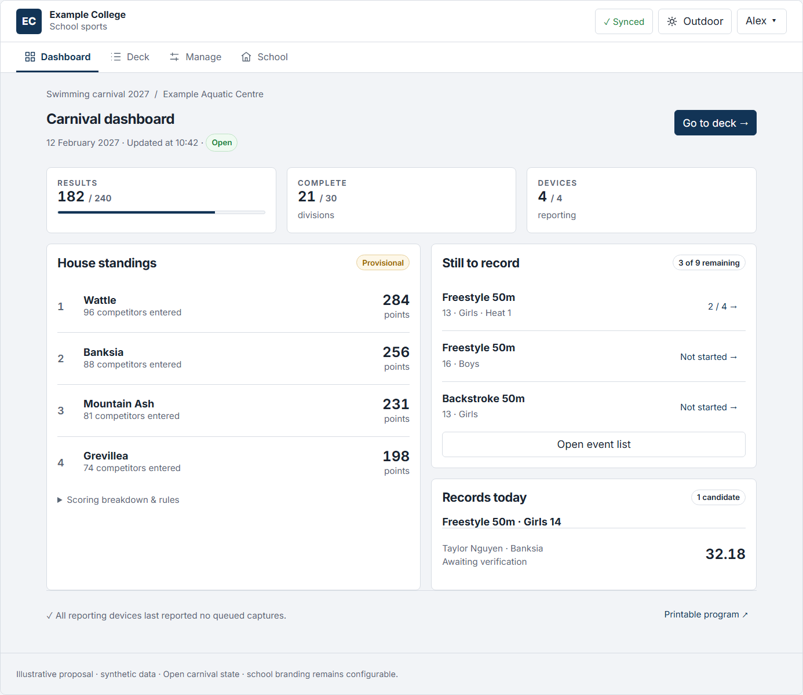
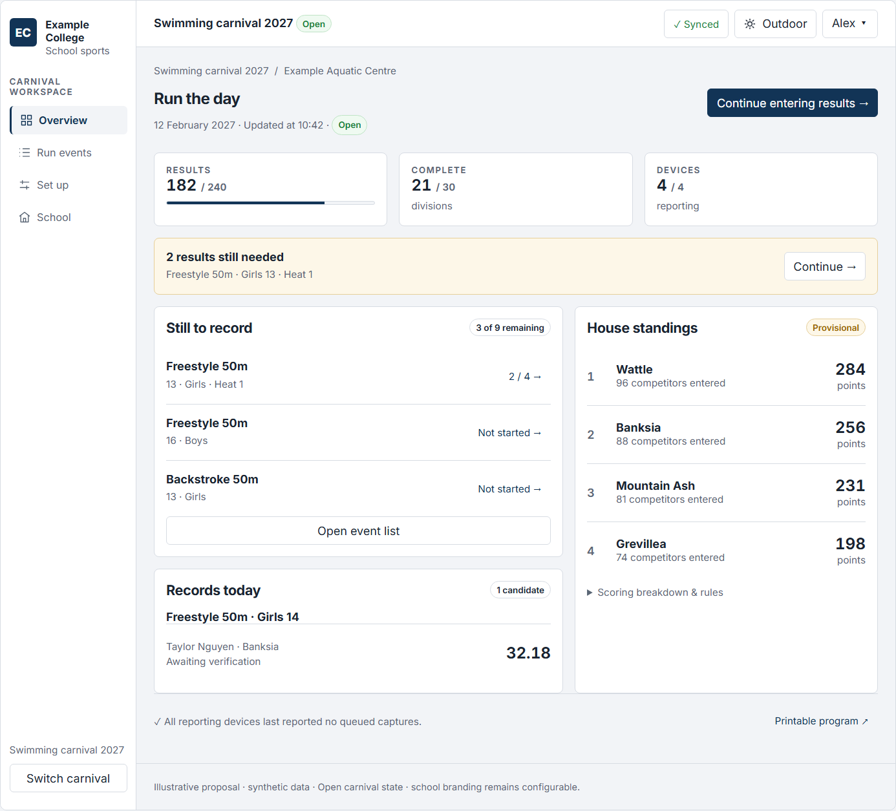

# Carnival App UI review and two proposals

14 September 2026 · proposals for discussion, not an approved implementation decision.

**Recommendation: Proposal 1, Focused refinement, for the swimming pilot.** The app already has the necessary visual foundations. The clearest improvement is to give the event, athlete and next action more prominence. Proposal 2 is a larger alternative for an organiser who spends much of the day switching between events and administration.

[Open the interactive comparison](2026-09-14-ui-proposals/index.html). Switch proposals, open Dashboard/Overview, Deck/Run events and Manage/Set up, then try the phone, offline and outdoor previews. The preview uses the repository's colour tokens and local Inter font. Open it in a browser from this checkout; no server is required.

## Review scope and evidence

Reviewed the source and synthetic screenshots from the screenshot pass. Screens inspected: dashboard, carnival event list, mobile result capture, settled/conflicted/rejected results, athletics attempts, carnival management, school hub and outbox recovery. Code inspection included the shell, dashboard, entry rows, styles and current design system. This is a visual and source review, not observed usability testing with officials.

**The existing-app observations use screenshots from a few days before the review, not a fresh runtime capture.** The proposal previews were independently rendered and exercised in Chromium.

An earlier UI study (not included in this repository) predates several improvements now present: design tokens, Inter, icons, configurable school branding, outdoor mode and the school hub. Those are existing strengths, not proposed new features. Its assertion that no Australian school competitor combines offline use and house scoring is not carried forward; current vendor pages are insufficient evidence for such a market-wide claim.

## What works, and what should improve

| Finding | Evidence | Proposed response |
|---|---|---|
| **High: persistent chrome competes with the task on phones.** | In the 390px division capture, header plus tabs occupy about 253px; long role identifiers wrap into multiple lines. The result list begins around 522px. | Put full account/role details in a labelled disclosure; keep device sync visible; show carnival context once. Preserve a quick carnival switch. |
| **High: result rows are unnecessarily tall.** | The same capture uses about 200px per athlete; the action menu occupies a separate line below the input. Source uses wrapping flex rows, full-width capture and reserved status height. | Put secondary actions beside athlete identity; keep a consistent two-line phone row and aligned columns on wider screens. Preserve stable geometry during Save → Undo → Edit. |
| **Medium: the dashboard distributes attention too evenly.** | Standings, scoring explanations, incomplete work and empty records panels have similar visual weight. The current dashboard already has useful information; explanation competes with it. | Promote progress totals; make unfinished events easy to open; move detailed scoring rules into a disclosure. Keep provisional and freshness labels visible. |
| **Medium: Manage mixes setup and day-of-operation tasks in one long page.** | The 820px Manage capture is 2,278px tall: checklist, template, reports, devices, bonus points, scoring, lanes and lifecycle. A new checklist already exists. | Give the checklist and selected next step a coherent top section; group routine administration below; preserve separation around finalisation. |
| **Medium: some copy exposes implementation language.** | Visible examples include `SystemAdministrator`, `CarnivalAdministrator`, “one division per event × age band × category” and an ADR reference in bonus-points help. | Use familiar role names and short explanations of outcomes. Keep technical detail in documentation or appropriate admin detail. |
| **Preserve: offline and recovery semantics are unusually explicit.** | Shell and outbox distinguish queued work, unavailable server, paused authentication and parked conflicts. Result rows distinguish accepted from rejected captures. | Simplify presentation without collapsing these states into a misleading green “Saved”. |
| **Preserve: school flexibility and field-event support.** | Branding and optional house colour are configuration; athletics has configurable attempt counts and distinct mark/status handling. | Keep neutral named houses by default. Apply the selected row hierarchy to field attempts; never impose lanes or heats on non-time events. |

Pixel observations above are approximate readings of the saved synthetic images; they are not timed task measurements. The prototype depicts a fuller carnival to assess hierarchy, so its dashboard is not a data-identical before/after comparison.

## Research and design implications

These are primary vendor documents and accessibility guidance accessed on 14 September 2026. Vendor capabilities are documented claims, not independently tested product evaluations.

| Source | Relevant evidence | Application to Carnival App |
|---|---|---|
| [SwimTopia: Meet Maestro time-entry interface](https://www.swimtopia.com/time-entry-interface/) | Event status provides navigation; heat/lane views support different capture tasks; time entry includes formatting and validation. | Keep event context close to capture. Proposal 2 offers a named event list beside the desktop deck. Retain Carnival App's existing input helpers instead of inventing another parser. |
| [SwimTopia: offline support and technical details](https://help.swimtopia.com/hc/en-us/articles/360008623811-Meet-Maestro-Technical-Details-System-Internet-Offline-Support-Meet-Access) | Describes locally pending updates and operational restrictions while offline. | Show device-held work explicitly; do not imply that local capture has reached standings or other devices. |
| [Athletic.net: entering results](https://support.athletic.net/article/6aoifppdcu-entering-results) | Supports a final mark or field series and distinguishes incomplete from completed result entry. | Keep attempts with the athlete, make units explicit, and preserve completion semantics. Athletics is a required extension of either proposal. |
| [Sports Tracker](https://sportstrackerapp.com/) | School-specific positioning includes mobile-friendly event result entry, house points and records. | School carnival operations are the relevant comparison; consumer fitness dashboards and decorative sports imagery add little to this task. |
| [W3C: Target Size (Enhanced)](https://www.w3.org/WAI/WCAG22/Understanding/target-size-enhanced.html) | SC 2.5.5 specifies 44×44 CSS pixels at AAA, with exceptions. | Keep the repository's 44px interaction standard; reclaim space from layout and metadata rather than reducing touch controls. The AA minimum is a different criterion. |
| [W3C: Status Messages](https://www.w3.org/WAI/WCAG22/Understanding/status-messages.html) | Status changes need to be programmatically available without moving focus. | Preserve live announcements for saves and recovery; do not replace the existing accessible feedback with visual badges alone. |

## Proposal 1 — Focused refinement

**A clearer version of the existing product.** Retain Dashboard, Deck, Manage and School; use a light header, a school-colour accent and consistent bordered surfaces. The design keeps the current 18px root, type scale, named houses, outdoor palette and restrained visual treatment.

On the dashboard, a concise totals row establishes progress, followed by standings beside unfinished events. Detailed scoring remains available on demand. On the deck, athlete identity and secondary actions share a line; capture and save state occupy a stable second line on phones and aligned columns on desktop. The existing add-entry search is disclosed after entries exist and stays expanded for an empty heat. Manage presents the existing setup checklist beside its selected task on a wide display, stacked on a phone.

**Scope:** primarily `AppShell`, `styles.css`, dashboard components, `EntryRow` and the Manage layout. Reuse existing endpoints, offline transport, validation, permissions and routing. Grouping, account disclosure and add-entry expansion behaviour still require a design decision before implementation.

**Tradeoff:** lower implementation and retraining risk; organisers still move between distinct tabs. Moving account details and the mobile outdoor control into a disclosure adds one tap to those secondary tasks. Device sync stays visible.

**Best fit:** a first swimming carnival, where capture speed and continuity matter most.

[View the phone result-entry mockup](2026-09-14-ui-proposals/proposal-a-deck-390.png).

## Proposal 2 — Carnival workspace

**An organiser's working area built around the day.** Use persistent desktop navigation for Overview, Run events, Set up and School. On phones, return to compact top tabs rather than retaining a sidebar. Keep the same school-configurable visual foundation as Proposal 1; the alternative changes information architecture, not just colour.

The overview leads with unfinished work and a direct continuation action, with standings alongside. A wide result-entry workspace has an event queue beside the active heat. On smaller screens, that queue yields to the existing event selection flow so result controls keep their space. Setup has explicit numbered steps and a corresponding working panel. School configuration retains its separate scope.

**Scope:** shared components from Proposal 1 plus responsive shell/navigation, active-section and deep-link treatment, the desktop event queue, and a clearer organiser landing priority. Existing “My events” assignments and completion reads are the intended inputs. A ranked cross-device exception inbox is not assumed; fleet reporting and local outbox items have different scopes.

**Tradeoff:** more substantial route/navigation testing and retraining. The sidebar consumes tablet width, and “Run events” / “Set up” need validation with officials. An attention-led landing should be organiser-specific; general readers should retain an appropriate standings view. Existing server permissions remain authoritative.

**Best fit:** frequent organisers coordinating several events, with broader rollout after the swimming pilot.

[View the phone result-entry mockup](2026-09-14-ui-proposals/proposal-b-deck-390.png).

## Decision and implementation boundary

| Consideration | 1 — Focused refinement | 2 — Carnival workspace |
|---|---|---|
| Visual character | Light, restrained, familiar tabs | Light, structured desktop workspace |
| Main improvement | Less chrome; denser, clearer capture | Faster orientation between operational tasks |
| Mobile | Compact header and existing navigation model | Same compact controls; task-oriented labels |
| Relative effort | Smaller; component and layout changes | Larger; shared refinements plus navigation and state coverage |
| Recommendation | **Start here for the pilot** | Choose if organiser navigation is the main pain point |

Neither proposal is ratified. No production UI, API, deployment, dependency or ADR was changed. The standalone HTML intentionally illustrates the layouts with synthetic data and limited interactions; it does not implement the app's result lifecycle. Its basic seconds input is a demonstration, not a proposed replacement for the production measure parser. Setup is a separate draft-carnival scenario; overview/deck show an open carnival. Preview controls that do not implement their full destination explicitly describe it.

Before shipping a selected design, record the design decision, bind all school identity and content to real configuration, use production Lucide icons and shared components, retain per-state sync/recovery behaviour and Undo timing, and extend the chosen capture layout to attempts. The prototype's layout-only widths and containers are exploratory values outside `app/src`; production changes must follow the existing token/ADR process. The font reference requires the existing app dependencies installed; system fonts are the fallback.

Acceptance should include 390px phone and 820px tablet layouts, long names, large text, landscape, keyboard/focus, screen-reader status announcements, outdoor contrast, empty/full heats, offline/paused/conflict/rejected states, and swimming plus configurable field attempts. Keep normal actionable controls at least 44×44px and avoid a page-level horizontal scrollbar. Observe an official finding an event, recording four results, correcting one, recovering a conflict and setting up a carnival. Any claimed speed improvement needs that user test.

Proposal verification: `node docs/research/2026-09-14-ui-proposals/review.mjs` renders both designs and all three screens at 390, 820 and 1440px, checks page/preview overflow and exercises the implemented controls. Generated checks are recorded in [validation.txt](2026-09-14-ui-proposals/validation.txt). These checks are preview smoke tests, not production regression or WCAG certification.
